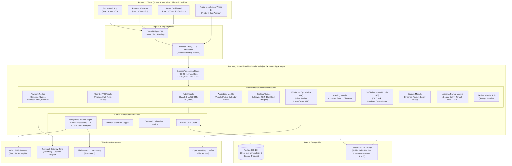
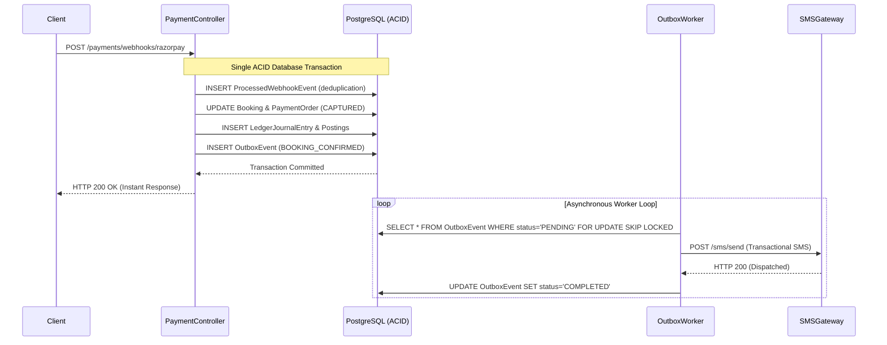

# Technical Architecture Document

# Discovery Uttarakhand (Stage 1 MVP — Vehicle Rentals)

| Document Control | Specification |
| :--- | :--- |
| **Product Name** | Discovery Uttarakhand |
| **Architecture Version** | 1.0.3 |
| **Associated PRD Version** | PRD v1.6.2 (Dispute Windows, Evidence Integrity & Architectural Taxonomy Refinement) |
| **Approved Launch Strategy** | **Option B: Vehicle Rentals First** (Nainital District, Uttarakhand) |
| **System Delivery Architecture**| **Modular Monolith** \| Phase A: Web-First Responsive Applications \| Phase B: Flutter Android App |
| **Core Technology Stack** | Node.js + Express.js + TypeScript \| PostgreSQL 15+ + Prisma ORM \| React + Vite + TypeScript |
| **Document Status** | Architectural Blueprint \| Launch Gates & Unresolved Legal/Tax Items Explicitly Flagged |

---

## Architecture Change Log

| Version | Date | Author / Context | Key Changes & Engineering Refinements |
| :--- | :--- | :--- | :--- |
| **1.0.0** | 2026-11-04 | Core Architectural Team | Initial comprehensive architecture document based on PRD v1.6.2. |
| **1.0.1** | 2026-11-04 | Systems Architecture Review | **Engineering Consistency & Concurrency Hardening:**<br>1. PostgreSQL Concurrency: Removed non-immutable `now()` from GiST partial index; added atomic expired-hold sweep in checkout transactions.<br>2. Lifecycle Enums: Reconciled `BookingStatus` (`REJECTED`, `EXPIRED_HOLD`) and lifecycle dimensions with PRD v1.6.2.<br>3. Ledger Integrity: Changed `LedgerPosting` to `onDelete: Restrict`; added append-only reversal rules and dual partial unique indexes for platform vs. provider accounts.<br>4. OTP Security: Replaced plaintext OTP fields with hashed fields and verification timestamps.<br>5. Sensitive Data Protection: Replaced ephemeral signed URLs in database with storage asset keys; masked/encrypted bank details in `PayoutItem` and `ProviderProfile`.<br>6. Multi-Role Authorization: Decoupled `User` identity from provider capabilities; formalized fine-grained ownership checks.<br>7. Pilot Payout Scope: Moved manual batch NEFT CSV export to Phase A (Release 3/4) as a commercial pilot requirement.<br>8. Technical Consistency: Applied `DateTime @db.Timestamptz` across Prisma models; clarified Haversine straight-line limitations on hill roads.<br>9. Legal & Compliance Wording: Standardized legal framing to "designed to support compliance subject to formal legal verification and audit". |
| **1.0.2** | 2026-11-04 | Systems Architecture Review | **Critical Concurrency, Ledger & Security Hardening:**<br>1. **Booking Hold Expiration:** Disambiguated unpaid checkout holds from paid bookings; expired-hold sweep strictly targets unpaid holds (`paymentStatus IN ('PENDING_CHECKOUT', 'PAYMENT_FAILED')`); payment capture sets `holdExpiresAt = NULL` and activates `slaExpiresAt`; defined late webhook handling (Case A: reinstate, Case B: overbooking prevented + 100% refund); aligned search query.<br>2. **Booking vs. Calendar Block Concurrency:** Implemented a unified `Vehicle FOR UPDATE` row-level mutex protocol across booking creation and calendar-block creation to prevent cross-table race conditions while preserving GiST exclusion constraints.<br>3. **Prisma Schema Validity & Enum Consistency:** Fixed invalid optional scalar list `returnPhotoStorageKeys String[]?` to `String[] @default([])`; added `NONE` to `OnSiteSettlementStatus`; decoupled `PaymentOrderStatus` from booking `PaymentStatus`; added `OutboxEvent` and `ProcessedWebhookEvent` models.<br>4. **Ledger Database Enforcement:** Implemented PostgreSQL triggers preventing `UPDATE` and `DELETE` on posted ledger records; provided complete `DEFERRABLE INITIALLY DEFERRED` constraint trigger verifying $\ge 2$ postings, strictly positive amounts, valid directions, and total debit-credit balance before commit.<br>5. **Keyed HMAC-SHA256 OTP Security:** Replaced unsalted SHA-256 with server-secret HMAC-SHA256 for auth and trip OTPs; defined 5-minute auth TTL, scheduled trip windows, 5-attempt lockout, single-use timestamps, and secret rotation.<br>6. **Durable Notifications & Webhook Idempotency:** Replaced pure in-memory `EventEmitter` with a Transactional Outbox pattern (`OutboxEvent` + background worker); added webhook deduplication via `ProcessedWebhookEvent` with raw-body signature verification.<br>7. **Sensitive Payout Data & Clearing Accounting:** Encrypted `bankIfscEncrypted` and masked `bankIfscMasked` in `PayoutItem`; restricted decryption to audit-logged export; added complete accounting flow for gateway clearing-to-bank settlement and gateway MDR expense.<br>8. **RESTful API Conventions:** Changed payout batch generation to `POST /api/v1/admin/ledger/payout-batches`; added export download endpoint; enforced persisted idempotency headers across state-changing endpoints. |
| **1.0.3** | 2026-11-04 | Systems Architecture Review | **Final Technical Verification & Defect Resolution:**<br>1. **Ledger Zero-Posting Journal Prevention:** Added complementary deferred constraint trigger `trg_verify_journal_entry_has_postings` on `LedgerJournalEntry` (`AFTER INSERT DEFERRABLE INITIALLY DEFERRED`); paired with existing `LedgerPosting` trigger to mathematically guarantee zero-posting journal entries cannot commit while allowing valid multi-posting transactions.<br>2. **OTP HMAC Security Clarification:** Corrected HMAC formulation to `HMAC-SHA256(key = OTP_SECRET_KEY, message = OTP || entityId || purpose)`; mandated `crypto.timingSafeEqual()` with mandatory buffer length verification before comparison; preserved key rotation, attempt counters, and single-use verification. |

---

## Strategic Architecture Alignment Register

This document strictly implements the functional, operational, and financial specifications established in **PRD v1.6.2**.

| Domain | Architectural Status | Implementation Specification |
| :--- | :---: | :--- |
| **Core Delivery Model** | **APPROVED** | **Modular Monolith.** A single backend service powering all frontend web clients and the future mobile application via unified RESTful APIs. Microservices are deliberately avoided to minimize operational complexity for early-stage engineering. |
| **Client Sequence** | **PROPOSED (Web-First)** | **Phase A (Web-First Public Pilot):** Tourist Responsive Web, Provider Responsive Web, and Admin Web Dashboard. **Phase B (Mobile Expansion):** Flutter Android application with offline caching and native camera optimization, deferred until web pilot stabilization. |
| **Release Branching** | **APPROVED** | **Independent Release 4 Branches:** Release 4A (With-Driver Operations) and Release 4B (Self-Drive Safety & Handover) operate as isolated software modules. A With-Driver public pilot can launch while Self-Drive code remains disabled in software. Release 5 (Reviews & Advanced Reporting) is strictly non-blocking for public pilots. |
| **Database Concurrency** | **APPROVED** | **Hybrid Concurrency Engine:** PostgreSQL `btree_gist` temporal exclusion constraints for intra-table overlaps combined with a unified `Vehicle FOR UPDATE` row-level mutex protocol for cross-table (Booking vs. CalendarBlock) conflict prevention. |
| **Ledger Architecture** | **APPROVED** | **Double-Entry Financial Ledger:** Append-only ledger journal entries with balanced debit and credit postings. Enforced at database level via immutability triggers and deferred balance constraint triggers. |
| **Payment Adapter** | **APPROVED** | **Modular `PaymentGatewayAdapter` Pattern:** Decoupled gateway interface allowing seamless switching between providers (Razorpay, Cashfree, Mock) without modifying core booking or ledger domain logic. |
| **Statutory Launch Gate** | **MANDATORY GATE** | Public commercial provider onboarding and public listing activation are strictly blocked by software permissions (AC-R1-00) until statutory legal checks L-01 through L-06 are completed by legal counsel with RTO Nainital / RTO Haldwani. |

---

## Table of Contents
1. [System Overview & Architecture Diagram](#1-system-overview--architecture-diagram)
2. [Frontend Applications & Responsibilities](#2-frontend-applications--responsibilities)
3. [Backend Modules & Responsibilities (Modular Monolith)](#3-backend-modules--responsibilities-modular-monolith)
4. [API Architecture & Endpoint Conventions](#4-api-architecture--endpoint-conventions)
5. [Database Architecture & Entity-Relationship Schema](#5-database-architecture--entity-relationship-schema)
6. [Authentication, Authorization & Role-Based Access Control (RBAC)](#6-authentication-authorization--role-based-access-control-rbac)
7. [Booking Lifecycle & Multi-Dimensional Status Architecture](#7-booking-lifecycle--multi-dimensional-status-architecture)
8. [Inventory Availability & Concurrency Protection](#8-inventory-availability--concurrency-protection)
9. [Payment Adapter, Internal Double-Entry Ledger & Payout Architecture](#9-payment-adapter-internal-double-entry-ledger--payout-architecture)
10. [File Uploads, Asset Privacy & Evidence Preservation](#10-file-uploads-asset-privacy--evidence-preservation)
11. [Notification Architecture, Transactional Outbox & Webhook Idempotency](#11-notification-architecture-transactional-outbox--webhook-idempotency)
12. [Maps, Geography & Location Services](#12-maps-geography--location-services)
13. [Hosting, Deployment & Infrastructure Configuration](#13-hosting-deployment--infrastructure-configuration)
14. [Logging, Monitoring, Backups & Security Safeguards](#14-logging-monitoring-backups--security-safeguards)
15. [Development Phases & Implementation Sequence](#15-development-phases--implementation-sequence)
16. [Unresolved Decisions & Legal/Compliance Launch Gates](#16-unresolved-decisions--legalcompliance-launch-gates)

---

## 1. System Overview & Architecture Diagram

Discovery Uttarakhand is architected as a **Modular Monolith** backend written in TypeScript running on Node.js/Express, communicating with a managed PostgreSQL database through Prisma ORM, and serving lightweight client applications via versioned JSON REST APIs (`/api/v1`).

### 1.1 High-Level Component Architecture



---

## 2. Frontend Applications & Responsibilities

The frontend architecture prioritizes a **responsive web-first delivery strategy (Phase A)** built using React 18, Vite, TypeScript, and Tailwind CSS. The desktop Admin Dashboard and mobile-responsive tourist/provider portals consume the identical backend REST API.

```
+----------------------------------------------------------------------------------------------------+
|                                FRONTEND APPLICATION MATRIX (PHASE A & B)                           |
+----------------------------------------------------------------------------------------------------+
  [TOURIST RESPONSIVE WEB]          [PROVIDER RESPONSIVE WEB]         [ADMIN WEB DASHBOARD]
  - Mobile & desktop browsers       - Mobile-first responsive         - Desktop-optimized interface
  - Public search & bookings        - Fleet & calendar management     - KYC queue & legal gate toggle
  - In-browser camera capture       - Handover & return checklists    - Dispute investigation console
  - OTP display & acknowledgments   - Balance recording at arrival    - Pilot payout batch generation & CSV
  
  [TOURIST FLUTTER APP (PHASE B)]
  - Android application (Flutter + Dart)
  - Native camera & local SQLite caching for high-altitude offline passes
  - Push notifications via Firebase Cloud Messaging (FCM)
```

### 2.1 Tourist Responsive Web Application
- **Stack:** React 18 + Vite + TypeScript + Tailwind CSS + Lucide Icons + Leaflet.js.
- **Responsibilities:**
  - Public vehicle catalog browsing, location filtering across Nainital District clusters, and date/time selection.
  - Indian mobile number authentication via 6-digit SMS OTP.
  - Checkout workflow: 15-minute temporary inventory hold timer display, driving licence upload (Stage 1), and online advance payment initiation via payment gateway checkout modal.
  - Active booking dashboard: live booking status, provider response countdown timer, mutual contact details upon confirmation.
  - Trip execution: display of 4-digit Pickup OTP (With-Driver) and Handover OTP (Self-Drive).
  - Trip completion: display of 4-digit Drop OTP (With-Driver) and Return OTP (Self-Drive); prompt for on-site balance acknowledgment.
  - Dispute initiation interface for fare overcharges, deposit disputes, or service failures.
  - Post-trip review and rating submission (Release 5).

### 2.2 Provider Responsive Web Interface
- **Stack:** React 18 + Vite + TypeScript + Tailwind CSS + Leaflet.js.
- **Responsibilities:**
  - Provider onboarding: profile setup, business details, vehicle compliance document upload (RC, Insurance, Fitness, PUC).
  - Bank payout setup (Stage 3 progressive onboarding): Account name, number, IFSC (mandatory prior to first payout).
  - Vehicle listing creator: vehicle specifications, photos, pricing rules, deposit amounts, and delivery options.
  - Calendar availability management: interactive date blocking for maintenance or personal use.
  - Request management: real-time incoming booking requests with business-hours SLA countdown timer; Accept and Reject actions.
  - With-Driver operations (4A): driver credential assignment (Name, Phone, Commercial DL), Pickup OTP entry, destination arrival on-site balance recording, and Drop OTP verification.
  - Self-Drive safety operations (4B): digital Handover Checklist (odometer, fuel level fraction, 4 photos, mandatory physical DL inspection confirmation checkbox), on-site balance and deposit collection recording, Handover OTP entry; digital Return Checklist (odometer, fuel, condition photos, deposit settlement), and Return OTP entry.
  - Earnings ledger: statement of completed trips, advance credits ($P_{advance}$), and payout clearance status.

### 2.3 Admin Web Dashboard
- **Stack:** React 18 + Vite + TypeScript + Tailwind CSS + TanStack Table.
- **Responsibilities:**
  - KYC verification queue: side-by-side inspection of provider-entered data against high-resolution uploaded compliance documents (RC, Insurance, Fitness, ID proofs) with approve/reject actions and feedback notes.
  - Statutory Legal Activation Gate Console (AC-R1-00): central administrative switchboard holding commercial listings in `APPROVED_PENDING_LEGAL_GATE` until statutory legal checks (L-01 to L-06) are formally signed off.
  - Live booking supervisor: global monitoring of active bookings, approaching SLA deadlines, and auto-expiries.
  - Minimum pilot dispute operations console (AC-R1-05): dispute ticket management, statement review, photo inspector, manual full/partial advance refund execution, and provider penalty strikes.
  - Vehicle Safety & Maintenance Hold Console (AC-R4B-04): management of vehicles placed in `UNDER_MAINTENANCE_HOLD` following damage or breakdown; authorization of return to `ACTIVE_PUBLISHED`.
  - Financial ledger and payout export (AC-R3-04 / AC-R4-04): trigger batch creation (`POST /api/v1/admin/ledger/payout-batches`), view batch listings, and download decrypted bank transfer CSVs for commercial batch NEFT processing during pilot operations.

### 2.4 Phase B: Tourist Mobile Application (Flutter + Dart)
- **Status:** Architectural roadmap for Phase B (deferred until web pilot stabilizes).
- **Responsibilities:** Native Android application offering complete functional parity with the Tourist Web App, supplemented by native camera capture for high-resolution driving licence photos, push notifications via FCM, and local SQLite offline caching for displaying booking vouchers and OTPs when traveling through connectivity dead zones in Kumaon mountain passes.

---

## 3. Backend Modules & Responsibilities (Modular Monolith)

The backend is structured as a **Modular Monolith** in `src/modules/`. Each module is encapsulated with its own controllers, services, repositories, and validation schemas, communicating via clean internal interfaces or the transactional outbox engine.

```
src/
├── app.ts                        # Express application configuration & middleware
├── server.ts                     # HTTP server startup & graceful shutdown
├── config/                       # Environment configuration & validation
├── shared/                       # Shared infrastructure & utilities
│   ├── database/                 # Prisma client instance & extensions
│   ├── errors/                   # Custom application error classes
│   ├── middleware/               # Auth, RBAC, error handling, rate limiting
│   ├── adapters/                 # Payment gateway, SMS, Cloudinary adapters
│   ├── outbox/                   # Transactional outbox writer & worker dispatcher
│   └── utils/                    # Crypto (HMAC-SHA256), date math, SLA algorithms
└── modules/
    ├── auth/                     # SMS OTP generation, JWT issuance & RTR
    ├── user/                     # User profiles, multi-role handling, privacy vault
    ├── provider/                 # Provider onboarding, compliance KYC, bank setup
    ├── catalog/                  # Vehicle listings, public search, location filters
    ├── availability/             # Calendar blocks, 15-min holds, GiST exclusion, row mutex
    ├── booking/                  # Booking creation, lifecycle state transitions
    ├── payment/                  # Gateway orders, webhook inbox deduplication, refunds
    ├── trip-with-driver/         # Release 4A: Driver assignment, Pickup/Drop OTP
    ├── trip-self-drive/          # Release 4B: DL check, Handover/Return checklists
    ├── dispute/                  # Dispute filing, evidence review, safety holds
    ├── ledger/                   # Double-entry ledger, clearance timers, batch NEFT CSV
    ├── review/                   # Release 5: Post-trip ratings, provider replies
    └── notification/             # Outbox worker consumers (SMS dispatch, FCM push)
```

---

## 4. API Architecture & Endpoint Conventions

The backend exposes a **RESTful JSON API** under the global version prefix `/api/v1`.

### 4.1 Global Conventions & Headers
- **Content Negotiation:** All requests with payloads must include `Content-Type: application/json`. All responses return `application/json`.
- **Authentication Header:** Standard bearer token format for JWT access: `Authorization: Bearer <access_token>`.
- **Refresh Token Transmission:** Transmitted exclusively via secure HTTP cookies: `Set-Cookie: refreshToken=<token>; HttpOnly; Secure; SameSite=Strict; Path=/api/v1/auth`.
- **Persisted Idempotency Header:** All state-changing payment, booking, cancellation, and payout endpoints mandate a client-generated UUIDv4 header: `Idempotency-Key: <uuid>`. The backend validates and persists this key to prevent duplicate mutations.
- **Standardized Timestamp Format:** All timestamps input and output in ISO 8601 UTC format with explicit timezone indicators (e.g., `2026-11-04T10:00:00.000Z`).

### 4.2 Standard API Response Envelope

#### Success Response
```json
{
  "success": true,
  "data": { ... },
  "meta": {
    "timestamp": "2026-11-04T10:00:00.000Z",
    "requestId": "req_du_89412a"
  }
}
```

#### Error Response
```json
{
  "success": false,
  "error": {
    "code": "INVENTORY_HOLD_CONFLICT",
    "message": "Vehicle is currently held or booked for the selected dates.",
    "details": [
      {
        "field": "rentalInterval",
        "issue": "Requested interval overlaps with an existing reservation"
      }
    ]
  },
  "meta": {
    "timestamp": "2026-11-04T10:00:00.000Z",
    "requestId": "req_du_89412b"
  }
}
```

### 4.3 Core API Route Catalog

| HTTP Method | Route Endpoint | Module | Access Control | Description |
| :--- | :--- | :---: | :---: | :--- |
| `POST` | `/api/v1/auth/otp/request` | Auth | Public | Request 6-digit SMS OTP for Indian mobile (+91) |
| `POST` | `/api/v1/auth/otp/verify` | Auth | Public | Verify OTP and receive JWT access token + refresh cookie |
| `POST` | `/api/v1/auth/token/refresh` | Auth | Public (Cookie) | Rotate refresh token and issue new access token |
| `POST` | `/api/v1/auth/logout` | Auth | Authenticated | Revoke refresh token and clear cookie |
| `GET` | `/api/v1/catalog/vehicles` | Catalog | Public | Search vehicles filtered by Nainital District cluster & dates |
| `GET` | `/api/v1/catalog/vehicles/:id` | Catalog | Public | Get listing detail, pricing breakdown & rental terms |
| `POST` | `/api/v1/provider/onboard/profile` | Provider | Authenticated | Submit provider business profile |
| `POST` | `/api/v1/provider/onboard/documents` | Provider | Provider | Upload vehicle compliance documents (RC, Insurance, Fitness) |
| `POST` | `/api/v1/provider/payout-account` | Provider | Provider Verified | Stage bank account details (Account No, IFSC, Name) |
| `POST` | `/api/v1/provider/vehicles` | Catalog | Provider Verified | Create vehicle listing with specs, pricing & photos |
| `PATCH` | `/api/v1/provider/vehicles/:id/calendar`| Availability | Provider Verified | Block/unblock specific dates on availability calendar |
| `POST` | `/api/v1/bookings/checkout/hold` | Booking | Tourist | Initiate 15-minute checkout inventory hold (Idempotent) |
| `POST` | `/api/v1/bookings/checkout/pay-advance`| Payment | Tourist | Generate gateway order for online advance payment (Idempotent) |
| `POST` | `/api/v1/payments/webhooks/:gateway` | Payment | Public (HMAC) | Receive, verify signature & deduplicate gateway webhooks |
| `GET` | `/api/v1/bookings/:id` | Booking | Tourist / Prov / Admin | Get booking status across all 6 lifecycle dimensions |
| `POST` | `/api/v1/bookings/:id/respond` | Booking | Provider (Own) | Accept or Reject incoming booking within SLA (Idempotent) |
| `POST` | `/api/v1/bookings/:id/cancel` | Booking | Tourist / Prov / Admin | Cancel booking and trigger tiered refund calculation (Idempotent) |
| `POST` | `/api/v1/bookings/:id/no-show` | Booking | Provider (Own) | Submit Tourist No-Show claim after 90-min wait & 2 calls (Idempotent) |
| `POST` | `/api/v1/trips/with-driver/:id/assign` | Trip 4A | Provider (Own) | Assign driver credentials (Name, Phone, Commercial DL) |
| `POST` | `/api/v1/trips/with-driver/:id/verify-pickup` | Trip 4A | Provider (Own) | Enter tourist's 4-digit Pickup OTP to start trip |
| `POST` | `/api/v1/trips/with-driver/:id/verify-drop` | Trip 4A | Provider (Own) | Enter tourist's 4-digit Drop OTP to complete trip |
| `POST` | `/api/v1/trips/with-driver/:id/record-balance` | Trip 4A | Provider (Own) | Driver logs on-site balance collection at destination |
| `POST` | `/api/v1/trips/self-drive/:id/handover` | Trip 4B | Provider (Own) | Submit pre-ride checklist, DL check & Handover OTP |
| `POST` | `/api/v1/trips/self-drive/:id/return` | Trip 4B | Provider (Own) | Submit return checklist & verify Return OTP |
| `POST` | `/api/v1/trips/self-drive/:id/settle-deposit` | Trip 4B | Provider (Own) | Record deposit settlement and net returned amount |
| `POST` | `/api/v1/trips/:id/acknowledge-balance` | Booking | Tourist (Own) | Tourist confirms or disputes recorded on-site balance |
| `POST` | `/api/v1/disputes` | Dispute | Tourist / Prov | Raise booking dispute (fare, damage, deposit, service) |
| `GET` | `/api/v1/admin/kyc/queue` | Admin | Admin | List pending provider and vehicle compliance packages |
| `PATCH` | `/api/v1/admin/kyc/:id/verify` | Admin | Admin | Approve or reject provider documents with audit comments |
| `PATCH` | `/api/v1/admin/legal-gate/:listingId` | Admin | Admin | Unlock statutory legal activation gate for a listing |
| `PATCH` | `/api/v1/admin/vehicles/:id/safety-hold`| Admin | Admin | Place or release vehicle `UNDER_MAINTENANCE_HOLD` |
| `GET` | `/api/v1/admin/disputes` | Admin | Admin | List and review active dispute cases and media logs |
| `POST` | `/api/v1/admin/disputes/:id/resolve` | Admin | Admin | Resolve dispute, issue manual refund or offset ledger (Idempotent) |
| `POST` | `/api/v1/admin/ledger/payout-batches` | Ledger | Admin | Generate cleared provider payout batch (Idempotent) |
| `GET` | `/api/v1/admin/ledger/payout-batches` | Ledger | Admin | List generated provider payout batches |
| `GET` | `/api/v1/admin/ledger/payout-batches/:id` | Ledger | Admin | Get details of a specific payout batch (masked accounts) |
| `GET` | `/api/v1/admin/ledger/payout-batches/:id/export` | Ledger | Admin | Download decrypted bank NEFT batch CSV (Audit-Logged) |
| `POST` | `/api/v1/reviews` | Review | Tourist (Own) | Post-trip 1-to-5 star rating and review (Release 5) |
| `POST` | `/api/v1/reviews/:id/reply` | Review | Provider (Own) | Provider single public reply to customer review (Release 5) |

---

## 5. Database Architecture & Entity-Relationship Schema

The database is built on **PostgreSQL 15+** managed via **Prisma ORM**. It requires the PostgreSQL extension `btree_gist` to enable GiST temporal range exclusion constraints alongside standard equality operators.

All timestamp columns are defined with `@db.Timestamptz` (`TIMESTAMP WITH TIME ZONE`) to ensure unambiguous UTC timestamp handling and compatibility with PostgreSQL temporal range functions (`tstzrange`).

### 5.1 Required PostgreSQL Extensions & Types
```sql
-- Required extensions for temporal interval exclusion constraints and UUID generation
CREATE EXTENSION IF NOT EXISTS btree_gist;
CREATE EXTENSION IF NOT EXISTS "uuid-ossp";
```

### 5.2 Core Prisma Schema Definition

```prisma
datasource db {
  provider   = "postgresql"
  url        = env("DATABASE_URL")
  extensions = [btree_gist, uuid_ossp(map: "uuid-ossp")]
}

generator client {
  provider        = "prisma-client-js"
  previewFeatures = ["postgresqlExtensions"]
}

enum UserRole {
  USER     // Standard platform user (can act as tourist)
  ADMIN    // Administrative operator
}

enum ProviderKycStatus {
  KYC_PENDING
  KYC_SUBMITTED
  KYC_APPROVED
  KYC_REJECTED
}

enum LegalEligibilityStatus {
  LEGAL_GATE_PENDING
  LEGAL_GATE_APPROVED
}

enum VehicleListingStatus {
  DRAFT
  UNDER_REVIEW
  APPROVED_PENDING_LEGAL_GATE
  ACTIVE_PUBLISHED
  UNDER_MAINTENANCE_HOLD
  SUSPENDED
  INACTIVE
}

enum RentalMode {
  SELF_DRIVE
  WITH_DRIVER
}

enum VehicleCategory {
  SCOOTER
  MOTORCYCLE
  HATCHBACK
  SEDAN
  SUV
}

enum BookingStatus {
  DRAFT
  PENDING_CONFIRMATION
  CONFIRMED
  REJECTED
  CANCELLED_BY_TOURIST
  CANCELLED_BY_PROVIDER
  CANCELLED_NO_SHOW
  EXPIRED_SLA
  EXPIRED_HOLD
  OVERBOOKING_PREVENTED
  CLOSED
}

enum PaymentStatus {
  PENDING_CHECKOUT
  PAYMENT_FAILED
  CAPTURED
  REFUND_PENDING
  REFUNDED
  FORFEITED
}

enum PaymentOrderStatus {
  PENDING
  CAPTURED
  FAILED
}

enum TripStatus {
  NOT_STARTED
  IN_PROGRESS
  TRIP_COMPLETED
}

enum OnSiteSettlementStatus {
  NONE
  PENDING_COLLECTION
  COLLECTION_LOGGED
  SETTLED
  DISPUTED
}

enum RefundStatus {
  NONE
  REFUND_INITIATED
  REFUND_PENDING_GATEWAY
  REFUNDED
  REFUND_FAILED
  MANUAL_ESCALATION
}

enum DisputeStatus {
  NONE
  OPEN_INVESTIGATION
  RESOLVED_SETTLED
  RESOLVED_REFUNDED
  RESOLVED_DISMISSED
}

enum LedgerAccountType {
  ASSET_GATEWAY_CLEARING
  ASSET_PLATFORM_BANK
  LIABILITY_PROVIDER_PAYABLE_PENDING
  LIABILITY_PROVIDER_PAYABLE_CLEARED
  LIABILITY_CUSTOMER_REFUND_PAYABLE
  REVENUE_PLATFORM_COMMISSION
  REVENUE_PLATFORM_CANCELLATION_FEE
  EXPENSE_GATEWAY_MDR
}

enum OutboxEventStatus {
  PENDING
  PROCESSING
  COMPLETED
  FAILED
}

model User {
  id              String         @id @default(uuid())
  phoneNumber     String         @unique // +91XXXXXXXXXX
  fullName        String?
  email           String?        @unique
  role            UserRole       @default(USER)
  createdAt       DateTime       @default(now()) @db.Timestamptz
  updatedAt       DateTime       @updatedAt @db.Timestamptz

  providerProfile ProviderProfile?
  touristBookings Booking[]      @relation("TouristBookings")
  disputesFiled   Dispute[]      @relation("DisputesFiled")
  reviews         Review[]
  refreshTokens   RefreshToken[]
  auditLogs       AuditLog[]
}

model RefreshToken {
  id          String   @id @default(uuid())
  tokenHash   String   @unique
  familyId    String   // Used for Refresh Token Rotation & family revocation
  userId      String
  user        User     @relation(fields: [userId], references: [id], onDelete: Cascade)
  isRevoked   Boolean  @default(false)
  expiresAt   DateTime @db.Timestamptz
  createdAt   DateTime @default(now()) @db.Timestamptz

  @@index([userId])
  @@index([familyId])
}

model ProviderProfile {
  id                     String                 @id @default(uuid())
  userId                 String                 @unique
  user                   User                   @relation(fields: [userId], references: [id])
  businessName           String
  operatorType           String                 // FLEET_OPERATOR or INDIVIDUAL_OWNER
  kycStatus              ProviderKycStatus      @default(KYC_PENDING)
  legalStatus            LegalEligibilityStatus @default(LEGAL_GATE_PENDING)
  rejectionReason        String?
  
  // Bank details staged progressively (encrypted at rest via AES-256-GCM)
  bankAccountEncrypted   String?
  bankAccountLast4       String?                // Masked for UI display: e.g. "4921"
  bankIfscEncrypted      String?
  bankIfscMasked         String?                // Masked for UI display: e.g. "SBIN000••••"
  bankAccountHolderName  String?
  bankVerificationStatus String                 @default("UNVERIFIED") // UNVERIFIED, PENNY_DROP_VERIFIED

  vehicles               Vehicle[]
  drivers                Driver[]
  ledgerAccounts         LedgerAccount[]
  payoutItems            PayoutItem[]
  createdAt              DateTime               @default(now()) @db.Timestamptz
  updatedAt              DateTime               @updatedAt @db.Timestamptz
}

model Driver {
  id                      String          @id @default(uuid())
  providerId              String
  provider                ProviderProfile @relation(fields: [providerId], references: [id])
  fullName                String
  phoneNumber             String
  commercialLicenceNo     String          // Encrypted at rest
  licenceExpiryDate       DateTime        @db.Timestamptz
  hillEndorsementVerified Boolean         @default(false)
  isActive                Boolean         @default(true)
  bookings                Booking[]
  createdAt               DateTime        @default(now()) @db.Timestamptz
  updatedAt               DateTime        @updatedAt @db.Timestamptz
}

model Vehicle {
  id                     String               @id @default(uuid())
  providerId             String
  provider               ProviderProfile      @relation(fields: [providerId], references: [id])
  modelName              String
  brand                  String
  yearOfManufacture      Int
  category               VehicleCategory
  rentalMode             RentalMode
  transmission           String               // MANUAL or AUTOMATIC
  fuelType               String               // PETROL, DIESEL, EV
  seatingCapacity        Int
  registrationNumber     String               @unique // Kept secure, masked publicly
  status                 VehicleListingStatus @default(DRAFT)
  
  // Pricing configuration (Proposed parameters)
  dailyBasePrice         Decimal              @db.Decimal(10, 2)
  securityDeposit        Decimal              @default(0.00) @db.Decimal(10, 2)
  kmAllowancePerDay      Int                  @default(150) // 0 = unlimited
  extraKmRate            Decimal              @default(0.00) @db.Decimal(10, 2)
  locationCluster        String               // NAINITAL, KATHGODAM, BHIMTAL, etc.
  pickupAddress          String

  complianceDocuments    ComplianceDocument[]
  marketingPhotos        VehiclePhoto[]
  calendarBlocks         CalendarBlock[]
  reservations           Booking[]
  createdAt              DateTime             @default(now()) @db.Timestamptz
  updatedAt              DateTime             @updatedAt @db.Timestamptz

  @@index([locationCluster, category, status])
}

model VehiclePhoto {
  id              String   @id @default(uuid())
  vehicleId       String
  vehicle         Vehicle  @relation(fields: [vehicleId], references: [id], onDelete: Cascade)
  storageKey      String   // Cloudinary public_id or S3 asset key
  storageProvider String   @default("CLOUDINARY")
  publicUrl       String   // Public CDN URL (EXIF stripped)
  mimeType        String
  fileSize        Int
  isCover         Boolean  @default(false)
  orderIndex      Int      @default(0)
  createdAt       DateTime @default(now()) @db.Timestamptz
}

model ComplianceDocument {
  id              String    @id @default(uuid())
  vehicleId       String
  vehicle         Vehicle   @relation(fields: [vehicleId], references: [id], onDelete: Cascade)
  documentType    String    // RC, INSURANCE, FITNESS, PUC, PERMIT
  storageKey      String    // Private storage asset identifier (never an expiring signed URL)
  storageProvider String    @default("CLOUDINARY")
  mimeType        String
  fileSize        Int
  checksumSha256  String    // Cryptographic proof of original file integrity
  expiryDate      DateTime? @db.Timestamptz
  isVerified      Boolean   @default(false)
  verifiedAt      DateTime? @db.Timestamptz
  createdAt       DateTime  @default(now()) @db.Timestamptz
}

model CalendarBlock {
  id          String   @id @default(uuid())
  vehicleId   String
  vehicle     Vehicle  @relation(fields: [vehicleId], references: [id], onDelete: Cascade)
  startDate   DateTime @db.Timestamptz
  endDate     DateTime @db.Timestamptz
  reason      String?  // MAINTENANCE, PERSONAL
  createdAt   DateTime @default(now()) @db.Timestamptz

  @@index([vehicleId, startDate, endDate])
}

model Booking {
  id                     String                 @id @default(uuid())
  bookingReferenceNumber String                 @unique // e.g. DU-VEH-2026-89412
  touristId              String
  tourist                User                   @relation("TouristBookings", fields: [touristId], references: [id])
  vehicleId              String
  vehicle                Vehicle                @relation(fields: [vehicleId], references: [id])
  driverId               String?
  driver                 Driver?                @relation(fields: [driverId], references: [id])

  // Six Decoupled Lifecycle Dimensions
  bookingStatus          BookingStatus          @default(DRAFT)
  paymentStatus          PaymentStatus          @default(PENDING_CHECKOUT)
  tripStatus             TripStatus             @default(NOT_STARTED)
  settlementStatus       OnSiteSettlementStatus @default(NONE)
  refundStatus           RefundStatus           @default(NONE)
  disputeStatus          DisputeStatus          @default(NONE)

  // Temporal reservation boundaries
  startTime              DateTime               @db.Timestamptz
  endTime                DateTime               @db.Timestamptz
  endTimeWithBuffer      DateTime               @db.Timestamptz // startTime to endTime + 60 mins buffer
  holdExpiresAt          DateTime?              @db.Timestamptz // Authoritative checkout hold TTL (15 mins, cleared upon CAPTURED)
  slaExpiresAt           DateTime?              @db.Timestamptz // Provider response SLA deadline (set upon CAPTURED)

  // Financial Ledger Values (Calculated by backend)
  grossRentalFare        Decimal                @db.Decimal(10, 2)
  onlineAdvanceAmount    Decimal                @db.Decimal(10, 2) // 15% (proposed)
  platformCommission     Decimal                @db.Decimal(10, 2) // 10% (proposed)
  providerAdvanceCredit  Decimal                @db.Decimal(10, 2) // 5% (proposed)
  onSiteBalanceAmount    Decimal                @db.Decimal(10, 2) // 85% (proposed)
  securityDepositAmount  Decimal                @default(0.00) @db.Decimal(10, 2)

  // Operational verification codes (Keyed HMAC-SHA256, TTL & Attempt Limited)
  pickupOtpHash          String?
  pickupOtpExpiresAt     DateTime?              @db.Timestamptz
  pickupOtpAttempts      Int                    @default(0)
  pickupOtpVerifiedAt    DateTime?              @db.Timestamptz

  dropOtpHash            String?
  dropOtpExpiresAt       DateTime?              @db.Timestamptz
  dropOtpAttempts        Int                    @default(0)
  dropOtpVerifiedAt      DateTime?              @db.Timestamptz

  handoverOtpHash        String?
  handoverOtpExpiresAt   DateTime?              @db.Timestamptz
  handoverOtpAttempts    Int                    @default(0)
  handoverOtpVerifiedAt  DateTime?              @db.Timestamptz

  returnOtpHash          String?
  returnOtpExpiresAt     DateTime?              @db.Timestamptz
  returnOtpAttempts      Int                    @default(0)
  returnOtpVerifiedAt    DateTime?              @db.Timestamptz

  // Operational inspection records
  selfDriveChecklist     SelfDriveChecklist?
  disputes               Dispute[]
  payments               PaymentOrder[]
  ledgerEntries          LedgerJournalEntry[]
  review                 Review?
  createdAt              DateTime               @default(now()) @db.Timestamptz
  updatedAt              DateTime               @updatedAt @db.Timestamptz

  @@index([vehicleId, startTime, endTimeWithBuffer])
  @@index([touristId])
  @@index([bookingStatus])
}

model SelfDriveChecklist {
  id                          String    @id @default(uuid())
  bookingId                   String    @unique
  booking                     Booking   @relation(fields: [bookingId], references: [id])
  
  // Handover (Trip Start)
  handoverOdometer            Int
  handoverFuelFraction        String    // 0%, 25%, 50%, 75%, 100%
  handoverPhotoStorageKeys    String[]  @default([]) // Private storage asset keys
  physicalDlInspected         Boolean   @default(false) // Mandatory provider confirmation checkbox
  handoverCompletedAt         DateTime? @db.Timestamptz

  // Return (Trip End)
  returnOdometer              Int?
  returnFuelFraction          String?
  returnPhotoStorageKeys      String[]  @default([]) // Valid non-optional scalar list with default
  netDepositReturned          Decimal?  @db.Decimal(10, 2)
  depositSettlementStorageKey String?   // Private storage key for UPI screenshot or receipt
  returnCompletedAt           DateTime? @db.Timestamptz
  createdAt                   DateTime  @default(now()) @db.Timestamptz
  updatedAt                   DateTime  @updatedAt @db.Timestamptz
}

model Dispute {
  id                  String        @id @default(uuid())
  bookingId           String
  booking             Booking       @relation(fields: [bookingId], references: [id])
  raisedById          String
  raisedBy            User          @relation("DisputesFiled", fields: [raisedById], references: [id])
  category            String        // FARE, DAMAGE, DEPOSIT, NO_SHOW, SAFETY
  description         String
  evidenceStorageKeys String[]      @default([]) // Valid non-optional scalar list
  adminNotes          String?
  resolutionType      String?       // FULL_REFUND, PARTIAL_REFUND, OFFSET_LEDGER, DISMISSED
  status              DisputeStatus @default(OPEN_INVESTIGATION)
  resolvedAt          DateTime?     @db.Timestamptz
  createdAt           DateTime      @default(now()) @db.Timestamptz
  updatedAt           DateTime      @updatedAt @db.Timestamptz

  @@index([bookingId])
  @@index([status])
}

model PaymentOrder {
  id                 String             @id @default(uuid())
  bookingId          String
  booking            Booking            @relation(fields: [bookingId], references: [id])
  gatewayProvider    String             // RAZORPAY, CASHFREE, MOCK
  gatewayOrderId     String             @unique
  gatewayPaymentId   String?            @unique
  amount             Decimal            @db.Decimal(10, 2)
  currency           String             @default("INR")
  status             PaymentOrderStatus @default(PENDING) // Decoupled from Booking.paymentStatus
  idempotencyKey     String             @unique
  webhookPayloadRaw  String?            @db.Text // Sanitized: auth headers & card numbers stripped
  refunds            RefundRecord[]
  createdAt          DateTime           @default(now()) @db.Timestamptz
  updatedAt          DateTime           @updatedAt @db.Timestamptz

  @@index([bookingId])
}

model RefundRecord {
  id                 String       @id @default(uuid())
  paymentOrderId     String
  paymentOrder       PaymentOrder @relation(fields: [paymentOrderId], references: [id])
  gatewayRefundId    String?      @unique
  amount             Decimal      @db.Decimal(10, 2)
  status             RefundStatus @default(REFUND_INITIATED)
  idempotencyKey     String       @unique
  retryCount         Int          @default(0)
  failureReason      String?
  createdAt          DateTime     @default(now()) @db.Timestamptz
  updatedAt          DateTime     @updatedAt @db.Timestamptz

  @@index([paymentOrderId])
}

// Transactional Outbox Pattern for Durable Asynchronous Dispatch
model OutboxEvent {
  id          String            @id @default(uuid())
  eventType   String            // e.g. BOOKING_CONFIRMED, REFUND_INITIATED, OTP_DISPATCH
  payload     Json
  status      OutboxEventStatus @default(PENDING)
  retryCount  Int               @default(0)
  maxRetries  Int               @default(5)
  lastError   String?
  processedAt DateTime?         @db.Timestamptz
  createdAt   DateTime          @default(now()) @db.Timestamptz
  updatedAt   DateTime          @updatedAt @db.Timestamptz

  @@index([status, createdAt])
}

// Webhook Deduplication Inbox
model ProcessedWebhookEvent {
  id              String   @id @default(uuid())
  gatewayProvider String   // RAZORPAY, CASHFREE
  gatewayEventId  String   @unique // Gateway-provided event ID
  eventType       String   // e.g. payment.captured, refund.processed
  idempotencyKey  String?
  processedAt     DateTime @default(now()) @db.Timestamptz
  createdAt       DateTime @default(now()) @db.Timestamptz

  @@index([gatewayProvider, gatewayEventId])
}

// Immutable Double-Entry Ledger Schema
model LedgerAccount {
  id           String            @id @default(uuid())
  accountType  LedgerAccountType
  providerId   String?           // Associated provider (null for platform accounts)
  provider     ProviderProfile?  @relation(fields: [providerId], references: [id])
  currency     String            @default("INR")
  postings     LedgerPosting[]
  createdAt    DateTime          @default(now()) @db.Timestamptz

  @@index([accountType, providerId])
}

model LedgerJournalEntry {
  id             String          @id @default(uuid())
  bookingId      String?
  booking        Booking?        @relation(fields: [bookingId], references: [id])
  entryType      String          // ADVANCE_CAPTURED, TRIP_FULFILLED, CANCELLATION_SPLIT, PAYOUT_REMITTANCE, REVERSAL
  description    String
  postings       LedgerPosting[]
  idempotencyKey String          @unique
  createdAt      DateTime        @default(now()) @db.Timestamptz

  @@index([bookingId])
}

model LedgerPosting {
  id             String             @id @default(uuid())
  journalEntryId String
  journalEntry   LedgerJournalEntry @relation(fields: [journalEntryId], references: [id], onDelete: Restrict)
  accountId      String
  account        LedgerAccount      @relation(fields: [accountId], references: [id], onDelete: Restrict)
  amount         Decimal            @db.Decimal(10, 2) // Positive value (> 0)
  direction      String             // DEBIT or CREDIT
  createdAt      DateTime           @default(now()) @db.Timestamptz

  @@index([accountId])
  @@index([journalEntryId])
}

model PayoutBatch {
  id             String       @id @default(uuid())
  batchReference String       @unique // e.g. NEFT-BATCH-20261104-01
  totalAmount    Decimal      @db.Decimal(12, 2)
  status         String       // GENERATED, REMITTED, RECONCILED
  items          PayoutItem[]
  generatedAt    DateTime     @default(now()) @db.Timestamptz
  remittedAt     DateTime?    @db.Timestamptz
}

model PayoutItem {
  id                   String          @id @default(uuid())
  batchId              String
  batch                PayoutBatch     @relation(fields: [batchId], references: [id])
  providerId           String
  provider             ProviderProfile @relation(fields: [providerId], references: [id])
  amount               Decimal         @db.Decimal(10, 2)
  bankAccountLast4     String          // Masked for audit display: e.g. "8912"
  bankAccountEncrypted String          // Encrypted at rest (AES-256-GCM)
  bankIfscMasked       String          // Masked for audit display: e.g. "SBIN000••••"
  bankIfscEncrypted    String          // Encrypted at rest (AES-256-GCM)
  status               String          // PENDING, SUCCESS, FAILED
  utrNumber            String?         // Bank UTR confirmation number
  createdAt            DateTime        @default(now()) @db.Timestamptz
}

model Review {
  id          String    @id @default(uuid())
  bookingId   String    @unique
  booking     Booking   @relation(fields: [bookingId], references: [id])
  touristId   String
  tourist     User      @relation(fields: [touristId], references: [id])
  rating      Int       // 1 to 5
  comment     String
  reply       String?   // Provider reply (Release 5)
  repliedAt   DateTime? @db.Timestamptz
  isPublished Boolean   @default(true)
  createdAt   DateTime  @default(now()) @db.Timestamptz
  updatedAt   DateTime  @updatedAt @db.Timestamptz
}

model AuditLog {
  id          String   @id @default(uuid())
  userId      String?
  user        User?    @relation(fields: [userId], references: [id])
  action      String   // KYC_APPROVAL, LEGAL_GATE_UNLOCK, DISPUTE_OVERRIDE, REFUND_TRIGGER, PAYOUT_BATCH_EXPORT
  entityType  String
  entityId    String
  beforeState Json?
  afterState  Json?
  ipAddress   String?
  userAgent   String?
  createdAt   DateTime @default(now()) @db.Timestamptz

  @@index([entityType, entityId])
}
```

---

## 6. Authentication, Authorization & Role-Based Access Control (RBAC)

The security architecture implements defense-in-depth designed to support compliance with the **Digital Personal Data Protection (DPDP) Act, 2023** and industry web standards, subject to formal legal verification and audit.

### 6.1 Authentication Pipeline, Keyed HMAC-SHA256 OTP & Token Rotation
1. **SMS OTP Generation, Storage & Verification:**
   - Tourists and providers authenticate using Indian mobile numbers (+91).
   - Rate limiting: Maximum 3 OTP requests per 10 minutes per phone number; maximum 5 failed verification attempts before a 15-minute lockout; maximum 10 OTP requests per hour per IP address.
   - **Keyed HMAC-SHA256 OTP Formulation:** Low-entropy 6-digit SMS OTPs and 4-digit operational OTPs cannot be safely hashed with unsalted SHA-256 (vulnerable to offline rainbow tables across $10^4$ or $10^6$ combinations). The system computes a keyed HMAC using a dedicated server secret (`OTP_SECRET_KEY`):
     $$\text{hash} = \text{HMAC-SHA256}(\text{key} = \text{OTP\_SECRET\_KEY}, \text{message} = \text{OTP} \mathbin{\Vert} \text{entityId} \mathbin{\Vert} \text{purpose})$$
     *Key vs. Message Specification:* The candidate OTP is strictly part of the message payload, never the HMAC key. The cryptographic key is the high-entropy server-side secret (`OTP_SECRET_KEY`) stored in environment vaults.
   - **Constant-Time Comparison (`crypto.timingSafeEqual`):** During OTP verification, the computed candidate digest is compared against the stored digest using Node.js `crypto.timingSafeEqual()`. The verification service must explicitly verify that buffer lengths are identical before calling `timingSafeEqual` to prevent timing leaks and unhandled runtime `RangeError` exceptions:
     ```typescript
     const candidateDigest = Buffer.from(computedCandidateHash, 'hex');
     const storedDigest = Buffer.from(storedHash, 'hex');

     // Digest buffer length check before constant-time comparison
     if (candidateDigest.length !== storedDigest.length || !crypto.timingSafeEqual(candidateDigest, storedDigest)) {
       await incrementOtpFailedAttempts(bookingId, otpType);
       throw new UnauthorizedError('Invalid verification OTP code.');
     }
     ```
   - **Expiry & Attempt Limits:** SMS OTPs expire after **5 minutes**. Operational trip OTPs expire at scheduled trip boundaries. If `attempts >= 5`, the OTP record is permanently invalidated.
   - **Single-Use Enforcement:** `pickupOtpVerifiedAt` (and counterparts) must be `NULL` prior to verification. Verification atomically sets `verifiedAt = now()`. Subsequent submissions are rejected with `ALREADY_VERIFIED`.
   - **Secret Rotation:** The crypto engine supports key versioning (`OTP_KEY_V1`, `OTP_KEY_V2`) allowing graceful fallback during key rotation windows. Plaintext OTPs are strictly excluded from all logs.
2. **Short-Lived Access Tokens:**
   - Stateless JSON Web Tokens (JWT) signed using HMAC-SHA256 (`HS256`) or RSA (`RS256`). Lifespan: **15 minutes**.
   - Claims payload: `{ "sub": "<userId>", "role": "<UserRole>", "iat": ..., "exp": ... }`.
3. **Refresh Token Rotation (RTR) & Family Revocation:**
   - Lifespan: **7 days**. Delivered via `HttpOnly; Secure; SameSite=Strict; Path=/api/v1/auth`.
   - **Reuse Detection:** Submitting an already-invalidated refresh token revokes the entire `familyId`, terminating all sessions for that user.
4. **Mobile Secure Storage (Phase B Flutter App):**
   - Stored in hardware-backed Android Keystore / `EncryptedSharedPreferences`.

### 6.2 Multi-Role User Support & Fine-Grained Ownership Authorization
- **Decoupled User Model:** Every registered individual has a single `User` record (`role = USER`). Any authenticated user can book vehicles as a tourist.
- **Provider Capability Attachment:** An existing user becomes a provider by creating an associated `ProviderProfile`. Their provider capabilities remain inactive until `kycStatus == KYC_APPROVED` and `legalStatus == LEGAL_GATE_APPROVED`.
- **Administrative Users:** Designated internal staff carry `role = ADMIN`.

#### Ownership Verification Rules
- **Tourist Operations:** `booking.touristId === currentUser.id || currentUser.role === 'ADMIN'`
- **Provider Operations:** `vehicle.provider.userId === currentUser.id || currentUser.role === 'ADMIN'`
- **Administrative Operations:** `currentUser.role === 'ADMIN'`

---

## 7. Booking Lifecycle & Multi-Dimensional Status Architecture

PRD v1.6.2 decouples booking state into **six orthogonal lifecycle dimensions** to eliminate status overloading.

```
+----------------------------------------------------------------------------------------------------+
|                                MULTI-DIMENSIONAL LIFECYCLE REPOSITORY                              |
+----------------------------------------------------------------------------------------------------+
  1. BookingStatus:          DRAFT -> PENDING_CONFIRMATION -> CONFIRMED -> CLOSED
  2. PaymentStatus:          PENDING_CHECKOUT -> CAPTURED (SUCCESS) -> REFUND_PENDING / REFUNDED
  3. TripStatus:             NOT_STARTED -> IN_PROGRESS -> TRIP_COMPLETED
  4. OnSiteSettlementStatus: NONE -> PENDING_COLLECTION -> COLLECTION_LOGGED -> SETTLED / DISPUTED
  5. RefundStatus:           NONE -> REFUND_INITIATED -> REFUND_PENDING_GATEWAY -> REFUNDED / FAILED
  6. DisputeStatus:          NONE -> OPEN_INVESTIGATION -> RESOLVED_SETTLED / RESOLVED_REFUNDED
```

### 7.1 Lifecycle State Transitions & Invariant Matrix

| Event / Trigger | BookingStatus | PaymentStatus | TripStatus | SettlementStatus | RefundStatus | DisputeStatus | Description / Financial Action |
| :--- | :--- | :--- | :--- | :--- | :--- | :--- | :--- |
| **Checkout Hold Created (15 min)** | `PENDING_CONFIRMATION` | `PENDING_CHECKOUT` | `NOT_STARTED` | `NONE` | `NONE` | `NONE` | 15-minute temporary inventory lock active (`holdExpiresAt = now() + 15m`). |
| **Advance Captured via Webhook** | `PENDING_CONFIRMATION` | `CAPTURED` | `NOT_STARTED` | `PENDING_COLLECTION` | `NONE` | `NONE` | Hold disabled (`holdExpiresAt = NULL`); `slaExpiresAt` activated. |
| **Provider Accepts within SLA** | `CONFIRMED` | `CAPTURED` | `NOT_STARTED` | `PENDING_COLLECTION` | `NONE` | `NONE` | Booking confirmed. Mutual contact details unlocked. |
| **Provider Rejects Booking** | `REJECTED` | `REFUND_PENDING` | `NOT_STARTED` | `NONE` | `REFUND_INITIATED` | `NONE` | Provider declined. 100% advance refund queued. |
| **Provider SLA Expires** | `EXPIRED_SLA` | `REFUND_PENDING` | `NOT_STARTED` | `NONE` | `REFUND_INITIATED` | `NONE` | SLA breached. 100% advance refund queued. |
| **Checkout Hold Expires (Unpaid)** | `EXPIRED_HOLD` | `PENDING_CHECKOUT` / `PAYMENT_FAILED` | `NOT_STARTED` | `NONE` | `NONE` | `NONE` | Hold expired without payment. Inventory unlocked. |
| **Late Webhook Arrives (Re-booked)**| `OVERBOOKING_PREVENTED`| `REFUND_PENDING` | `NOT_STARTED` | `NONE` | `REFUND_INITIATED` | `NONE` | Paid after hold expired & vehicle re-booked; 100% refund. |
| **Tourist Cancels (> 48 hr)** | `CANCELLED_BY_TOURIST` | `REFUND_PENDING` | `NOT_STARTED` | `NONE` | `REFUND_INITIATED` | `NONE` | Full advance refund minus gateway processing fee. |
| **Tourist Cancels (24–48 hr)** | `CANCELLED_BY_TOURIST` | `REFUND_PENDING` | `NOT_STARTED` | `NONE` | `REFUND_INITIATED` | `NONE` | 50% advance refund; 50% split (platform / provider). |
| **Tourist Cancels (< 24 hr)** | `CANCELLED_BY_TOURIST` | `FORFEITED` | `NOT_STARTED` | `NONE` | `NONE` | `NONE` | Advance forfeited; 50% platform fee, 50% provider credit. |
| **Provider Cancels Post-Confirm** | `CANCELLED_BY_PROVIDER`| `REFUND_PENDING` | `NOT_STARTED` | `NONE` | `REFUND_INITIATED` | `NONE` | 100% refund to tourist; strike recorded against provider. |
| **Tourist No-Show (5-Step Protocol)**| `CANCELLED_NO_SHOW` | `FORFEITED` | `NOT_STARTED` | `NONE` | `NONE` | `NONE` | Advance forfeited after 90m wait & 2 calls. |
| **Handover / Pickup OTP Verified** | `CONFIRMED` | `CAPTURED` | `IN_PROGRESS` | `PENDING_COLLECTION` | `NONE` | `NONE` | Vehicle handed over or passenger boarded. |
| **Drop / Return OTP Verified** | `CONFIRMED` | `CAPTURED` | `TRIP_COMPLETED` | `PENDING_COLLECTION` | `NONE` | `NONE` | Vehicle returned or passenger dropped at destination. |
| **Provider Records Balance** | `CONFIRMED` | `CAPTURED` | `TRIP_COMPLETED` | `COLLECTION_LOGGED` | `NONE` | `NONE` | Provider logs on-site collection; awaiting tourist confirm. |
| **Tourist Confirms Balance** | `CONFIRMED` | `CAPTURED` | `TRIP_COMPLETED` | `SETTLED` | `NONE` | `NONE` | On-site balance confirmed; financial closure reached. |
| **Dispute Raised (Fare/Deposit/Damage)**| `CONFIRMED` | `CAPTURED` | `IN_PROGRESS` / `TRIP_COMPLETED` | `DISPUTED` | `NONE` | `OPEN_INVESTIGATION` | Disagreement logged; provider payout holdback frozen. |
| **Dispute Resolved (Settled/Refunded)**| `CONFIRMED` | `CAPTURED` / `REFUND_PENDING` | `TRIP_COMPLETED` | `SETTLED` / `DISPUTED` | `REFUND_INITIATED` / `NONE` | `RESOLVED_SETTLED` / `RESOLVED_REFUNDED` | Admin issues resolution; ledger adjusted accordingly. |
| **Refund Completed via Gateway** | As Above | `REFUNDED` | As Above | As Above | `REFUNDED` | As Above | Gateway webhook confirms refund credit to banking rails. |
| **All Financials Finalized** | `CLOSED` | `CAPTURED` / `REFUNDED`| `TRIP_COMPLETED` / `NOT_STARTED` | `SETTLED` / `NONE` | `REFUNDED` / `NONE` | `RESOLVED_SETTLED` / `NONE` | Terminal state. Review unlocked; provider payout cleared. |

---

## 8. Inventory Availability & Concurrency Protection

The platform guarantees **zero double-booking** through database-level exclusion constraints, immutable index predicates, transactional hold sweeps, and vehicle-level row mutexes.

### 8.1 Half-Open Intervals & Turnaround Buffers
- **Interval Formula:** All reservations and calendar blocks are stored as half-open ranges: $[T_{start}, T_{end})$.
- **Mandatory Turnaround Buffer:** The backend automatically appends a **60-minute buffer** ($T_{buffer} = 60\text{ min}$) to the vehicle's locked interval:
  $$\text{Blocked Interval} = [T_{start}, T_{end} + 60\text{ minutes})$$

### 8.2 PostgreSQL GiST Exclusion Constraints
Database integrity is enforced at the storage engine layer using PostgreSQL exclusion constraints via `btree_gist`. Index predicates must remain static and immutable:

```sql
-- Exclusion constraint preventing overlapping vehicle reservations
ALTER TABLE "Booking" ADD CONSTRAINT "no_overlapping_vehicle_reservations"
EXCLUDE USING GIST (
  "vehicleId" WITH =,
  tstzrange("startTime", "endTimeWithBuffer", '[)') WITH &&
)
WHERE ("bookingStatus" IN ('CONFIRMED', 'PENDING_CONFIRMATION'));

-- Exclusion constraint preventing overlapping driver assignments (With-Driver)
ALTER TABLE "Booking" ADD CONSTRAINT "no_overlapping_driver_assignments"
EXCLUDE USING GIST (
  "driverId" WITH =,
  tstzrange("startTime", "endTimeWithBuffer", '[)') WITH &&
)
WHERE (
  "driverId" IS NOT NULL 
  AND "bookingStatus" IN ('CONFIRMED', 'PENDING_CONFIRMATION')
);

-- Exclusion constraint preventing overlapping provider calendar blocks
ALTER TABLE "CalendarBlock" ADD CONSTRAINT "no_overlapping_calendar_blocks"
EXCLUDE USING GIST (
  "vehicleId" WITH =,
  tstzrange("startDate", "endDate", '[)') WITH &&
);
```

### 8.3 Disambiguation of Holds vs. Paid Bookings & Search Availability Rules
A critical distinction is enforced between **unpaid temporary checkout holds** and **paid bookings awaiting provider response**:
1. **Unpaid Checkout Hold:**
   - `bookingStatus = PENDING_CONFIRMATION`, `paymentStatus = PENDING_CHECKOUT`, `holdExpiresAt = now() + 15m`, `slaExpiresAt = NULL`.
2. **Paid Booking Awaiting Provider Response:**
   - On successful payment capture webhook, the system executes:
     ```sql
     UPDATE "Booking"
     SET "paymentStatus" = 'CAPTURED',
         "holdExpiresAt" = NULL,
         "slaExpiresAt" = $calculatedSlaDeadline
     WHERE id = $bookingId;
     ```
   - Clearing `holdExpiresAt` permanently shields the booking from checkout hold expiration sweeps. It remains reserved under the GiST constraint (`WHERE bookingStatus IN ('CONFIRMED', 'PENDING_CONFIRMATION')`) until explicitly accepted (`CONFIRMED`), rejected (`REJECTED`), or SLA-expired (`EXPIRED_SLA`).
3. **Expired-Hold Sweep Rule:**
   - In-transaction sweeps and background workers strictly target **unpaid** holds:
     ```sql
     UPDATE "Booking"
     SET "bookingStatus" = 'EXPIRED_HOLD'
     WHERE "vehicleId" = $vehicleId
       AND "bookingStatus" = 'PENDING_CONFIRMATION'
       AND "paymentStatus" IN ('PENDING_CHECKOUT', 'PAYMENT_FAILED')
       AND "holdExpiresAt" <= now();
     ```
4. **Late Payment Webhooks (Hold Expired & Possible Re-booking):**
   - If a payment capture webhook arrives after `holdExpiresAt` and the booking was already marked `EXPIRED_HOLD`:
     - Acquire exclusive row lock: `SELECT id FROM "Vehicle" WHERE id = $vehicleId FOR UPDATE;`
     - Query if the interval $[T_{start}, T_{end} + 60\text{ min})$ is still free from active bookings or blocks.
     - **Case A (Vehicle Free):** Reinstate booking: `bookingStatus = 'PENDING_CONFIRMATION'`, `paymentStatus = 'CAPTURED'`, `holdExpiresAt = NULL`, activate `slaExpiresAt`, and enqueue provider notification.
     - **Case B (Vehicle Re-booked or Blocked):** Cannot fulfill without double-booking. Set `bookingStatus = 'OVERBOOKING_PREVENTED'`, `paymentStatus = 'REFUND_PENDING'`, `refundStatus = 'REFUND_INITIATED'`, enqueue 100% automated refund command via `PaymentGatewayAdapter`, and notify tourist via SMS.
5. **Search Availability Lifecycle Query:**
   ```sql
   SELECT v.id FROM "Vehicle" v
   WHERE v.status = 'ACTIVE_PUBLISHED'
     AND NOT EXISTS (
       SELECT 1 FROM "Booking" b
       WHERE b."vehicleId" = v.id
         AND (
           b."bookingStatus" = 'CONFIRMED'
           OR (
             b."bookingStatus" = 'PENDING_CONFIRMATION'
             AND (
               b."paymentStatus" = 'CAPTURED'
               OR (
                 b."paymentStatus" IN ('PENDING_CHECKOUT', 'PAYMENT_FAILED')
                 AND b."holdExpiresAt" > now()
               )
             )
           )
         )
         AND tstzrange(b."startTime", b."endTimeWithBuffer", '[)') && tstzrange($reqStart, $reqEndWithBuffer, '[)')
     )
     AND NOT EXISTS (
       SELECT 1 FROM "CalendarBlock" cb
       WHERE cb."vehicleId" = v.id
         AND tstzrange(cb."startDate", cb."endDate", '[)') && tstzrange($reqStart, $reqEnd, '[)')
     );
   ```

### 8.4 Cross-Entity Concurrency: Booking vs. Calendar Block Row-Locking Protocol
PostgreSQL exclusion constraints operate strictly within a single table; they cannot cross-reference `Booking` against `CalendarBlock`. To prevent concurrent race conditions between a tourist creating a hold and a provider creating a calendar block:

```
[Booking Checkout Hold Transaction]             [Calendar Block Creation Transaction]
               │                                                  │
               ▼                                                  ▼
     Acquire Row-Level Lock:                            Acquire Row-Level Lock:
 SELECT id FROM "Vehicle" FOR UPDATE                SELECT id FROM "Vehicle" FOR UPDATE
               │                                                  │
     (Serialized: One Transaction Executes; Other Waits for Lock Release)
               │                                                  │
 1. Check "CalendarBlock" for overlaps              1. Check "Booking" for active overlaps
    (If found: Abort HTTP 409)                         (If found: Abort HTTP 409)
 2. Sweep expired unpaid holds                      2. Insert "CalendarBlock"
 3. Insert "Booking" hold                           3. Commit & Release Lock
 4. Commit & Release Lock
```

- **Protocol Specification:**
  Every transaction creating or modifying a checkout hold (`Booking`) or a provider unavailability block (`CalendarBlock`) must execute inside an ACID transaction beginning with:
  ```sql
  SELECT id FROM "Vehicle" WHERE id = $vehicleId FOR UPDATE;
  ```
- Because both operations serialize on the identical vehicle row lock, simultaneous requests cannot bypass cross-table checks. Table-level GiST constraints remain active as secondary defense-in-depth against intra-table collisions.

---

## 9. Payment Adapter, Internal Double-Entry Ledger & Payout Architecture

The payment architecture enforces strict separation between gateway transaction processing, internal accounting ledgers, and actual bank remittances.

### 9.1 Modular Payment Gateway Adapter Interface
The backend defines an extensible `PaymentGatewayAdapter` interface in `src/shared/adapters/payment/`:

```typescript
export interface CreateOrderParams {
  bookingId: string;
  bookingRef: string;
  amountInPaisa: number;
  currency: string;
  touristPhone: string;
  idempotencyKey: string;
}

export interface GatewayOrderResult {
  gatewayOrderId: string;
  amount: number;
  currency: string;
  gatewayKeyId: string;
}

export interface InitiateRefundParams {
  paymentId: string;
  amountInPaisa: number;
  reason: string;
  idempotencyKey: string;
}

export interface GatewayRefundResult {
  gatewayRefundId: string;
  status: 'PENDING' | 'PROCESSED' | 'FAILED';
}

export interface PaymentGatewayAdapter {
  createOrder(params: CreateOrderParams): Promise<GatewayOrderResult>;
  verifyWebhookSignature(rawBody: string, signatureHeader: string): boolean;
  parseWebhookEvent(rawBody: string): { eventType: string; payload: any };
  initiateRefund(params: InitiateRefundParams): Promise<GatewayRefundResult>;
  getRefundStatus(refundId: string): Promise<{ status: string; failureReason?: string }>;
}
```

*Implementations:* `RazorpayAdapter`, `CashfreeAdapter`, `MockPaymentGatewayAdapter`.

### 9.2 Immutable Double-Entry Ledger Architecture & Database Enforcement

Financial transactions are strictly append-only. To prevent data corruption or unauthorized balance adjustments, immutability and mathematical balance are enforced at the database storage engine layer:

#### 1. Database-Level Immutability Enforcement (Triggers)
`onDelete: Restrict` prevents cascade deletion of parents with children, but does not prevent direct `UPDATE` or `DELETE` on posting records. PostgreSQL triggers physically forbid modifications to posted ledger records:

```sql
CREATE OR REPLACE FUNCTION prevent_ledger_mutation() RETURNS TRIGGER AS $$
BEGIN
  RAISE EXCEPTION 'Ledger records are strictly immutable. UPDATE and DELETE operations are prohibited on %. (Entity ID: %)', TG_TABLE_NAME, OLD.id;
END;
$$ LANGUAGE plpgsql;

CREATE TRIGGER trg_immutable_ledger_journal
BEFORE UPDATE OR DELETE ON "LedgerJournalEntry"
FOR EACH ROW EXECUTE FUNCTION prevent_ledger_mutation();

CREATE TRIGGER trg_immutable_ledger_posting
BEFORE UPDATE OR DELETE ON "LedgerPosting"
FOR EACH ROW EXECUTE FUNCTION prevent_ledger_mutation();
```

#### 2. Dual Deferred Balance & Postings Constraint Triggers
Every journal entry must contain at least 2 postings, all amounts must be strictly positive (> 0), directions must be valid (`DEBIT` or `CREDIT`), and debits must exactly equal credits. Validation occurs at transaction commit (`INITIALLY DEFERRED`).

##### Why Both Triggers Are Strictly Required:
1. **The `LedgerPosting` Trigger (`trg_verify_journal_balance`):** Evaluates whenever postings are inserted. It verifies that amounts are positive, directions are valid, postings balance ($\sum \text{Debits} = \sum \text{Credits}$), and at least two postings exist for that `journalEntryId`. However, if an errant or malicious transaction creates a `LedgerJournalEntry` and inserts **zero** rows into `LedgerPosting`, the posting trigger is never invoked.
2. **The `LedgerJournalEntry` Trigger (`trg_verify_journal_entry_has_postings`):** Closes this zero-posting loophole. Whenever a `LedgerJournalEntry` is created, this trigger evaluates at transaction commit, querying `LedgerPosting` to confirm that `COUNT(*) >= 2` for that journal entry.
3. **Transaction Execution Safety (`DEFERRABLE INITIALLY DEFERRED`):** Because both constraint triggers are deferred to commit time, the application can insert `LedgerJournalEntry` first, followed by all corresponding `LedgerPosting` rows in any order within the same ACID transaction. Valid multi-posting transactions satisfy both checks at commit time and commit cleanly without ordering errors.

```sql
-- Trigger Function A: Evaluated on LedgerPosting insertions
CREATE OR REPLACE FUNCTION verify_journal_entry_balance() RETURNS TRIGGER AS $$
DECLARE
  posting_count INT;
  debit_sum NUMERIC(10, 2);
  credit_sum NUMERIC(10, 2);
  invalid_amount_count INT;
  invalid_direction_count INT;
BEGIN
  SELECT 
    COUNT(*),
    COALESCE(SUM(CASE WHEN direction = 'DEBIT' THEN amount ELSE 0 END), 0),
    COALESCE(SUM(CASE WHEN direction = 'CREDIT' THEN amount ELSE 0 END), 0),
    COUNT(CASE WHEN amount <= 0 THEN 1 END),
    COUNT(CASE WHEN direction NOT IN ('DEBIT', 'CREDIT') THEN 1 END)
  INTO 
    posting_count, 
    debit_sum, 
    credit_sum, 
    invalid_amount_count, 
    invalid_direction_count
  FROM "LedgerPosting"
  WHERE "journalEntryId" = NEW."journalEntryId";

  IF posting_count < 2 THEN
    RAISE EXCEPTION 'Ledger journal entry % must have at least 2 postings, found %', NEW."journalEntryId", posting_count;
  END IF;

  IF invalid_amount_count > 0 THEN
    RAISE EXCEPTION 'Ledger postings must have strictly positive amounts (> 0) in entry %', NEW."journalEntryId";
  END IF;

  IF invalid_direction_count > 0 THEN
    RAISE EXCEPTION 'Ledger posting directions must be strictly DEBIT or CREDIT in entry %', NEW."journalEntryId";
  END IF;

  IF debit_sum <> credit_sum THEN
    RAISE EXCEPTION 'Ledger transaction unbalanced for entry %: Total Debits (%) != Total Credits (%)', NEW."journalEntryId", debit_sum, credit_sum;
  END IF;

  RETURN NEW;
END;
$$ LANGUAGE plpgsql;

-- Trigger Function B: Evaluated on LedgerJournalEntry creation to prevent zero-posting journals
CREATE OR REPLACE FUNCTION verify_journal_entry_has_postings() RETURNS TRIGGER AS $$
DECLARE
  posting_count INT;
BEGIN
  SELECT COUNT(*) INTO posting_count
  FROM "LedgerPosting"
  WHERE "journalEntryId" = NEW.id;

  IF posting_count < 2 THEN
    RAISE EXCEPTION 'Ledger journal entry % has % postings. Every journal entry must have at least 2 postings at commit.', NEW.id, posting_count;
  END IF;

  RETURN NEW;
END;
$$ LANGUAGE plpgsql;

-- Constraint Trigger 1: Evaluated on LedgerPosting at transaction commit
DROP TRIGGER IF EXISTS trg_verify_journal_balance ON "LedgerPosting";
CREATE CONSTRAINT TRIGGER trg_verify_journal_balance
AFTER INSERT ON "LedgerPosting"
DEFERRABLE INITIALLY DEFERRED
FOR EACH ROW
EXECUTE FUNCTION verify_journal_entry_balance();

-- Constraint Trigger 2: Evaluated on LedgerJournalEntry at transaction commit
DROP TRIGGER IF EXISTS trg_verify_journal_entry_has_postings ON "LedgerJournalEntry";
CREATE CONSTRAINT TRIGGER trg_verify_journal_entry_has_postings
AFTER INSERT ON "LedgerJournalEntry"
DEFERRABLE INITIALLY DEFERRED
FOR EACH ROW
EXECUTE FUNCTION verify_journal_entry_has_postings();
```

#### 3. Platform vs. Provider Ledger Accounts Uniqueness
```sql
CREATE UNIQUE INDEX "uq_platform_ledger_account" 
ON "LedgerAccount" ("accountType") 
WHERE "providerId" IS NULL;

CREATE UNIQUE INDEX "uq_provider_ledger_account" 
ON "LedgerAccount" ("accountType", "providerId") 
WHERE "providerId" IS NOT NULL;
```

#### 4. End-to-End Financial Posting Sequences

##### Stage 1: Advance Captured via Webhook (Gross ₹2,100, Advance ₹315)
- **Debit:** `ASSET_GATEWAY_CLEARING` ₹315.00
- **Credit:** `LIABILITY_CUSTOMER_REFUND_PAYABLE` ₹315.00

##### Stage 2: Trip Fulfilled & Confirmed (Commission ₹210, Provider Share ₹105)
- **Debit:** `LIABILITY_CUSTOMER_REFUND_PAYABLE` ₹315.00
- **Credit:** `REVENUE_PLATFORM_COMMISSION` ₹210.00
- **Credit:** `LIABILITY_PROVIDER_PAYABLE_PENDING` (Provider Account) ₹105.00

##### Stage 3: Clearance Holdback Completed (48 Hours Post-Trip)
- **Debit:** `LIABILITY_PROVIDER_PAYABLE_PENDING` (Provider Account) ₹105.00
- **Credit:** `LIABILITY_PROVIDER_PAYABLE_CLEARED` (Provider Account) ₹105.00

##### Stage 4: Gateway Settlement to Platform Bank Net of MDR
When payment gateway deposits advance funds into the platform's bank account (T+2 days) net of merchant discount rate (e.g. 2% + 18% GST = ₹7.43):
- **Debit:** `ASSET_PLATFORM_BANK` ₹307.57
- **Debit:** `EXPENSE_GATEWAY_MDR` ₹7.43
- **Credit:** `ASSET_GATEWAY_CLEARING` ₹315.00
*(Clears `ASSET_GATEWAY_CLEARING` to zero, records money in bank, and accounts for gateway processing expense).*

##### Stage 5: Provider NEFT Batch Remittance Executed
When platform executes manual NEFT batch disbursement to provider's verified bank account:
- **Debit:** `LIABILITY_PROVIDER_PAYABLE_CLEARED` (Provider Account) ₹105.00
- **Credit:** `ASSET_PLATFORM_BANK` ₹105.00

##### Stage 6: Cancellation & Refund Accounting (Full Advance Refund)
- **Debit:** `LIABILITY_CUSTOMER_REFUND_PAYABLE` ₹315.00
- **Credit:** `ASSET_GATEWAY_CLEARING` ₹315.00 (or `ASSET_PLATFORM_BANK` if refund paid from settled funds).

> [!NOTE]
> All tax treatments (18% GST on platform commission, Section 52 TCS, Section 194-O TDS) and gateway MDR fee absorption rules (B-07) are provisional and subject to formal Chartered Accountant sign-off (Launch Gate T-01).

---

## 10. File Uploads, Asset Privacy & Evidence Preservation

The media architecture enforces strict segregation between public marketing imagery and sensitive legal/trip evidence.

```
[Client Upload Request]
       │
       ├──> [Listing Marketing Photos]
       │      └── Uploaded to Cloudinary Public Preset
       │      └── Automated EXIF Metadata Stripping (GPS / Device info removed)
       │      └── WebP Derivative Conversion & CDN Caching
       │
       └──> [Identity Proofs & Trip Condition Photos]
              └── Uploaded to Private/Authenticated Storage (Cloudinary Authenticated / S3 Private)
              └── Original EXIF / Timestamp preserved server-side for tamper evidence
              └── Immutable Storage Asset Keys stored in DB (NOT ephemeral signed URLs)
              └── Access strictly via Short-Lived Pre-Signed URLs (TTL < 15 mins) on demand
              └── View/Download access logged in append-only AuditLog
```

### 10.1 Storage Asset Identifiers vs. Ephemeral Signed URLs
Database columns never store long-lived or pre-signed URLs, as temporary signatures expire, breaking historical audit records. The database records immutable asset metadata:
- `storageKey`: Canonical path/identifier in the storage provider (e.g., `compliance/provider_891/rc_doc_99.pdf`).
- `storageProvider`: Provider identifier (`CLOUDINARY` or `S3`).
- `checksumSha256`: Cryptographic SHA-256 hash of original file bytes for legal tamper verification.
- `fileSize` and `mimeType`: Technical file metadata.

When an authorized user requests an image, the backend verifies authorization and generates a dynamic pre-signed URL with an expiration TTL of **15 minutes**.

### 10.2 Sensitive Data Protection & Webhook Sanitization
- **Encryption at Rest:** Sensitive bank account numbers, IFSC codes, and driving licence numbers are encrypted at rest using **AES-256-GCM** with keys managed in environment vaults.
- **Display Masking:** Frontend interfaces display only masked representations (`•••• 4921`, `SBIN000••••`).
- **Authorized Decryption:** Decryption of full bank credentials occurs strictly during payout export by an authorized Admin, writing an immutable record to `AuditLog`.
- **Webhook Sanitization:** Incoming payment gateway webhooks are sanitized before storage in `PaymentOrder.webhookPayloadRaw`. Middleware strips raw HTTP authorization headers, internal API keys, and sensitive cardholder data to comply with DPDP Act data minimization.

---

## 11. Notification Architecture, Transactional Outbox & Webhook Idempotency

To ensure zero message loss and prevent external I/O from failing database transactions, all critical notifications and downstream tasks are governed by the **Transactional Outbox Pattern**.

### 11.1 Transactional Outbox Pipeline


1. **Atomic Outbox Insertion:** Every business event (booking confirmation, refund trigger, SLA expiry) writes an `OutboxEvent` inside the identical database transaction as the entity state update.
2. **Outbox Worker Dispatcher:** An asynchronous background worker polls `OutboxEvent` records with `status = 'PENDING'`, dispatches them to external SMS/FCM gateways, handles exponential retries (up to 5 retries with backoff), and marks events `COMPLETED` or `FAILED`.

### 11.2 Webhook Signature Verification & Deduplication Pipeline
Payment gateways routinely send duplicate webhook events. The backend enforces a strict 4-step pipeline:

```
[Incoming Webhook Request]
       │
       ├──> 1. Raw Body Signature Verification
       │       Compute HMAC-SHA256 over raw unparsed buffer using webhook secret.
       │       Compare with gateway signature header using crypto.timingSafeEqual.
       │       (If invalid: Reject immediately with HTTP 400 Bad Request)
       │
       ├──> 2. Deduplication Check (ProcessedWebhookEvent Inbox)
       │       Query ProcessedWebhookEvent by unique gatewayEventId.
       │       (If found: Return HTTP 200 OK immediately without re-processing)
       │
       └──> 3. Atomic Transactional Execution
               Inside a single database transaction:
               - Record gatewayEventId in ProcessedWebhookEvent
               - Update PaymentOrder and Booking status
               - Post balanced ledger journal entries
               - Write OutboxEvent for tourist/provider SMS notifications
               - Sanitize and store raw payload in PaymentOrder
```

This pipeline guarantees that duplicate webhooks can **never create duplicate ledger postings, duplicate refunds, or duplicate SMS notifications**.

---

## 12. Maps, Geography & Location Services

To maintain low operating costs for an early-stage MVP while ensuring accurate hill navigation, the platform utilizes **OpenStreetMap (OSM)** with **Leaflet.js** on client interfaces.

### 12.1 Designated Geography Clusters in Nainital District
The catalog service enforces location bounding to verified operational hubs:
1. **Kathgodam Railway Station:** `[29.2736° N, 79.5434° E]` (Transit gateway)
2. **Haldwani Bus Terminal:** `[29.2183° N, 79.5130° E]` (Foothill transit hub)
3. **Nainital Town (Mallital/Tallital):** `[29.3919° N, 79.4542° E]` (Urban/Lake center)
4. **Bhimtal Lake Belt:** `[29.3489° N, 79.5539° E]` (Lake valley hub)
5. **Bhowali Junction:** `[29.3828° N, 79.5222° E]` (Transit crossroads)
6. **Mukteshwar / Ramgarh:** `[29.4722° N, 79.6479° E]` (High altitude orchard belt)
7. **Ramnagar (Jim Corbett):** `[29.3947° N, 79.1256° E]` (Corbett wildlife gateway)

### 12.2 Hill Road Distance vs. Straight-Line Proximity
- **Search & Hub Proximity:** The backend utilizes the **Haversine formula** strictly to calculate approximate straight-line ("as the crow flies") proximity to hubs for user search filters.
- **Pricing Limitation:** **Haversine distance is strictly prohibited for road distance billing.** Due to winding Himalayan terrain in Nainital District, actual driving distance is typically **1.3× to 1.8× greater** than straight-line distance (e.g., Kathgodam to Nainital Town is ~17 km straight-line but ~34 km by road).
- **Billing Integrity:** Trip pricing relies exclusively on:
  1. Flat daily rental fares with generous daily km allowances (e.g., 150 km/day).
  2. Fixed cluster-to-cluster transfer rates for With-Driver trips.
  3. Physical odometer readings recorded during Handover and Return checklists for extra-km billing.

---

## 13. Hosting, Deployment & Infrastructure Configuration

The initial infrastructure deployment is optimized for developer ergonomics, low operational overhead, and rapid deployment.

```
+----------------------------------------------------------------------------------------------------+
|                               HOSTING & INFRASTRUCTURE TOPOLOGY                                    |
+----------------------------------------------------------------------------------------------------+
  [STATIC EDGE HOSTING - VERCEL]
  - Tourist Responsive Web SPA (dist/)
  - Provider Responsive Web SPA (dist/)
  - Admin Web Dashboard SPA (dist/)
  
  [APPLICATION RUNTIME - RENDER / RAILWAY]
  - Node.js Express Container (Monolith Backend)
  - Automatic TLS termination & HTTPS redirect
  - Health check endpoint: /api/v1/health
  - Scheduled Background Worker (Outbox Dispatcher, SLA Monitor, Hold Sweeper)
  
  [MANAGED DATABASE - RENDER POSTGRES / NEON]
  - PostgreSQL 15+ with btree_gist extension
  - Connection pooling via PgBouncer (max 20 pool connections)
  
  [MEDIA STORAGE - CLOUDINARY]
  - Public marketing images (WebP CDN)
  - Authenticated private documents & condition media
```

---

## 14. Logging, Monitoring, Backups & Security Safeguards

### 14.1 Structured Logging & Auditing
- **Logger:** Winston structured logger outputting JSON logs to stdout.
- **Sensitive Data Masking:** Middleware automatically redacts passwords, OTPs, full credit card numbers, and bank account numbers from all logs.
- **Append-Only Audit Log:** Sensitive administrative actions (KYC approvals, statutory legal gate toggles, manual refunds, dispute overrides, payout exports) are recorded in the PostgreSQL `AuditLog` table.

### 14.2 Error Monitoring & Uptime
- **Error Tracking:** Sentry SDK initialized in both Express backend and React frontends.
- **Health Checks:** Liveness and readiness endpoints: `GET /api/v1/health` and `GET /api/v1/health/db`.

### 14.3 Database Backups
- Automated daily PostgreSQL logical snapshots retained for 7 days.
- Point-In-Time-Recovery (PITR) enabled on managed database tiers.

### 14.4 Security Safeguards
- **HTTP Security Headers:** Enforced via `helmet` middleware.
- **CORS Configuration:** Strictly restricted to whitelisted frontend domains.
- **Input Validation:** Zod schemas applied as validation middleware on every API endpoint.

---

## 15. Development Phases & Implementation Sequence

Development strictly mirrors the **6 internal release workstreams** defined in PRD v1.6.2:

```
+----------------------------------------------------------------------------------------------------+
|                               PHASED ENGINEERING IMPLEMENTATION PLAN                               |
+----------------------------------------------------------------------------------------------------+
  [RELEASE 1: FOUNDATION]               [RELEASE 2: BOOKING CORE]           [RELEASE 3: ADVANCE PAYMENTS]
  - Project setup & Prisma schema       - Calendar availability models      - GatewayAdapter integration
  - Auth module & Keyed OTP             - 15-minute checkout hold logic     - Webhook signature & inbox
  - Provider KYC & listing forms        - GiST exclusion constraints        - Tiered cancellation engine
  - Admin KYC verification queue        - Vehicle FOR UPDATE mutex          - Double-entry ledger triggers
  - Statutory Legal Gate (AC-R1-00)     - Business-hours SLA algorithm      - 5-step No-Show protocol
             │                                     │                        - Pilot NEFT payout CSV export
             └─────────────────────────────────────┴─────────────────────────────────────┘
                                                   │
                                                   ├─────────────────────────────────────┐
                                                   ▼                                     ▼
                                      [RELEASE 4A: WITH-DRIVER]             [RELEASE 4B: SELF-DRIVE]
                                      - Driver assignment                   - 3-stage DL verification
                                      - Pickup OTP verification             - Handover inspection form
                                      - Drop OTP verification               - Return checklist & deposit
                                      - Destination balance logging         - Maintenance hold trigger
                                      - With-Driver dispute ops             - Offline deposit dispute ops
                                                   │                                     │
                                                   └─────────────────┬───────────────────┘
                                                                     ▼
                                                        [RELEASE 5: POST-PILOT POLISH]
                                                        - 1-to-5 star rating & reviews
                                                        - Provider review replies
                                                        - Advanced dispute photo inspector
                                                        - Automated bank API integration
```

### 15.1 Release Descriptions & Milestones
- **Release 1 (Foundation & Compliance Gate):** Mobile SMS authentication, provider progressive onboarding, vehicle document uploads, Admin KYC queue, and the Statutory Legal Activation Gate (AC-R1-00).
- **Release 2 (Catalog, Search & Booking Core):** Vehicle catalog with Nainital cluster filters, provider calendar blocking, 15-minute checkout hold logic with GiST range exclusion, `Vehicle FOR UPDATE` concurrency protocol, and the 2-hour business-hours response SLA.
- **Release 3 (Online Advance Payments & Pilot Payouts):** Payment gateway integration, raw-body HMAC webhook verification, inbox deduplication, transactional outbox engine, immutable double-entry ledger triggers, tiered cancellation refunds, 5-step Tourist No-Show claims, and the **mandatory commercial pilot NEFT payout batch creation and CSV export**.
- **Release 4A (With-Driver Operations):** Independent branch for chauffeur operations: driver credential assignment, 4-digit Pickup and Drop OTP verification, destination balance recording, and minimum With-Driver dispute handling.
- **Release 4B (Self-Drive Safety & Handover):** Independent branch for self-drive rentals: 3-stage DL verification, pre-ride Handover Checklist (odometer, fuel, 4 photos, mandatory physical DL inspection checkbox, deposit logging), Return Checklist, deposit settlement logging, and maintenance safety holds.
- **Release 5 (Post-Pilot Polish):** Post-trip customer reviews and ratings, provider public replies, automated bank API payouts (e.g. RazorpayX / Cashfree), and advanced photographic dispute inspectors. Non-blocking for the initial commercial pilot.

---

## 16. Unresolved Decisions & Legal/Compliance Launch Gates

In strict accordance with PRD v1.6.2, the following technical and operational items remain explicitly **UNRESOLVED** and serve as mandatory launch gates before commercial operations commence:

### 16.1 Statutory Legal Launch Gates (Mandatory Verification)
- **L-01 to L-04 (Motor Vehicles Act & RTO Compliance):** Verification of commercial vs private vehicle eligibility, Rent-a-Cab/Motorcycle licensing mandates, commercial passenger insurance policies, and hill driving endorsements with RTO Nainital / RTO Haldwani.
- **L-05 (DPDP Act, 2023):** Legal counsel review of identity verification consent forms and document retention periods.
- **L-06 (Hill Road Safety Compliance):** Verification of commercial mountain fitness certificates and high-altitude transport permits.

### 16.2 Financial & Tax Launch Gates (Chartered Accountant Sign-off)
- **T-01 (Tax Compliance):** Chartered Accountant validation of GST on platform commissions (18%), Section 52 Tax Collected at Source (TCS) on e-commerce operators, and Section 194-O Tax Deducted at Source (TDS).
- **B-07 (Gateway MDR Fees):** Founder policy decision on whether the platform absorbs gateway processing fees during cancellation refunds or deducts them from customer refunds.

### 16.3 Configurable Business Policy Parameters (Founder Calibration)
- Exact percentages: 15% Online Advance, 10% Platform Commission, 5% Provider Advance Credit, 85% On-Site Balance.
- Cancellation tiers ($48\text{ hr}$, $24\text{ hr}$) and 50/50 late cancellation split.
- Operational timers: 2-hour daytime response SLA, 24-hour tourist dispute submission window, 48-hour provider payout clearance holdback.
