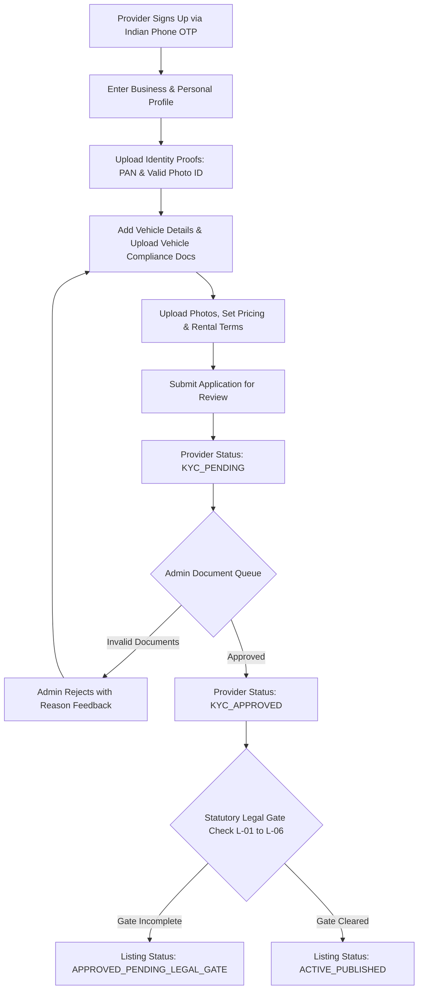

# Product Requirements Document (PRD)

# Discovery Uttarakhand (Stage 1 MVP — Vehicle Rentals)

| Document Control | Specification |
| :--- | :--- |
| **Product Name** | Discovery Uttarakhand |
| **Document Version** | 1.6.2 (Dispute Windows, Evidence Integrity & Architectural Taxonomy Refinement) |
| **Launch Scope Strategy** | **APPROVED: Option B — Vehicle Rentals First** |
| **Document Status** | Approved Launch Scope \| Client Delivery, Financial & Operational Targets **PROPOSED** \| Legal & Tax Items **UNRESOLVED** |
| **Target Geography (MVP)** | Nainital District, Uttarakhand, India |
| **Delivery Architecture** | Proposed Web-First Rollout (Tourist Responsive Web, Provider Web, Admin Web) \| Flutter Android App Roadmap (Phase B) |
| **Backend & Database** | Node.js + Express.js + TypeScript \| PostgreSQL + Prisma ORM |

---

### Document Version History

| Version | Date | Primary Author / Focus | Key Changes & Refinements |
| :--- | :---: | :--- | :--- |
| **1.0.0** | 2026-11-01 | Product Team | Initial platform requirements covering all 4 tourism verticals across Uttarakhand. |
| **1.1.0** | 2026-11-02 | Founder Alignment | Refined scope around **Option B — Vehicle Rentals First** in Nainital District. |
| **1.2.0** | 2026-11-02 | Operational Review | Converted unverified statutory legal claims into unresolved verification items; separated advance and balance. |
| **1.3.0** | 2026-11-03 | Architectural Review | Established Single Merchant Gateway + Internal Ledger architecture; proposed Web-First delivery sequence. |
| **1.4.0** | 2026-11-03 | Safety Boundary Audit | Formally split Release 4 into Release 4A (With-Driver) and Release 4B (Self-Drive) with independent safety gates. |
| **1.5.0** | 2026-11-04 | State Machine & SLAs | Added formal 20-state booking machine, business-hours SLA algorithm, and minimum dispute workflows. |
| **1.6.0** | 2026-11-04 | Consistency Audit | Resolved balance collection timing contradictions; decoupled Release 4A/4B dependencies; introduced no-show protocol. |
| **1.6.1** | 2026-11-04 | Consistency & Integrity | Decoupled multi-dimensional lifecycle statuses; resolved AC-R1-00 vs AC-R1-03 legal gate contradiction; corrected provider SLA 18:00 boundary math; decoupled physical trip closure from payment acknowledgment; formalized offline deposit evidence rules; added missing acceptance criteria (AC-R1-05, AC-R4B-05, AC-R5-02 to AC-R5-04); enhanced token rotation and upload pipeline security. |
| **1.6.2** | 2026-11-04 | Final Consistency Review | **Current Version:** Reconciled 24-hr tourist dispute window with 48-hr provider payout clearance holdback; distinguished 4 refund lifecycle milestones with gateway-dependent customer settlement reality; separated commercial disputes from safety/maintenance availability holds; bounded offline deposit deductions by explicit contractual authorization and evidence review; clarified public EXIF metadata stripping, private storage access controls, and retention limits; restructured founder decision taxonomy into architectural blocking choices vs configurable business parameters. |

---

## Strategic Decision Register

| Decision Area | Status | Current Specification / Status Summary |
| :--- | :---: | :--- |
| **Launch Scope Strategy** | **APPROVED** | **Option B: Vehicle Rentals First.** The initial MVP is strictly restricted to Vehicle Rentals (scooters, motorcycles, cars; self-drive and with-driver) in Nainital District. Future categories (Local Guides, Hotels & Homestays, Activities & Experiences) are preserved in the strategic product vision but excluded from MVP implementation. |
| **Long-Term Vision** | **APPROVED** | Discovery Uttarakhand will eventually encompass 4 core verticals: (1) Vehicle Rentals, (2) Local Guides, (3) Hotels & Homestays, and (4) Activities & Experiences. |
| **Internal Release Staging** | **PROPOSED** | Phased engineering rollout into 6 workstreams: Releases 1, 2, and 3 provide shared foundational capabilities. Release 4 branches into two independent parallel workstreams: **Release 4A (With-Driver Operations)** and **Release 4B (Self-Drive Safety & Handover)**. Neither 4A nor 4B depends on the other. **Release 5 (Reviews, Reporting & Operational Improvements)** provides post-pilot polish and is strictly non-blocking for public pilots. |
| **Client Delivery Sequence** | **PROPOSED** | **Web-First Implementation (Phase A):** Build Tourist Responsive Website, Provider Responsive Web Interface, and Admin Web Dashboard first. All mandatory pilot capabilities (including camera inputs, inspection forms, OTP verification, and dispute reporting) are delivered on responsive web. Flutter Android app remains in technical architecture as Phase B, with full feature parity deferred until web booking workflows stabilize. |
| **Public Pilot Safety Boundary** | **PROPOSED** | Releases 1–3 alone are **NOT** sufficient for any public pilot. A With-Driver pilot requires Releases 1, 2, 3, 4A, plus minimum Admin With-Driver dispute inspection. A Self-Drive pilot requires Releases 1, 2, 3, 4B, plus minimum Admin Self-Drive dispute inspection. If Release 4B is delayed, **self-drive remains disabled in software**, and the pilot launches as With-Driver only. |
| **Onboarding & Legal Gate** | **PROPOSED** | Provider KYC verification, provider legal eligibility, listing review, and public listing activation are strictly decoupled. Commercial listings can only transition to `ACTIVE_PUBLISHED` if both provider KYC is verified AND statutory legal checks (L-01 to L-06) are cleared (enforced by AC-R1-00). |
| **Financial Pricing Structure** | **PROPOSED** | Gross Fare split conceptually into Online Advance ($15\%$, proposed), Platform Commission on completed trips ($10\%$, proposed), Provider Advance Credit ($5\%$, proposed), and On-Site Balance ($85\%$, proposed) paid directly to provider. **Collection timing:** For With-Driver, on-site balance is collected at destination upon trip arrival; for Self-Drive, on-site balance is collected at vehicle handover (trip start). All percentages require founder approval. |
| **Security Deposit Custody & Deductions** | **PROPOSED** | For Self-Drive rentals only. Collected directly by provider at physical vehicle handover (cash/UPI) and refunded on-site upon undamaged return, documented via digital condition form. The platform does not hold custody of offline deposits and cannot electronically reverse them. Deductions from provider future earnings/credits are **strictly subject to contractual authorization in the Provider Terms of Service, verified documented evidence, formal dispute review, and applicable legal requirements under Indian contract law**. |
| **Provider Payout & Dispute Window** | **PROPOSED** | Proposed 24-hour tourist dispute submission window post-trip completion reconciled with a proposed 48-hour provider payout holdback window. Disputes during holdback freeze payout eligibility; post-remittance disputes result in internal ledger recovery balance tracking subject to contractual terms. |
| **Provider Response SLA** | **PROPOSED** | 2-hour daytime window (08:00:00–20:00:00 IST). Requests received at or before 18:00:00 expire same day; requests after 18:00:00 roll over remaining minutes to next morning starting at 08:00:00. Exact boundary and overnight calculations defined in Section 8.5. |
| **Cancellation Fee Allocation** | **PROPOSED** | Forfeited advance on late cancellation ($T < 24\text{ hr}$) or tourist no-show split 50% to platform (cancellation service fee) and 50% to provider (inventory reservation compensation). Exact cancellation intervals ($T \ge 48\text{ hr}$, $24\text{ hr} \le T < 48\text{ hr}$, $T < 24\text{ hr}$) defined mathematically in Section 9.3. |
| **Tourist No-Show Protocol** | **PROPOSED** | Structured 5-step operational protocol: 60-min elapsed wait past scheduled pickup $\to$ Provider logs $\ge 2$ contact attempts $\to$ Platform automated urgent SMS with 30-min grace window $\to$ Provider submits no-show claim after 90 min total elapsed $\to$ Admin reviews contact logs and declares no-show, applying late cancellation fee (50/50 split). |
| **Provider Payout Routing** | **UNRESOLVED** | Initial pilot proposes manual/batch bank transfers (NEFT/IMPS) based on internal ledger calculations. Automated split payouts via payment gateway marketplace products (e.g., Razorpay Route) require future technical evaluation and escrow compliance. |
| **Legal & Regulatory Status** | **UNRESOLVED** | Motor Vehicles Act compliance, private vs. commercial vehicle eligibility, Rent-a-Cab/Motorcycle scheme applicability, hill driving rules, driver endorsements, and DPDP Act identity verification must be formally validated with Uttarakhand authorities (Items L-01 to L-06). |
| **Tax & Accounting Compliance** | **UNRESOLVED** | Gateway MDR processing fees, GST applicability on platform commissions, Tax Collected at Source (TCS) under GST Section 52, and TDS under Section 194-O must be formally verified by professional chartered accountants (Item T-01). |

---

## Table of Contents
1. [Product Overview & Problem Statement](#1-product-overview--problem-statement)
2. [Target Users & Customer Personas](#2-target-users--customer-personas)
3. [Product Goals & Proposed Pilot Operational Targets](#3-product-goals--proposed-pilot-operational-targets)
4. [Internal Release Staging & Public Pilot Safety Boundary](#4-internal-release-staging--public-pilot-safety-boundary)
5. [Platform Client Delivery Matrix (Proposed Web-First Strategy)](#5-platform-client-delivery-matrix-proposed-web-first-strategy)
6. [User Roles, Permissions & Access Control (RBAC)](#6-user-roles-permissions--access-control-rbac)
7. [Vehicle Rental Workflows: Self-Drive vs. With-Driver](#7-vehicle-rental-workflows-self-drive-vs-with-driver)
8. [Booking, Payment, Trip, Refund & Dispute Lifecycle & Concurrency](#8-booking-payment-trip-refund--dispute-lifecycle--concurrency)
9. [Payment, Commission & Financial Settlement Logic](#9-payment-commission--financial-settlement-logic)
10. [Provider Onboarding, KYC, Bank Details & Verification](#10-provider-onboarding-kyc-bank-details--verification)
11. [Admin Dashboard Requirements](#11-admin-dashboard-requirements)
12. [Search, Filtering, Catalog Discovery & Pricing Rules](#12-search-filtering-catalog-discovery--pricing-rules)
13. [Functional Requirements (FR) Catalog](#13-functional-requirements-fr-catalog)
14. [Non-Functional Requirements (NFR)](#14-non-functional-requirements-nfr)
15. [Legal, Regulatory & Operational Uncertainty Register](#15-legal-regulatory--operational-uncertainty-register)
16. [Acceptance Criteria for Stage 1 Vehicle Rental MVP](#16-acceptance-criteria-for-stage-1-vehicle-rental-mvp)
17. [Structured Founder Decision List](#17-structured-founder-decision-list)

---

## 1. Product Overview & Problem Statement

### 1.1 Long-Term Product Vision
**Discovery Uttarakhand** is conceived as a trusted, hyper-local tourism and travel rental marketplace connecting domestic and international tourists with verified local service providers across Uttarakhand. The comprehensive long-term platform vision encompasses four core verticals:
1. **Vehicle Rentals:** Two-wheelers and four-wheelers for self-drive exploration and chauffeured transit.
2. **Local Guides:** Regional historians, certified nature/birding experts, and high-altitude trekking leaders.
3. **Hotels & Homestays:** Registered village homestays, heritage mountain cottages, and boutique budget stays.
4. **Activities & Experiences:** Curated nature walks, lake activities, cultural tours, and adventure experiences.

### 1.2 Approved Stage 1 MVP Focus: Vehicle Rentals First
To achieve disciplined execution, operational clarity, and rapid validation, the founder has confirmed **Launch Strategy: Option B — Vehicle Rentals First**.

The Stage 1 MVP is strictly restricted to **Vehicle Rentals** within **Nainital District**, Uttarakhand. All product architecture, APIs, data schemas, web interfaces, and mobile applications developed in Stage 1 will support:
- Two-wheelers (scooters, motorcycles) and four-wheelers (hatchbacks, sedans, SUVs).
- Both **Self-Drive** and **With-Driver** rental modes.
- Onboarding of eligible local fleet operators and individual vehicle owners (*subject to formal legal verification*).
- Verification of driving credentials, transparent pricing breakdowns, online advance payments, pre-trip condition logs, and post-trip reviews.

Categories 2, 3, and 4 (Guides, Homestays, Activities) remain part of the strategic vision but are explicitly deferred to post-MVP stages.

### 1.3 Target Geography & Geographic Boundary: Nainital District
Stage 1 MVP operations are restricted to designated clusters in Nainital District:
- **Urban & Lake Centers:** Nainital Town (Mallital & Tallital), Pangot, Kilbury.
- **Lake Valley Hubs:** Bhimtal, Naukuchiatal, Sattal, Bhowali.
- **Fruit Belt & High Altitude:** Mukteshwar, Ramgarh, Peora.
- **Foothill Gateways:** Ramnagar (Jim Corbett gateway), Kaladhungi.
- **Transit Terminals:** Kathgodam Railway Station, Haldwani Bus Terminal.

### 1.4 Authentication Scope: Indian Mobile Numbers Only
- **Stage 1 MVP Authentication:** Registration and login are strictly restricted to **Indian mobile numbers (+91)** via 6-digit SMS OTP verification.
- **International Visitors:** International travelers visiting Uttarakhand must possess an active Indian tourist SIM card (+91) to authenticate during Stage 1. Direct international mobile number support (+ country codes) and international SMS routing are explicitly **deferred to post-MVP** due to international carrier delivery costs and regulatory routing complexities.

### 1.5 Problem Statement & Value Proposition
- **Problem:** Opaque street pricing, undocumented vehicle conditions resulting in unfair damage claims upon return, uncertain hill roadworthiness, high cancellation rates from casual phone inquiries, and absence of secure advance reservations.
- **Value Proposition:** Guaranteed upfront pricing, advance payment protection, verified vehicle/driver credentials, mandatory condition logging at handover, direct on-site collection of remaining fare balance by providers, and predictable commission revenue for Discovery Uttarakhand.

---

## 2. Target Users & Customer Personas

```
+----------------------------------------------------------------------------------------------------+
|                             DISCOVERY UTTARAKHAND USERS (STAGE 1 MVP)                              |
+----------------------------------------------------------------------------------------------------+
                                |                                                   |
                   [TOURISTS / TRAVELERS]                                  [LOCAL VEHICLE PARTNERS]
                                |                                                   |
       +------------------------+------------------------+          +---------------+---------------+
       |                                                 |          |                               |
[Independent Travelers / Solo]                    [Families & Groups]  [Commercial Fleet Operators]    [Individual Vehicle Owners]
(Self-drive scooters & bikes,                     (With-driver cabs,   (Local rental bureaus,          (Eligible individual owners
Activa, Himalayan, Classic 350)                   Innova, Ertiga, SUV)  multi-vehicle operators)        subject to legal review)
```

### 2.1 Stage 1 MVP Active Personas
- **Persona 1: Independent Tourist / Couple (Self-Drive):** Seeks reliable scooter/motorcycle hire from Kathgodam/Nainital; requires clear deposit rules and condition records to prevent damage disputes.
- **Persona 2: Family / Group Vacationer (Chauffeured Cab):** Pre-books a 6–7 seater SUV with an experienced hill driver for scenic tours; requires transparent sightseeing and toll/parking terms.
- **Persona 3: Local Commercial Fleet Operator:** Rental bureau operator with 5–25 vehicles seeking verified advance bookings to eliminate phone booking no-shows.
- **Persona 4: Individual Vehicle Owner (*Subject to Legal Review*):** Local resident owning a vehicle seeking supplementary income. *Must be legally validated under Motor Vehicles Act provisions prior to onboarding.*
- **Persona 5: Platform Administrator / Operations Specialist:** Internal operator managing document verification queues, active booking oversight, dispute investigations, and commission ledgers.

### 2.2 Future Stage Personas (Preserved for Long-Term Vision)
- **Certified Local Tour Guides (Stage 2)**
- **Homestay Hosts (Stage 3)**
- **Activity & Adventure Operators (Stage 4)**

---

## 3. Product Goals & Proposed Pilot Operational Targets

To avoid presenting unvalidated metrics as guaranteed outcomes, the figures below represent **proposed pilot operational targets** that will be empirically measured and calibrated during the initial pilot phase in Nainital District.

| Metric Domain | Proposed Pilot Indicator | Target Benchmark (Proposed) | Validation Method |
| :--- | :--- | :---: | :--- |
| **Provider Compliance** | Document Verification Turnaround | Median $< 24\text{ hours}$ | Measured from document submission to Admin review |
| | Pre-Activation Document Completion | $100\%$ verified | Hard software gate before listing search activation |
| **Marketplace Health** | Provider Request Acceptance Rate | $\ge 80\%$ of requests | Tracked across all active verified providers |
| | Provider Response SLA Compliance | $\ge 90\%$ within SLA | Measured against the proposed business-hours algorithm |
| | Request Auto-Expiry Rate | $< 10\%$ of requests | Tracked as expired requests relative to total requests |
| **Trip Execution & Safety** | Booking Fulfillment Rate | $\ge 95\%$ of confirmed bookings | Completed bookings vs. confirmed bookings |
| | Digital Handover Completion Rate | $100\%$ of self-drive rentals | Mandatory gate before trip status transitions to `IN_PROGRESS` |
| | Handover / Return Dispute Rate | $< 2\%$ of completed trips | Escalated dispute tickets divided by completed rentals |
| **Customer Experience** | Post-Trip Review Submission Rate | $\ge 35\%$ of completed trips | Verified reviews submitted divided by completed trips |
| | Average Customer Service Rating | $\ge 4.2\text{ / }5.0$ stars | Average score of all verified customer reviews |
| **Technical Health** | API Latency (P95) | $< 250\text{ ms}$ | Measured on catalog search and listing read endpoints |
| | Webhook Processing Accuracy | $100\%$ accuracy | Validated via HMAC-SHA256 signature verification |
| | Automated Reconciliation Rate | $100\%$ accuracy | Captured gateway orders matched with internal database orders |

---

## 4. Internal Release Staging & Public Pilot Safety Boundary

To ensure maintainable, stepwise development, the Vehicle Rental MVP is organized into **six focused internal release stages**. Releases 1, 2, and 3 build shared marketplace, booking, and payment foundations. Release 4 then branches into two **independent parallel workstreams**: **Release 4A (With-Driver Operations)** and **Release 4B (Self-Drive Safety & Handover)**. **Release 5 (Reviews, Reporting & Operational Improvements)** provides post-pilot polish and is strictly non-blocking for public pilots.

```
+----------------------------------------------------------------------------------------------------+
|                         STAGE 1 MVP INTERNAL RELEASE STAGING (VEHICLES)                            |
+----------------------------------------------------------------------------------------------------+
  [RELEASE 1]       --> [RELEASE 2]       --> [RELEASE 3]       
  Marketplace &         Booking Core &        Advance Payments &
  Onboarding            Availability FSM      Refund Webhooks   
  (Web Foundational)    (Web Foundational)    (Web Foundational)
                               │
                               ├─────────────────────────────────────────┐
                               ▼                                         ▼
                        [RELEASE 4A]                              [RELEASE 4B]
                        With-Driver Operations                    Self-Drive Safety & Handover
                        (Chauffeur Workstream)                    (Self-Drive Workstream)
                        *Prerequisite for With-Driver Pilot*      *Prerequisite for Self-Drive Pilot*
                               │                                         │
                               └────────────────────┬────────────────────┘
                                                    ▼
                                              [RELEASE 5]
                                              Reviews, Reporting & Improvements
                                              (Post-Pilot Polish & Non-Blocking)
```

### 4.1 Scope of Internal Releases

#### Release 1: Basic Vehicle Marketplace, Onboarding & Catalog Search (Foundation)
- Tourist user registration and login via Indian mobile SMS OTP (+91).
- Provider registration, business profile setup, and vehicle compliance document submission.
- Admin dashboard: document review queue, verify provider KYC and vehicle listings.
- Decoupled onboarding architecture: provider document verification, legal eligibility check, listing approval, and public listing activation.
- Minimum Admin dispute inspection: review uploaded evidence, view booking history, and record notes.
- Vehicle listing management: photos, specs, pricing, location, and rental terms.
- Public vehicle search, sub-region filtering (Nainital District), and detail views on responsive web.
- **Enforcement of Legal Activation Gate (AC-R1-00):** Commercial listings remain hidden from public search until statutory legal verification (L-01 to L-06) is formally completed.

#### Release 2: Booking Requests, Availability & Booking Management
- Calendar availability management (blocking maintenance and personal dates).
- Tourist booking request submission (dates, times, vehicle selection).
- Provider booking dashboard: view pending requests, Accept / Reject actions.
- Provider response SLA timer (2 hours daytime operating window) with corrected boundary handling and auto-expiry logic.
- Booking status tracking for tourists and providers across decoupled lifecycle dimensions.

#### Release 3: Online Advance Payment, Webhooks, Cancellation & Refunds
- Payment gateway integration for online advance payment (proposed: 15%).
- Cryptographic webhook verification (HMAC-SHA256) and atomic state transitions.
- Payment reconciliation: matching gateway transaction IDs, order IDs, and server-calculated amounts.
- Automated full refund processing on provider rejection or request auto-expiry.
- Tiered tourist cancellation engine and automated refund calculation.
- Payment transaction append-only audit ledger, refund failure retry handling, late payment webhook handling, and structured 5-step Tourist No-Show Protocol.

#### Release 4A: With-Driver Trip Operations (Independent Chauffeur Workstream)
- Assignment and verification of driver details (Name, Phone Number, Commercial Licence).
- Pickup verification via 4-digit **Pickup OTP** to transition trip to `IN_PROGRESS`.
- Physical trip completion via 4-digit **Drop OTP** transitioning trip to `TRIP_COMPLETED`.
- On-site balance collection recording by driver/provider at destination upon trip arrival, updating on-site settlement status to `COLLECTION_LOGGED`.
- Tourist payment acknowledgment updating on-site settlement to `SETTLED`.
- Minimum With-Driver dispute reporting (driver no-show, route divergence, fare disagreement).
- Digital receipt generation.

#### Release 4B: Self-Drive Safety & Handover (Independent Self-Drive Workstream)
- 3-stage Self-Drive Driving Licence verification: checkout upload, preliminary validation, and mandatory physical inspection at handover.
- Digital **Handover Checklist**: starting odometer, fuel fraction, photos, mandatory physical DL inspection confirmation checkbox, on-site balance collection, Handover OTP, moving trip to `IN_PROGRESS`.
- Digital **Return Checklist**: closing odometer, fuel check, damage check.
- Physical vehicle return confirmation via 4-digit **Return OTP** transitioning trip to `TRIP_COMPLETED`.
- Deposit settlement recording, tourist balance acknowledgment, and offline deposit dispute protocols.
- Separation of commercial disputes from physical safety/maintenance holds (`UNDER_MAINTENANCE_HOLD`).
- Minimum Self-Drive dispute reporting (damage deductions, deposit retention, fuel disputes).

#### Release 5: Reviews, Reporting & Operational Improvements (Post-Pilot Polish)
- Post-trip 1-to-5 star ratings and written reviews for completed rentals.
- Provider review responses and aggregate rating computation.
- Advanced dispute resolution management console with comparative photo viewer.
- Financial reporting: GMV, platform commission retained, provider payout liabilities.
- *Release 5 is non-blocking for public pilots and can be deployed following operational validation of Releases 4A/4B.*

---

### 4.2 Public Pilot Safety Boundary (*Mandatory Operational Rule*)

> [!CAUTION]
> **INDEPENDENT PILOT SAFETY GATES**
> A public pilot involves real customers, real money, and physical vehicles on public mountain roads. **Releases 1–3 alone are NOT sufficient to conduct any public pilot**, because they lack physical trip commencement, handover, and drop verification protocols.
> 
> **Explicit Pilot Boundary Rules:**
> 1. **With-Driver Public Pilot Prerequisites:** 
>    - Requires **Release 1, Release 2, Release 3, Release 4A**, plus minimum Admin With-Driver dispute operations (AC-R1-05).
>    - A With-Driver pilot does **NOT** depend on Release 4B (self-drive).
>    - All participating operators, vehicles, drivers, and route permits must be verified.
> 2. **Self-Drive Public Pilot Prerequisites:**
>    - Requires **Release 1, Release 2, Release 3, Release 4B**, plus minimum Admin Self-Drive dispute operations (AC-R1-05, AC-R4B-05).
>    - All self-drive vehicles must undergo the mandatory pre-trip condition checklist, original DL physical verification, safety equipment check, and on-site deposit settlement.
> 3. **Self-Drive Contingency Rule:**
>    - If Release 4B is **NOT** ready at the targeted pilot launch date, **self-drive vehicle listings MUST remain disabled in the software**.
>    - The public pilot will launch strictly as a **With-Driver-only pilot** (using Releases 1–3 + 4A).
> 4. **Statutory Legal Gate:**
>    - Commercial provider onboarding and public listing activation remain strictly blocked until legal checks L-01 through L-06 are completed (AC-R1-00).

---

## 5. Platform Client Delivery Matrix (Proposed Web-First Strategy)

To avoid premature engineering duplication, the platform defines a **PROPOSED Web-First Delivery Strategy**. All workflows required for the first public pilot (including photo uploads, checklists, OTPs, and minimum dispute operations) will be delivered on responsive web clients.

```
+----------------------------------------------------------------------------------------------------+
|                         PROPOSED CLIENT DELIVERY SEQUENCE (STAGE 1 MVP)                            |
+----------------------------------------------------------------------------------------------------+
  [PHASE A: WEB-FIRST PUBLIC PILOT]                         [PHASE B: MOBILE APP EXPANSION]
  - Tourist Responsive Website (React + Vite + TS)         - Tourist Android Application (Flutter + Dart)
  - Provider Responsive Web Interface (React + Vite + TS)  - Native camera optimization for DL & handover
  - Admin Web Dashboard (Desktop React + Vite + TS)        - Local SQLite offline caching for mountain passes
```

| Platform Client | Primary Target User | Capabilities Delivered for Public Pilot (Phase A) | Phase Availability (Proposed) |
| :--- | :--- | :--- | :---: |
| **Tourist Website**<br>*(React + Vite + TS Responsive)* | Tourists on Mobile & Desktop Browsers | - Indian Mobile OTP login (+91)<br>- Vehicle catalog search & Nainital District filters<br>- Vehicle detail pages & price breakdown<br>- Booking request & online advance payment<br>- Booking status, cancellation & refund tracking<br>- Self-drive DL upload (via browser file/camera input)<br>- Pickup OTP, Drop OTP, and Handover OTP display<br>- Balance payment acknowledgment prompt & receipt<br>- Dispute initiation interface | **Phase A (Pilot Core)**<br>Releases 1, 2, 3, 4A, 4B<br>*(Release 5 Post-Pilot)* |
| **Provider Web Interface**<br>*(React + Vite + TS Responsive)* | Fleet Operators & Individual Owners | - Indian Mobile OTP login & business profile setup<br>- Vehicle compliance document upload (RC, Insurance, Fitness)<br>- Vehicle listing creation & photo upload<br>- Calendar availability blocking<br>- Booking request notification, Accept / Reject<br>- Release 4A: Driver assignment, Pickup/Drop OTP verification, on-site balance recording at destination<br>- Release 4B: Mobile browser digital Handover/Return checklists, physical DL inspection checkbox, on-site balance recording at handover<br>- Earnings ledger view & dispute response interface | **Phase A (Pilot Core)**<br>Releases 1, 2, 4A, 4B<br>*(Release 5 Post-Pilot)* |
| **Admin Dashboard**<br>*(Desktop React Web)* | Internal Platform Operations | - Provider & vehicle KYC verification queue<br>- Document review viewer with approve/reject actions<br>- Statutory legal gate toggle (AC-R1-00)<br>- Live booking monitor across Nainital District<br>- Pilot dispute inspection & manual refund controls (4A & 4B, AC-R1-05)<br>- Vehicle safety hold management console (`UNDER_MAINTENANCE_HOLD`)<br>- Commission ledger & payout batch export (CSV) | **Phase A (Pilot Core)**<br>Releases 1, 2, 3, 4A, 4B<br>*(Release 5 Post-Pilot)* |
| **Tourist Mobile App**<br>*(Flutter + Dart Android)* | Tourists / Android Mobile Users | - Parity with Tourist Web capabilities<br>- Native camera optimization for DL and handover photo review<br>- Offline-resilient view of active booking details & OTPs<br>- Push notifications via FCM | **Phase B (Post-Web Pilot)**<br>Deferred until web pilot stabilizes |

*Note: The Web-First sequence is **PROPOSED** to optimize development resources and requires founder confirmation.*

---

## 6. User Roles, Permissions & Access Control (RBAC)

```
       +--------------------------------------------------------+
       |             STAGE 1 MVP USER ROLES                     |
       +--------------------------------------------------------+
         |                  |                 |                 |
 [GUEST / PUBLIC]     [TOURIST]         [PROVIDER]          [ADMIN]
         |                  |                 |                 |
   Browse Vehicles    Create Bookings   Manage Vehicles   Verify KYC Docs
   View Pricing       Pay Advance       Accept/Reject     Manage Disputes
   Read Reviews       Upload DL         Log Handovers     Platform Ledger
                      Submit Reviews    Record Returns    System Config
```

### 6.1 Role Definitions
- **`GUEST` (Unauthenticated Visitor):** Can browse active vehicle listings, apply search filters, inspect pricing breakdowns, and view public reviews. Cannot initiate bookings.
- **`TOURIST` (Authenticated Customer):** Can initiate booking requests, upload driving credentials, pay online advances, cancel bookings within policy windows, provide handover/pickup OTPs, view booking history, acknowledge balance payments, raise disputes, and submit post-trip reviews.
- **`PROVIDER_PENDING` (Applicant Vehicle Partner):** Can complete provider profile, upload personal identity proofs and vehicle compliance documents, and create draft listings. Listings remain invisible to the public until approved by Admin and legal gate is cleared.
- **`PROVIDER_VERIFIED` (Active Vehicle Partner):** Can publish vehicle listings (subject to statutory legal activation), manage availability calendars, accept or reject booking requests, complete digital handover/return inspection checklists, record on-site balance collection, respond to disputes, and view completed booking statements.
- **`ADMIN` (Platform Operations):** Full operational access to inspect and verify provider KYC documents, control statutory legal activation gates, monitor active bookings, manage vehicle safety/maintenance blocks, resolve disputes, issue manual refunds, configure platform commission rates, and access append-only system audit logs.

### 6.2 Granular Permissions Matrix

| Platform Action / Capability | Guest | Tourist | Provider (Pending) | Provider (Verified) | Admin |
| :--- | :---: | :---: | :---: | :---: | :---: |
| **Search & Browse Vehicle Listings** | Yes | Yes | Yes | Yes | Yes |
| **View Pricing Breakdown & Rental Terms** | Yes | Yes | Yes | Yes | Yes |
| **Create Booking Request** | No | Yes | No | No | No |
| **Pay Online Booking Advance** | No | Yes | No | No | No |
| **Upload Driving Licence Proof** | No | Yes | No | No | View All |
| **Cancel Tourist Booking** | No | Yes (Own) | No | No | Yes (Any) |
| **Submit Post-Trip Rating & Review (R5)** | No | Yes (Own) | No | No | Moderate |
| **Submit Provider & Vehicle KYC Documents** | No | No | Yes | Yes | View All |
| **Create / Edit Vehicle Listings** | No | No | Drafts Only | Yes (Own) | Yes (Any) |
| **Accept / Reject Booking Requests** | No | No | No | Yes (Own) | Override |
| **Execute Handover / Return Checklists (4B)** | No | No | No | Yes (Own) | Audit |
| **Assign Driver & Verify OTPs (4A)** | No | No | No | Yes (Own) | Audit |
| **Record On-Site Balance Collection** | No | Acknowledge | No | Yes (Own) | Audit |
| **Report / Escalate Booking Dispute** | No | Yes (Own) | No | Yes (Own) | Resolve |
| **Approve / Reject Provider KYC Documents** | No | No | No | No | Yes |
| **Unlock Statutory Legal Activation Gate** | No | No | No | No | Yes |
| **Place / Release Vehicle Safety Maintenance Hold** | No | No | No | No | Yes |
| **Trigger Payment Refund** | No | System | No | No | Yes |
| **Configure Platform Commission Rates** | No | No | No | No | Yes |
| **Access System Audit Logs** | No | No | No | No | Yes |

---

## 7. Vehicle Rental Workflows: Self-Drive vs. With-Driver

```
+--------------------------------------------------------------------------------------------------------+
|                                      VEHICLE RENTAL OPERATING MODES                                    |
+--------------------------------------------------------------------------------------------------------+
                               |                                                        |
                    [MODE 1: SELF-DRIVE]                                     [MODE 2: WITH-DRIVER]
                   (Release 4B Workstream)                                  (Release 4A Workstream)
                               |                                                        |
         - Scooters (Activa/Access), Motorcycles, Cars           - Taxis, Chauffeur-driven Hatchbacks/SUVs
         - 3-Stage DL Verification (Upload, Check, In-Person)    - Proposed Tourist Taxi Permit (*Legal check)
         - Digital Handover Checklist with Photos                - Point-to-Point, Sightseeing or Day Package
         - Odometer & Fuel Level Fraction Log                    - Fare: Base Fare + Km + Extra Time Surcharge
         - Balance ($B_{onsite}$) & Deposit ($D_{sec}$) at Start - Driver assignment & Pickup/Drop OTPs
         - On-Site Handover Completed -> Trip IN_PROGRESS        - Pickup OTP verified -> Trip IN_PROGRESS
         - Return Inspection & Return OTP -> Trip COMPLETED      - Drop OTP verified -> Trip COMPLETED
         - Deposit Settlement Protocol (Cash/UPI)                - Balance Logged at Drop -> PENDING_SETTLEMENT
         - Balance Confirmed & Deposit Settled                   - Balance Confirmed by Tourist -> SETTLED
         - Post-Trip Rating & Review (Release 5)                 - Post-Trip Rating & Review (Release 5)
```

### 7.1 Mode 1: Self-Drive Rentals (Release 4B Workstream)

#### 7.1.1 3-Stage Driving Licence & Age Verification Protocol (*Subject to Legal Review*)
To eliminate safety risks on mountainous terrain, licence verification is structured into three mandatory operational stages:
1. **Stage 1 (Checkout Upload):** During checkout, the tourist must upload clear front and back images of a valid Indian Driving Licence (LMV for cars; Motorcycle with/without Gear for two-wheelers) or a valid International Driving Permit (IDP) accompanied by passport identity page.
2. **Stage 2 (Preliminary Validation):** Backend performs preliminary validations (file format, image dimensions, minimum age check: proposed 18 for two-wheelers, 21 for cars, and expiry date check) prior to booking submission.
3. **Stage 3 (Mandatory Physical Inspection at Handover):** Before handing over vehicle keys, the provider **must physically inspect the original physical Driving Licence card**. The provider must toggle an explicit verification checkbox in the web interface: *"I have physically inspected the renter's original Driving Licence card and verified that it matches the renter and is valid."* The system enforces this checkbox before enabling Handover OTP verification.

#### 7.1.2 Security Deposit Handling & Platform Limitations (*Proposed Protocol*)
- Listing must transparently state the required refundable **Security Deposit** (e.g., ₹1,000 for scooters, ₹3,000 for motorcycles, ₹5,000–₹10,000 for cars).
- **Custody:** Collected directly by the provider at physical vehicle handover (via cash or instant UPI) and refunded immediately upon undamaged return, documented via the app/web return checklist.
- **Platform Limitation & Contractual Authority:** The platform **never takes custody of offline deposits** and **cannot electronically debit or reverse offline cash/UPI payments**. Platform ledger deductions or offsets against provider future earnings are **strictly subject to explicit contractual authorization in the Provider Terms of Service, verified photographic and documentary evidence, formal administrative dispute review, and applicable legal requirements under Indian contract law**.

#### 7.1.3 Digital Handover Protocol (Trip Start — Release 4B)
Provider web/mobile interface enforces a structured pre-ride condition checklist:
1. **Physical DL Checkbox:** Provider toggles confirmation of physical original Driving Licence inspection.
2. **Odometer & Fuel Fraction:** Provider inputs current odometer reading and selects fuel fraction (0%, 25%, 50%, 75%, 100%).
3. **Condition Media Capture:** Provider and tourist capture at least 4 photos (Front, Rear, Left, Right) documenting pre-existing scratches, dents, or tyre wear.
4. **Safety Gear & Documents Check:** Physical copies of RC, insurance, PUC, 2 ISI helmets for two-wheelers, spare tyre/tools for cars.
5. **On-Site Balance & Deposit Collection:** Provider collects on-site rental balance ($B_{onsite} = 85\%$) and refundable security deposit ($D_{sec}$) in cash/UPI. Provider records balance collection in web interface.
6. **Handover Confirmation:** Tourist shares the 4-digit **Handover OTP**; provider submits checklist and OTP to transition trip status to `IN_PROGRESS`.

#### 7.1.4 Digital Return & Settlement Protocol (Trip End — Release 4B)
1. **Return Condition Audit:** Provider inspects vehicle against the initial check-in photos.
2. **Odometer & Fuel Logging:** Closing odometer and fuel level are recorded.
3. **Usage Adjustments:** Extra fuel or excess km charges calculated based on published rates.
4. **Physical Return Confirmation (Decoupled):** Tourist shares the 4-digit **Return OTP** to verify that the vehicle is physically returned to the provider's custody; trip status updates to `TRIP_COMPLETED`.
5. **Deposit Settlement Recording:** Provider records net deposit returned and logs settlement details; on-site settlement status enters `COLLECTION_LOGGED`.
6. **Tourist Settlement Acknowledgment:** Tourist confirms deposit settlement and balance payment; on-site settlement status updates to `SETTLED`. If the tourist disputes damage deductions or deposit retention, the settlement status transitions to `DISPUTED` while the trip remains safely recorded as `TRIP_COMPLETED`.

---

### 7.2 Mode 2: With-Driver Rentals (Release 4A Workstream)

#### 7.2.1 Operating Types
1. **Point-to-Point Transit:** Fixed transfer routes (e.g., Kathgodam Railway Station to Nainital Mall Road; Haldwani to Mukteshwar; Nainital to Ramnagar).
2. **Sightseeing Packages:** Curated day itineraries (e.g., Nainital Lake Tour covering Bhimtal, Sattal, Naukuchiatal; Mukteshwar Himalayan View Tour).
3. **Multi-Day Outstation Hire:** Dedicated vehicle and driver assigned for multi-day itineraries across Kumaon.

#### 7.2.2 Transparent Fare Structure
Listings must explicitly itemize all pricing components:
- **Base Fare:** Covers vehicle, driver service, fuel, and standard kilometers/hours for the selected itinerary.
- **Night / Early Morning Driver Allowance:** Fixed charge (e.g., ₹300) for trips starting before 06:00 or running past 20:00.
- **Hill Tolls, State Taxes & Parking Fees:** Must clearly specify whether parking fees and toll plaza receipts are **Included** or **Payable by Tourist on actuals**.
- **Driver Overnight Accommodation Allowance:** Specified per-night fee (e.g., ₹500/night) for outstation trips.

#### 7.2.3 Trip Execution Workflow (Release 4A)
1. **Driver Assignment:** Provider assigns verified driver credentials (Name, Phone Number, Commercial Licence Number) prior to pickup.
2. **Pickup Verification:** Driver and tourist match via a 4-digit **Pickup OTP** generated in the tourist's app/web, moving trip status to `IN_PROGRESS`.
3. **Trip Drop Verification (Decoupled):** At destination upon trip arrival, the tourist shares the 4-digit **Drop OTP** with the driver to confirm safe completion of the journey; trip status transitions to `TRIP_COMPLETED`.
4. **On-Site Balance Collection:** Driver/provider collects on-site balance ($B_{onsite} = 85\%$) in cash/UPI and enters payment confirmation in the web interface; on-site settlement status updates to `COLLECTION_LOGGED`.
5. **Tourist Settlement Acknowledgment:** Tourist confirms recorded balance payment in app/web; on-site settlement status updates to `SETTLED`. If the tourist disputes an unauthorized extra cash demand, the settlement status updates to `DISPUTED` while the trip status remains `TRIP_COMPLETED`.

---

### 7.3 Decoupling Physical Trip Completion from Payment Acknowledgment

To prevent operational deadlocks and protect both parties, **physical trip completion and on-site payment acknowledgment are strictly decoupled**:
- **Drop OTP (With-Driver) / Return OTP (Self-Drive):** Verifies solely that the physical transit occurred or that the physical vehicle was returned to the provider's possession. It does **NOT** constitute cryptographic proof of cash or UPI payment.
- If a tourist disputes an extra charge or deposit deduction, the physical trip or vehicle handover is still formally closed (`TRIP_COMPLETED`). The dispute is isolated to `OnSiteSettlementStatus = DISPUTED` and `DisputeStatus = OPEN_INVESTIGATION`.

---

### 7.4 Offline Security Deposit Disputes & Vehicle Safety Holds

To balance operational fairness and passenger safety, disputes are categorized into two distinct tracks:

#### Track 1: Commercial / Financial Disputes (No Availability Block)
Disputes regarding disputed cash balances, extra waiting charges, disputed fuel rates, or minor deposit retention where the vehicle itself is physically undamaged and roadworthy:
- These disputes do **NOT** block the vehicle from future availability or bookings.
- The vehicle remains open on the calendar and searchable.

#### Track 2: Physical Damage, Mechanical Failure & Safety Disputes (Mandatory Safety Hold)
Disputes involving vehicular collision, accident damage, brake failure, mechanical breakdown, bald tyres, or reported roadworthiness defects:
- The system or Admin **must immediately place the vehicle under a Safety & Maintenance Hold (`VehicleStatus = UNDER_MAINTENANCE_HOLD`)**.
- The vehicle is instantly blocked from public search and cannot be reserved for future dates.
- The hold remains active until:
  1. Documented physical repair and safety inspection are recorded.
  2. The provider uploads a certified repair invoice or roadworthiness certificate.
  3. An authorized Admin reviews the inspection documentation and formally toggles the vehicle back to `ACTIVE_PUBLISHED`.

#### Offline Deposit Dispute Investigation & Contractual Offset Protocol
Because security deposits are collected offline by providers in cash or direct UPI, the platform cannot electronically debit or reverse the funds. To resolve deposit disputes:
1. **Pre-Ride Condition Evidence:** Mandatory baseline photos (front, rear, both sides) and odometer/fuel readings during handover.
2. **Return Condition Evidence:** Mandatory return photos highlighting specific new damages, closing odometer, and fuel gauge readings.
3. **Itemized Deduction Proof:** Provider must submit an official repair invoice/estimate or standard fuel receipt, along with proof of net deposit refund (UPI screenshot or signed receipt).
4. **Admin Investigation:** Admin reviews check-in versus return photos and evaluates reasonable repair charges.
5. **Contractual Remedies & Sanctions:** If an Admin determines that a provider wrongfully withheld a renter's deposit:
   - Subject to explicit authorization in the Provider Terms of Service, the platform offsets the verified wrongful amount against the provider's internal platform advance credit ledger ($P_{advance}$) and future booking earnings.
   - The provider receives a formal disciplinary strike. Persistent non-compliance leads to suspension or permanent removal from Discovery Uttarakhand.

---

## 8. Booking, Payment, Trip, Refund & Dispute Lifecycle & Concurrency

### 8.1 Multi-Dimensional Lifecycle Architecture

To eliminate state machine ambiguities, the platform decouples the booking lifecycle into **six orthogonal dimensions**:

```
+----------------------------------------------------------------------------------------------------+
|                                MULTI-DIMENSIONAL LIFECYCLE MODEL                                   |
+----------------------------------------------------------------------------------------------------+
  1. Booking Status:      DRAFT -> PENDING_CONFIRMATION -> CONFIRMED -> CANCELLED / CLOSED
  2. Payment Status:      PENDING_CHECKOUT -> CAPTURED (SUCCESS) -> REFUND_PENDING / REFUNDED
  3. Trip Status:         NOT_STARTED -> IN_PROGRESS -> TRIP_COMPLETED
  4. Settlement Status:   PENDING_COLLECTION -> COLLECTION_LOGGED -> SETTLED / DISPUTED
  5. Refund Status:       NONE -> REFUND_INITIATED -> REFUND_PENDING_GATEWAY -> REFUNDED / FAILED
  6. Dispute Status:      NONE -> OPEN_INVESTIGATION -> RESOLVED_SETTLED / RESOLVED_REFUNDED
```

---

### 8.2 Primary Booking Lifecycle State Diagram

```mermaid
stateDiagram-v2
    [*] --> DRAFT : Tourist selects vehicle & dates
    DRAFT --> PENDING_PAYMENT : Checkout initiated (15-min hold)
    
    PENDING_PAYMENT --> PAYMENT_FAILED : Gateway reports failure / drops
    PAYMENT_FAILED --> PENDING_PAYMENT : Retry payment within 15-min TTL
    PAYMENT_FAILED --> EXPIRED_HOLD : 15-min TTL lapses without retry
    PENDING_PAYMENT --> EXPIRED_HOLD : 15-min hold window expires
    EXPIRED_HOLD --> [*]
    
    EXPIRED_HOLD --> REQUESTED : Late webhook arrived & inventory free
    EXPIRED_HOLD --> OVERBOOKING_PREVENTED : Late webhook arrived & inventory re-booked
    OVERBOOKING_PREVENTED --> REFUND_INITIATED : Automated 100% refund command
    
    PENDING_PAYMENT --> REQUESTED : Advance verified via Webhook
    
    REQUESTED --> REJECTED_BY_PROVIDER : Provider clicks Reject
    REQUESTED --> AUTO_EXPIRED : SLA timer expires
    REQUESTED --> CANCELLED_BY_TOURIST : Tourist cancels before response
    
    REJECTED_BY_PROVIDER --> REFUND_INITIATED : 100% advance refund
    AUTO_EXPIRED --> REFUND_INITIATED : 100% advance refund
    CANCELLED_BY_TOURIST --> REFUND_INITIATED : 100% advance refund (pre-acceptance)
    
    REQUESTED --> CONFIRMED : Provider accepts booking within SLA
    
    CONFIRMED --> CANCELLED_BY_TOURIST : Tourist cancels post-confirmation
    CONFIRMED --> CANCELLED_BY_PROVIDER : Provider cancels post-confirmation
    CONFIRMED --> CANCELLED_NO_SHOW : Tourist fails to appear (5-step protocol)
    
    CANCELLED_BY_TOURIST --> REFUND_INITIATED : Tiered refund calculation (9.3)
    CANCELLED_BY_PROVIDER --> REFUND_INITIATED : 100% refund + provider penalty
    CANCELLED_NO_SHOW --> REFUND_INITIATED : 0% refund (advance forfeited, 50/50 split)
    
    CONFIRMED --> IN_PROGRESS : Handover/Pickup OTP verified
    IN_PROGRESS --> DISPUTED : Breakdown, damage, or on-trip dispute
    
    IN_PROGRESS --> TRIP_COMPLETED : Drop / Return OTP verified
    TRIP_COMPLETED --> PENDING_SETTLEMENT : Provider logs on-site balance collection
    
    PENDING_SETTLEMENT --> DISPUTED : Tourist disputes recorded balance
    PENDING_SETTLEMENT --> SETTLED : Tourist confirms on-site payment
    
    DISPUTED --> SETTLED : Admin resolves dispute
    DISPUTED --> REFUND_INITIATED : Admin awards partial/full advance refund
    
    REFUND_INITIATED --> REFUND_PENDING : Command dispatched to gateway adapter
    REFUND_PENDING --> REFUNDED : Gateway webhook confirms disbursement
    REFUND_PENDING --> REFUND_FAILED : Gateway webhook reports failure
    REFUND_FAILED --> REFUND_INITIATED : Automated retry with idempotency key (up to 3 attempts)
    REFUND_FAILED --> ADMIN_ESCALATION : Persistent failure; Admin intervention
    
    SETTLED --> CLOSED : All financial obligations finalized
    REFUNDED --> CLOSED : Terminal refund closed
    ADMIN_ESCALATION --> CLOSED : Manual offline resolution finalized
    CLOSED --> [*]
```



---

### 8.3 Detailed State Reference & Dimension Mapping Table

| Composite State Name | Primary Booking Status | Payment Status | Trip Status | Settlement Status | Refund Status | Dispute Status | Description & Permitted Operations |
| :--- | :--- | :--- | :--- | :--- | :--- | :--- | :--- |
| `DRAFT` | `DRAFT` | `PENDING_CHECKOUT` | `NOT_STARTED` | `PENDING_COLLECTION` | `NONE` | `NONE` | Initial vehicle and date selection. No inventory hold. |
| `PENDING_PAYMENT` | `PENDING_CONFIRMATION` | `PENDING_CHECKOUT` | `NOT_STARTED` | `PENDING_COLLECTION` | `NONE` | `NONE` | Checkout initiated. 15-minute temporary inventory hold active. |
| `PAYMENT_FAILED` | `PENDING_CONFIRMATION` | `PAYMENT_FAILED` | `NOT_STARTED` | `PENDING_COLLECTION` | `NONE` | `NONE` | Payment failed; hold remains active until 15-min TTL expires. |
| `EXPIRED_HOLD` | `EXPIRED` | `PAYMENT_FAILED` | `NOT_STARTED` | `PENDING_COLLECTION` | `NONE` | `NONE` | 15-minute checkout window lapsed. Inventory released immediately. |
| `REQUESTED` | `PENDING_CONFIRMATION` | `CAPTURED` | `NOT_STARTED` | `PENDING_COLLECTION` | `NONE` | `NONE` | Advance captured. Provider SLA timer active. |
| `AUTO_EXPIRED` | `EXPIRED_SLA` | `REFUND_PENDING` | `NOT_STARTED` | `PENDING_COLLECTION` | `REFUND_INITIATED` | `NONE` | Provider SLA expired. 100% refund command dispatched. |
| `REJECTED_BY_PROVIDER` | `REJECTED` | `REFUND_PENDING` | `NOT_STARTED` | `PENDING_COLLECTION` | `REFUND_INITIATED` | `NONE` | Provider declined request. 100% refund command dispatched. |
| `CONFIRMED` | `CONFIRMED` | `CAPTURED` | `NOT_STARTED` | `PENDING_COLLECTION` | `NONE` | `NONE` | Provider accepted. Mutual contact and pickup landmark unlocked. |
| `CANCELLED_BY_TOURIST` | `CANCELLED_BY_TOURIST` | `REFUND_PENDING` / `FORFEITED` | `NOT_STARTED` | `PENDING_COLLECTION` | `REFUND_INITIATED` / `NONE` | `NONE` | Tourist cancelled. Refund calculated per tiered policy (Section 9.3). |
| `CANCELLED_BY_PROVIDER` | `CANCELLED_BY_PROVIDER` | `REFUND_PENDING` | `NOT_STARTED` | `PENDING_COLLECTION` | `REFUND_INITIATED` | `NONE` | Provider cancelled post-confirmation. 100% refund triggered + strike. |
| `CANCELLED_NO_SHOW` | `CANCELLED_BY_TOURIST` | `FORFEITED` | `NOT_STARTED` | `PENDING_COLLECTION` | `NONE` | `NONE` | Tourist failed to show up after 5-step protocol. Advance forfeited. |
| `IN_PROGRESS` | `CONFIRMED` | `CAPTURED` | `IN_PROGRESS` | `PENDING_COLLECTION` | `NONE` | `NONE` | Physical trip commenced via Pickup OTP or Handover OTP. |
| `TRIP_COMPLETED` | `CONFIRMED` | `CAPTURED` | `TRIP_COMPLETED` | `PENDING_COLLECTION` | `NONE` | `NONE` | Vehicle returned or passenger dropped off via Drop/Return OTP. |
| `PENDING_SETTLEMENT` | `CONFIRMED` | `CAPTURED` | `TRIP_COMPLETED` | `COLLECTION_LOGGED` | `NONE` | `NONE` | Provider logged balance/deposit settlement; awaiting tourist confirm. |
| `SETTLED` | `CONFIRMED` | `CAPTURED` | `TRIP_COMPLETED` | `SETTLED` | `NONE` | `NONE` | Tourist confirmed balance payment; physical and financial closure reached. |
| `DISPUTED` | `CONFIRMED` | `CAPTURED` | `IN_PROGRESS` / `TRIP_COMPLETED` | `DISPUTED` | `NONE` | `OPEN_INVESTIGATION` | Disagreement logged regarding fare, damage, deposit, or service. |
| `OVERBOOKING_PREVENTED` | `OVERBOOKING_PREVENTED` | `REFUND_PENDING` | `NOT_STARTED` | `PENDING_COLLECTION` | `REFUND_INITIATED` | `NONE` | Late payment captured after hold expired & vehicle re-booked; 100% refund. |
| `REFUND_INITIATED` | Any Cancelled | `REFUND_PENDING` | As Applicable | As Applicable | `REFUND_INITIATED` | As Applicable | Refund record created with idempotency key, pending dispatch. |
| `REFUND_PENDING` | Any Cancelled | `REFUND_PENDING` | As Applicable | As Applicable | `REFUND_PENDING_GATEWAY` | As Applicable | Command sent to gateway adapter; awaiting asynchronous webhook. |
| `REFUND_FAILED` | Any Cancelled | `REFUND_PENDING` | As Applicable | As Applicable | `REFUND_FAILED` | As Applicable | Gateway reported error; system retrying (up to 3 times). |
| `ADMIN_ESCALATION` | Any Cancelled / Disputed | As Applicable | As Applicable | `DISPUTED` | `MANUAL_ESCALATION` | `OPEN_INVESTIGATION` | Persistent failure or unresolved dispute requiring Admin intervention. |
| `REFUNDED` | Any Cancelled | `REFUNDED` | As Applicable | As Applicable | `REFUNDED` | As Applicable | Gateway confirmed refund disbursement to banking rails. |
| `CLOSED` | `CLOSED` | `CAPTURED` / `REFUNDED` | `TRIP_COMPLETED` / `NOT_STARTED` | `SETTLED` / `NONE` | `REFUNDED` / `NONE` | `RESOLVED_SETTLED` / `NONE` | Terminal operational state. Eligible for reviews and ledger payouts. |

---

### 8.4 Inventory Concurrency, Checkout Holds & Race Condition Invariants

#### Invariant 1: Definition of Active Reservation & Half-Open Temporal Intervals
A vehicle cannot have more than one active booking or temporary hold for any overlapping temporal interval.
- **Interval Representation:** All rental intervals are modeled as **half-open ranges** $[T_{start}, T_{end})$.
- **Turnaround Buffer ($T_{buffer}$):** To allow for vehicle inspection, cleaning, refueling, and transit delays, every reservation automatically appends a mandatory turnaround buffer of at least **1 hour** ($T_{buffer} \ge 60\text{ minutes}$) to the vehicle's blocked window: $[T_{start}, T_{end} + T_{buffer})$.
- **Active Hold Inclusions:** An active inventory reservation is defined as:
  1. Any booking with `BookingStatus` in (`CONFIRMED`, `PENDING_CONFIRMATION`), OR
  2. Any booking with `BookingStatus = PENDING_CONFIRMATION` where `PaymentStatus` is (`PENDING_CHECKOUT`, `PAYMENT_FAILED`) AND the checkout expiration timestamp is valid: **`expires_at > now()`**.
- **Driver Concurrency:** For With-Driver bookings, the assigned driver is similarly locked for $[T_{start}, T_{end} + T_{buffer})$ to prevent overlapping chauffeur assignments.

#### Invariant 2: Authoritative Hold Expiry & Late Webhook Handling
- **Authoritative Expiration:** The field `expires_at` is the authoritative source of truth. Any database query checking inventory availability treats a hold as expired immediately once `now() >= expires_at`, regardless of whether a background worker has updated the record.
- **Atomic Availability Check:** All availability queries execute inside an isolated transaction with row-level locks or temporal range exclusions.
- **Late Successful Payment Webhook:** If a gateway webhook reporting successful payment arrives for a booking that has already passed its `expires_at`:
  1. The backend performs an atomic check: Is the vehicle (and driver, if applicable) still free for $[T_{start}, T_{end} + T_{buffer})$?
  2. **Case A (Inventory still available):** System locks inventory, transitions booking to `REQUESTED` (`PENDING_CONFIRMATION`), calculates provider SLA timer, and notifies parties.
  3. **Case B (Inventory re-booked or blocked):** System **strictly aborts confirmation**, immediately creates a refund record with idempotency key, sets status to `OVERBOOKING_PREVENTED` (`RefundStatus = REFUND_INITIATED`), dispatches a 100% refund command to the gateway adapter, and alerts the tourist via SMS.

#### Invariant 3: Database Concurrency & Exclusion Constraints
To guarantee zero double-bookings under concurrent checkout requests:
- **Primary Mechanism:** PostgreSQL exclusion constraints using GiST indexing on temporal ranges:
  ```sql
  ALTER TABLE vehicle_reservations ADD CONSTRAINT no_overlapping_vehicle_reservations
  EXCLUDE USING GIST (vehicle_id WITH =, tstzrange(start_time, end_time_with_buffer, '[)') WITH &&)
  WHERE (status IN ('CONFIRMED', 'PENDING_CONFIRMATION') AND (expires_at IS NULL OR expires_at > now()));
  ```
- **Fallback / Application Transaction Strategy:** If exclusion constraints are combined with complex business logic, transactions must execute at `ISOLATION LEVEL SERIALIZABLE` with an explicit application-tier retry loop (up to 3 retries with exponential backoff) handling PostgreSQL serialization error code `40001`.

---

### 8.5 Provider SLA Algorithm & Business-Hours Policy (*Proposed*)

To eliminate operational ambiguity, the 2-hour response SLA operates on a **business-hours algorithm** (08:00:00 to 20:00:00 IST):
- Operating Window: 08:00:00 to 20:00:00 IST (12 daytime operating hours = 720 operating minutes).
- Allowed Provider SLA Window: 2 hours (120 operating minutes).

**Mathematical Specification:**
Let $T_{req}$ be the request timestamp in Indian Standard Time (IST, UTC+05:30).
Let $Date(T_{req})$ be the calendar date of the request.
1. **Early Morning ($T_{req} < 08:00:00$ IST):**
   Timer starts at 08:00:00 on $Date(T_{req})$ with full 120 minutes.
   `sla_expires_at` = 08:00:00 + 120 minutes = **10:00:00 IST on $Date(T_{req})$**.
2. **Daytime Standard ($08:00:00 \le T_{req} \le 18:00:00$ IST):**
   Full 120 minutes elapse on the same day.
   `sla_expires_at` = $T_{req} + 120\text{ minutes}$ on $Date(T_{req})$.
3. **Evening Transition ($18:00:00 < T_{req} < 20:00:00$ IST):**
   Operating minutes remaining today: $M_{today} = 20:00:00 - T_{req}$.
   Operating minutes rolling over to next day: $M_{next} = 120 - M_{today}$.
   `sla_expires_at` = 08:00:00 on $Date(T_{req}) + 1\text{ day} + M_{next}\text{ minutes}$.
4. **Night ($20:00:00 \le T_{req} \le 23:59:59$ IST):**
   0 operating minutes remain today. Full 120 minutes roll over to next morning.
   `sla_expires_at` = 08:00:00 on $Date(T_{req}) + 1\text{ day} + 120\text{ minutes}$ = **10:00:00 IST next morning**.

**Boundary Verification Test Cases:**
- *Test 1 (14:15 IST):* $08:00 \le 14:15 \le 18:00 \implies 14:15 + 120\text{ min} =$ **16:15 IST same day**. (Pass)
- *Test 2 (17:30 IST):* $08:00 \le 17:30 \le 18:00 \implies 17:30 + 120\text{ min} =$ **19:30 IST same day**. (Pass)
- *Test 3 (18:00 IST):* $08:00 \le 18:00 \le 18:00 \implies 18:00 + 120\text{ min} =$ **20:00 IST same day**. (Pass)
- *Test 4 (19:30 IST):* $18:00 < 19:30 < 20:00 \implies M_{today} = 30\text{ min}, M_{next} = 90\text{ min} \implies 08:00 + 90\text{ min} =$ **09:30 IST next morning**. (Pass)
- *Test 5 (20:00 IST):* $20:00 \le 20:00 \le 23:59:59 \implies 08:00 + 120\text{ min} =$ **10:00 IST next morning**. (Pass)
- *Test 6 (23:00 IST):* $20:00 \le 23:00 \le 23:59:59 \implies 08:00 + 120\text{ min} =$ **10:00 IST next morning**. (Pass)
- *Test 7 (07:00 IST):* $07:00 < 08:00 \implies 08:00 + 120\text{ min} =$ **10:00 IST same morning**. (Pass)

If no response is received by `sla_expires_at`, a scheduled background worker transitions the booking to `AUTO_EXPIRED` (`RefundStatus = REFUND_INITIATED`) and dispatches an automated 100% refund command.

---

## 9. Payment, Commission & Financial Settlement Logic

### 9.1 Conceptual Deconstruction of Financial Terms

To eliminate financial contradictions, all monetary flows are conceptually separated. **All percentages and settlement terms below are PROPOSED and subject to founder approval.**

```
Gross Rental Fare (F_gross) = ₹2,100  (Calculated by platform based on provider rates)
│
├── 1. Collected Online by Platform via Payment Gateway: Online Advance (A_online) = ₹315 (15% of F_gross, PROPOSED)
│     ├── Retained by Platform: Platform Commission on Completed Booking (C_platform) = ₹210 (10% of F_gross, PROPOSED)
│     └── Credited to Provider Ledger: Provider Advance Credit (P_advance) = ₹105 (5% of F_gross, PROPOSED)
│
├── 2. Paid Directly to Provider On-Site: On-Site Balance (B_onsite) = ₹1,785 (85% of F_gross, PROPOSED)
│     ├── With-Driver: Paid at DESTINATION upon trip arrival (prior to Drop OTP)
│     └── Self-Drive: Paid at HANDOVER / TRIP START (along with Security Deposit)
│     └── Paid directly via Cash or direct UPI on site; never touches platform bank accounts
│
└── 3. Refundable Security Deposit (D_sec) = ₹1,000 (Self-Drive only, set by provider)
      └── Paid directly on-site at handover; refunded on-site at return; 100% independent of rental fare
```

| Financial Concept | Formal Definition | Method of Custody / Movement | Status |
| :--- | :--- | :--- | :---: |
| **Gross Rental Fare ($F_{gross}$)** | Total contractual price for the vehicle rental duration. | Reference calculation figure. | Baseline |
| **Online Advance ($A_{online}$)** | Upfront commitment paid by tourist at checkout to secure booking. | Collected into platform primary gateway account. | **PROPOSED: 15%** |
| **Platform Commission ($C_{platform}$)** | Software service fee earned **only upon fulfilled bookings**. | Retained by platform directly from $A_{online}$. | **PROPOSED: 10%** |
| **Provider Advance Credit ($P_{advance}$)** | Advance surplus credited to provider payout ledger upon trip completion. | Netting: $A_{online} - C_{platform}$ ($5\%$ of $F_{gross}$). | **PROPOSED: 5%** |
| **On-Site Balance ($B_{onsite}$)** | Remaining rental fare paid by tourist to provider directly. **Timing:** At destination for With-Driver; at vehicle handover for Self-Drive. | Paid directly by tourist to provider via Cash/UPI. | **PROPOSED: 85%** |
| **Security Deposit ($D_{sec}$)** | Refundable guarantee against damage or fuel deficiency (Self-Drive only). | Collected and refunded directly on-site by provider. | **PROPOSED** |
| **Cancellation Fee ($Fee_{canc}$)** | Charge deducted when a tourist cancels without adequate notice or no-shows. | Distinct from completed commission; see 9.2. | **PROPOSED** |

---

### 9.2 Completed Commission vs. Cancellation Fee Allocation

It is vital to distinguish between:
1. **Commission on Completed Bookings ($C_{platform}$):** Earned solely when a booking is fulfilled (`CLOSED` following `TRIP_COMPLETED`). Proposed at 10% of $F_{gross}$.
2. **Cancellation Charges on Forfeited Advances:** When a tourist cancels late ($T < 24\text{ hours}$) or fails to show up, the online advance ($A_{online}$) is non-refundable. Because no trip occurred, standard completed commission does not apply. Instead, the forfeited amount is treated as a **cancellation penalty**, proposed to be allocated:
   - **50% to Platform:** Compensating for gateway processing and customer support overhead.
   - **50% to Provider:** Credited to the provider's payout ledger to compensate for holding inventory off the market.

---

### 9.3 Exact Cancellation Schedule, Exceptional Scenarios & Tourist No-Show Protocol (*Proposed*)

| Time Remaining to Pickup ($T$) | Cancellation Status | Tourist Refund % | Provider Share of Advance | Platform Share of Advance | Boundary Rule |
| :--- | :---: | :---: | :---: | :---: | :--- |
| **Pre-Acceptance (`REQUESTED`)** | Pre-Response Cancellation | **100% Refund** | 0% | 0% | Tourist cancels before provider accepts $\to$ immediate full refund |
| **$T \ge 48\text{ hours}$** | Early Cancellation | **100% Refund** | 0% | 0% (less gateway fees if applicable) | Exactly 48 hours is included in this full refund tier |
| **$24\text{ hours} \le T < 48\text{ hours}$** | Mid-Window Cancellation | **50% Refund** | 25% of Advance (50% of retained) | 25% of Advance (50% of retained) | Exactly 24 hours is included in this 50% refund tier |
| **$T < 24\text{ hours}$** | Late Cancellation | **0% Refund (Forfeited)** | 50% of Advance | 50% of Advance | Strictly under 24 hours results in 100% forfeiture |
| **Tourist No-Show** | No-Show Protocol Declared | **0% Refund (Forfeited)** | 50% of Advance | 50% of Advance | Triggered via structured 5-step protocol below |

#### Exceptional Operational Scenarios:
1. **Provider Cancellation (Post-Confirmation):** Tourist receives immediate 100% refund of advance. Provider receives a formal cancellation strike, visibility demotion, and a financial penalty fee deducted from future payout earnings.
2. **Vehicle Mechanical Breakdown:**
   - *With-Driver:* Provider must provide an equivalent replacement vehicle within 60 minutes. If unable, the trip is terminated; tourist receives a prorated refund of the advance, and no on-site balance is due for incomplete transit legs.
   - *Self-Drive:* Provider must arrange roadside assistance, towing, or replacement vehicle. If mechanical fault is verified as non-renter negligence, rental charges are prorated/paused and the security deposit is refunded in full.
3. **Driver No-Show (With-Driver):** If assigned driver fails to appear within 60 minutes of pickup time, tourist receives a 100% full refund of the advance. Provider is penalized.
4. **Force Majeure & Weather Blockages:** In the event of documented landslides, cloudbursts, severe snowfalls, or official road closures by Nainital District Administration, Admin override enables penalty-free 100% refunds or complimentary trip rescheduling.
5. **Dispute During Active Trip:** The trip is concluded physically, but financial settlement is frozen in `DISPUTED` status pending Admin evidence review.

#### Structured 5-Step Tourist No-Show Protocol:
1. **Step 1 (60-Minute Elapsed Threshold):** 60 minutes elapse past the scheduled pickup time ($T_{start}$) without the tourist appearing or communicating.
2. **Step 2 (Provider Contact Logging):** Provider logs at least two (2) separate contact attempts (phone/SMS) within the provider web interface, recording call timestamps and status notes.
3. **Step 3 (Automated Platform Grace Alert):** The system dispatches an automated urgent SMS and notification to the tourist warning that the booking will be cancelled as a no-show with full advance forfeiture unless acknowledged within a 30-minute grace window.
4. **Step 4 (Provider Claim Submission):** If the tourist remains uncontactable and does not arrive after 90 minutes total elapsed time from $T_{start}$, the provider submits an official "Tourist No-Show" claim with contact logs.
5. **Step 5 (Admin Verification & Declaration):** Admin reviews call logs and timestamps in the dispute queue and declares "Tourist No-Show". The booking updates to `CANCELLED_NO_SHOW`, the online advance is 100% forfeited, 50% is credited to provider payout ledger for idle inventory compensation, and 50% is retained by platform.

---

### 9.4 Financial Architecture, Ledgers, Payouts & Gateway Integration

The platform operates on a **Single Merchant Gateway + Internal Ledger** model, decoupling ledger accruals from actual bank remittances:

```
[Tourist Pays Advance] ---> [Platform Gateway Merchant Account] ---> [Internal Ledger Records Payment]
                                                                                │
                   ┌────────────────────────────────────────────────────────────┴──────────────────────────────────────┐
                   ▼                                                                                                   ▼
         [If Rejected / Cancelled]                                                                           [If Trip Completed]
   Backend issues Gateway Refund API command                                                            Platform retains C_platform (10%)
   100% or partial refund returned to Tourist                                                           P_advance (5%) added to Provider Ledger
                                                                                                                       │
                                                                                                                       ▼
                                                                                                       [Dispute Window: 24hr Post-Trip]
                                                                                                                       │
                                                                                                                       ▼
                                                                                                       [Payout Holdback: 48hr Clearance]
                                                                                                                       │
                                                                                                                       ▼
                                                                                                      [Weekly Batch NEFT Bank Transfer]
                                                                                                       Disbursed manually from platform bank
```

#### 1. Four Distinct Refund Lifecycle Milestones
To eliminate ambiguity between platform commands and banking clearing realities:
1. **Milestone 1 — Refund Initiation (`REFUND_INITIATED`):** Platform backend creates a refund transaction record with an idempotency key (`refund_{booking_id}_{attempt}`).
2. **Milestone 2 — Gateway Processing (`REFUND_PENDING_GATEWAY`):** Gateway API adapter receives the refund command and acknowledges it for asynchronous processing.
3. **Milestone 3 — Gateway Confirmation (`REFUNDED`):** Gateway asynchronous webhook confirms that funds have been debited from the platform's merchant account and disbursed to interbank clearing rails.
4. **Milestone 4 — Customer Bank Account Credit:** Actual credit of funds into the customer's original payment instrument (credit/debit card, UPI linked bank account, net banking). This step is entirely governed by NPCI and issuing bank clearing cycles; it is **gateway- and payment-method dependent, not guaranteed** (typically estimated at 5–7 banking days, but can vary by issuing bank).
*Explicit Boundary Rule:* A gateway refund API response or webhook confirmation is **NOT** proof that the customer's bank account has been credited; it is solely proof that the refund command has been executed on gateway merchant rails.

#### 2. Reconciliation of Tourist Dispute Window and Provider Payout Holdback
To prevent disbursing platform funds before tourist complaints are evaluated:
- **Proposed Tourist Dispute Submission Window:** A tourist may submit a booking, fare, or deposit dispute within **24 hours** (proposed) following physical trip completion (`TRIP_COMPLETED`).
- **Proposed Provider Payout Holdback Window:** Provider advance credits ($P_{advance}$) remain in `PENDING_CLEARANCE` for at least **48 hours** (proposed) following trip completion before becoming `ELIGIBLE_FOR_PAYOUT`.
- **Pre-Disbursement Dispute Freeze:** Because the 48-hour holdback exceeds the 24-hour dispute window, any dispute submitted within the standard window automatically transitions the ledger credit to `FROZEN_DISPUTED`, preventing payout inclusion.
- **Disputes Raised After 48-Hour Clearance but Before Remittance:** If an Admin accepts an exceptional dispute after 48 hours but before the weekly batch remittance executes, the ledger balance is immediately frozen.
- **Disputes Raised After Actual Bank Remittance:** If a formal dispute or serious grievance is lodged after payout funds have physically been remitted to the provider's bank account:
  - The platform initiates administrative investigation.
  - If substantiated against the provider, the platform logs a negative recovery balance against the provider's internal ledger to offset against future booking advance credits, subject to the Provider Terms of Service.
  - *All holdback durations, dispute windows, and post-remittance recovery terms remain explicitly **PROPOSED** pending founder approval.*

#### 3. Payment Gateway Integration via Adapter Pattern
- Rather than assuming a single universal gateway interface, the backend abstracts payment operations behind a `PaymentGatewayAdapter` interface with provider-specific implementations (e.g. `RazorpayAdapter`, `CashfreeAdapter`).
- Every refund command must pass a unique `idempotency_key` (`refund_{booking_id}_{attempt}`).
- If gateway returns an error, system calls the adapter's `checkRefundStatus()` before retrying up to 3 times.

#### 4. Gateway Processing Fees (MDR)
- Payment gateway MDR fees (typically 1.8% to 2.5% + GST) are incurred on advance transactions. Responsibility for bearing gateway MDR fees on full or partial refunds (absorbed by platform vs deducted from refund) is an **UNRESOLVED founder policy decision** (Item B-07).

#### 5. Tax & Accounting Compliance (*Unresolved*)
- GST on platform commissions, Tax Collected at Source (TCS) under Section 52 of CGST Act, and TDS under Section 194-O of Income Tax Act are **proposed baselines subject to formal Chartered Accountant verification** prior to live disbursements.

---

### 9.5 Concrete Numerical Scenarios (*Proposed Model*)

All examples assume:
- $F_{gross} = \text{₹}2,100$ (3-day scooter rental @ ₹700/day).
- $A_{online} = \text{₹}315$ ($15\%$ paid online, proposed).
- $C_{platform} = \text{₹}210$ ($10\%$ platform commission on completed trip, proposed).
- $P_{advance} = \text{₹}105$ ($5\%$ provider advance share on completed trip, proposed).
- $B_{onsite} = \text{₹}1,785$ ($85\%$ paid on-site, proposed).
- $D_{sec} = \text{₹}1,000$ (Self-Drive cash/UPI deposit at pickup, proposed).

#### Scenario 1: Successful Booking & Completion (With-Driver)
1. Tourist pays $A_{online} = \text{₹}315$ online. Provider accepts booking within SLA. Driver assigned.
2. Driver verifies Pickup OTP at pickup $\to$ `IN_PROGRESS`.
3. At destination, tourist shares Drop OTP $\to$ `TRIP_COMPLETED`.
4. Driver collects $B_{onsite} = \text{₹}1,785$ directly in cash/UPI and logs receipt $\to$ `PENDING_SETTLEMENT`. Tourist confirms $\to$ `SETTLED`.
5. **Internal Ledger Entry:** Platform retains $C_{platform} = \text{₹}210$. Platform credits $P_{advance} = \text{₹}105$ to provider payout ledger (`PENDING_CLEARANCE`).
6. **Bank Transfer:** After 48-hour clearance holdback without dispute, ₹105 transitions to `ELIGIBLE_FOR_PAYOUT` and is remitted to provider's bank via weekly batch NEFT.
7. **Net Financial Accounting:** Tourist paid ₹2,100 total (₹315 online + ₹1,785 on-site). Provider received ₹1,890 net (₹1,785 direct cash + ₹105 platform bank transfer = 90% of gross fare). Platform retained ₹210 commission (10% of gross fare). Zero amount double-counted.

#### Scenario 2: Provider Rejection or Auto-Expiry
1. Tourist pays $A_{online} = \text{₹}315$ online. Provider explicitly clicks "Reject" (or SLA expires).
2. Backend dispatches refund API command to gateway adapter for ₹315.
3. **Internal Ledger Entry:** Platform retains ₹0. Provider ledger credited ₹0.
4. **Bank Transfer:** ₹0 to provider. Tourist refunded ₹315 via gateway.
5. **Net Financial Accounting:** Tourist receives $100\%$ refund (₹315). Provider receives ₹0. Platform retains ₹0.

#### Scenario 3: Provider Cancellation (Post-Confirmation)
1. Tourist paid $A_{online} = \text{₹}315$. Booking was `CONFIRMED`. Provider cancels due to mechanical issue.
2. Backend triggers immediate $100\%$ refund of $A_{online}$ (₹315) to tourist via gateway adapter.
3. **Internal Ledger Entry:** Platform retains ₹0 commission. Provider ledger receives ₹0 credit; operational penalty fee logged against provider ledger (deductible from future payouts).
4. **Bank Transfer:** ₹0 to provider. Tourist refunded ₹315 via gateway.
5. **Net Financial Accounting:** Tourist receives full refund (₹315). Provider receives ₹0. Platform retains ₹0.

#### Scenario 4: Early Tourist Cancellation ($T \ge 48\text{ Hours}$)
1. Tourist cancels at $T = 48\text{ hours}$ or earlier before scheduled start time.
2. System issues $100\%$ refund command of $A_{online}$ (₹315) back to tourist via gateway adapter.
3. **Internal Ledger Entry:** Platform retains ₹0. Provider ledger credited ₹0.
4. **Bank Transfer:** ₹0 to provider. Tourist refunded ₹315 via gateway.
5. **Net Financial Accounting:** Tourist refunded ₹315. Provider receives ₹0. Platform retains ₹0.

#### Scenario 5: Mid-Window Tourist Cancellation ($24\text{ Hours} \le T < 48\text{ Hours}$)
1. Tourist cancels between 24 and 48 hours (including exactly 24 hours) before scheduled start time.
2. System refunds $\text{₹}157.50$ ($50\%$) to tourist via gateway adapter. Forfeited advance = ₹157.50.
3. **Internal Ledger Entry:** Platform retains cancellation service fee 50% of retained fee = ₹78.75. Provider ledger credited 50% of retained fee = ₹78.75 (`PENDING_CLEARANCE`).
4. **Bank Transfer:** After 48-hour holdback, ₹78.75 remitted to provider's bank via batch NEFT.
5. **Net Financial Accounting:** Tourist refunded ₹157.50. Provider receives ₹78.75. Platform retains ₹78.75.

#### Scenario 6: Late Tourist Cancellation ($T < 24\text{ Hours}$) or Tourist No-Show
1. Tourist cancels $< 24\text{ hours}$ before pickup, or 5-step no-show protocol completes.
2. Advance is 100% forfeited (₹315). Tourist receives ₹0 refund.
3. **Internal Ledger Entry:** Platform retains cancellation service charge 50% = ₹157.50. Provider ledger credited 50% = ₹157.50 (`PENDING_CLEARANCE`, idle inventory compensation).
4. **Bank Transfer:** After 48-hour holdback, ₹157.50 remitted to provider's bank via batch NEFT.
5. **Net Financial Accounting:** Tourist receives ₹0 refund. Provider receives ₹157.50. Platform retains ₹157.50.

#### Scenario 7: Payment Gateway Failure & Retry at Checkout
1. Tourist initiates checkout. 15-minute hold placed. Payment drops; state updates to `PAYMENT_FAILED`.
2. Hold remains active until 15-min TTL. Tourist retries with alternative payment method within TTL and succeeds $\to$ `REQUESTED`.
3. If not retried within 15 minutes, hold expires (`EXPIRED_HOLD`) and inventory is immediately released.
4. **Net Financial Accounting:** Tourist debited ₹0. Provider receives ₹0. Platform receives ₹0.

#### Scenario 8: Dispute at Vehicle Return (Self-Drive Damage / Fuel Shortage)
1. Tourist returns vehicle with minor new scratch. Return OTP is verified $\to$ `TRIP_COMPLETED`.
2. Provider proposes ₹300 deduction from $D_{sec} = \text{₹}1,000$. Renter agrees; provider returns ₹700 directly in cash/UPI.
3. Provider logs deposit settlement; tourist acknowledges; status updates to `SETTLED`. Vehicle remains roadworthy and available.
4. *If unresolved:* Tourist disputes deduction. On-site settlement enters `DISPUTED`; trip remains `TRIP_COMPLETED`. Admin investigates condition photos. If physical damage renders vehicle unsafe, vehicle transitions to `UNDER_MAINTENANCE_HOLD`.

#### Scenario 9: Late Payment Webhook with Overbooking Prevention
1. Tourist checkout hold expires at 15:15:00. At 15:16:30, a late gateway webhook arrives reporting captured payment of ₹315.
2. Backend queries inventory: Vehicle was already booked by another user at 15:15:45.
3. System aborts confirmation, creates refund record with idempotency key, sets status to `OVERBOOKING_PREVENTED`, dispatches automated 100% refund command, and sends alert SMS to tourist.
4. **Net Financial Accounting:** Overbooking prevented; tourist fully refunded ₹315 via gateway adapter.

---

## 10. Provider Onboarding, KYC, Bank Details & Verification



### 10.1 Progressive Provider Onboarding Pipeline
To minimize onboarding friction and reduce data privacy risks, provider information is captured progressively across three distinct stages:
1. **Stage 1: Basic Registration & Profile:** Business name, operator type (fleet vs individual), contact name, mobile number (+91).
2. **Stage 2: Compliance & Listing Setup:** Identity proofs, vehicle documents (RC, Insurance, Fitness, PUC), listing photos, pricing, and rental terms.
3. **Stage 3: Bank Payout Setup (Staged):** Bank account details are **not required at initial registration or listing drafting**. Bank payout details (Account Name, Account Number, IFSC) become mandatory only **prior to receiving the first payout disbursement** from the platform ledger.

### 10.2 DPDP Act Data Minimization, EXIF Stripping & Privacy Controls
Under the **Digital Personal Data Protection (DPDP) Act, 2023**, the platform enforces strict data minimization:
- **Aadhaar is NOT mandatory by default.** The platform permits providers and drivers to submit any recognized government photo identification (Voter ID, Passport, Indian Driving Licence, or voluntarily submitted masked Aadhaar where the first 8 digits are obscured).
- **Public Marketing Image EXIF Stripping:** All vehicle marketing photos undergo automated EXIF metadata stripping (removing embedded GPS coordinates, camera serial numbers, and device fingerprints) during the WebP derivative generation pipeline before serving via CDN.
- **Original Trip Condition Evidence (Handover & Return Photos):**
  - Stored in private cloud object storage (e.g., AWS S3 with Object Versioning, strict IAM least-privilege policies, and Block Public Access enabled).
  - High-resolution original images preserve timestamp and location metadata solely for server-side verification against scheduled pickup landmarks.
  - Access is restricted strictly to authenticated Admins and active booking participants via short-lived pre-signed URLs (expiry $< 15$ minutes).
  - *Retention Policy:* Retained for 180 days for standard completed bookings, and up to 3 years for bookings with active formal legal, insurance, or dispute claims, after which files are securely purged.
  - *Access Audit Logging:* Every pre-signed URL generation and evidence download is recorded in append-only audit tables with User ID, Timestamp, IP Address, and Purpose.
- **Bank Details Protection:** Bank account numbers and IFSC codes are encrypted at rest using AES-256, masked in user interfaces (showing only the last 4 digits), and accessible solely to authorized platform finance operators.

### 10.3 Vehicle Compliance Documents (*Subject to Formal Legal Verification*)
Every vehicle submitted for listing must provide:
1. **Vehicle Registration Certificate (RC):** Documenting registration status. *(Commercial registration requirements flagged for legal verification, see Section 15)*.
2. **Vehicle Insurance Policy:** Comprehensive commercial passenger or rental liability policy valid for the listing duration.
3. **Fitness Certificate:** Valid certificate issued by Regional Transport Office (RTO) where applicable.
4. **Pollution Under Control (PUC) Certificate.**
5. **State / Hill Route Permit:** Where required by state transport regulations.
6. **For Chauffeured Cabs:** Assigned driver's Driving Licence and relevant hill endorsements as required by local transport authorities.

### 10.4 Provider and Listing Lifecycle Statuses

To resolve operational contradictions, provider verification and listing publication statuses are strictly decoupled:
- **Provider KYC Status:** `KYC_PENDING` $\to$ `KYC_SUBMITTED` $\to$ `KYC_APPROVED` / `KYC_REJECTED`.
- **Provider Legal Eligibility Status:** `LEGAL_GATE_PENDING` $\to$ `LEGAL_GATE_APPROVED` (conditioned on clearance of statutory items L-01 through L-06).
- **Vehicle Listing Status:**
  - `DRAFT`: Incomplete listing being prepared by provider.
  - `UNDER_REVIEW`: Submitted by provider for administrative review.
  - `APPROVED_PENDING_LEGAL_GATE`: Documents verified by Admin, but public search activation blocked because statutory legal checks (L-01 to L-06) remain uncompleted.
  - `ACTIVE_PUBLISHED`: Verified and legally cleared; visible in public search.
  - `UNDER_MAINTENANCE_HOLD`: Temporarily blocked from search and calendar booking due to accident damage, mechanical failure, or safety dispute pending repair and inspection sign-off.
  - `SUSPENDED`: Temporarily deactivated by Admin due to expired documents or disciplinary sanctions.
  - `INACTIVE`: Toggled off by provider for seasonal maintenance.

---

## 11. Admin Dashboard Requirements

The Admin Panel is a desktop-first web workspace for internal platform operations.

### 11.1 Functional Modules
1. **KYC & Verification Queue (Release 1):**
   - Unified inbox of pending provider profiles and vehicle document packages.
   - Dual-view document inspection: side-by-side view of provider-entered data against high-resolution uploaded images/PDFs of RC, Insurance, Fitness, and ID proofs.
   - Actions: `Approve KYC`, `Request Re-upload` (with mandatory reason comment), or `Permanently Reject`.
2. **Statutory Legal Activation Gate Console (Release 1, AC-R1-00):**
   - Operational switchboard controlling public listing activation for commercial vehicle categories.
   - Restricts transition of listings from `APPROVED_PENDING_LEGAL_GATE` to `ACTIVE_PUBLISHED` until legal counsel sign-off is logged.
3. **Live Booking Supervision (Release 2 & 3):**
   - Real-time list of active bookings filtered by status (`REQUESTED`, `CONFIRMED`, `IN_PROGRESS`, `TRIP_COMPLETED`, `DISPUTED`).
   - Monitor provider response timers and inspect approaching SLA auto-expiries.
4. **Minimum Pilot Dispute Operations (Pilot Prerequisite — Release 1, 4A & 4B, AC-R1-05):**
   - **With-Driver Dispute Operations:** Inspect driver assignment, pickup/drop timestamps, tourist statement, and driver response; initiate manual full/partial advance refund or penalize provider.
   - **Self-Drive Dispute Operations (AC-R4B-05):** Inspect pre-ride vs return photos, odometer readings, fuel fractions, and deposit deduction claims; record administrative findings.
5. **Vehicle Safety & Maintenance Hold Console (Release 4B, AC-R4B-04):**
   - Manage vehicles in `UNDER_MAINTENANCE_HOLD` following damage or breakdown disputes.
   - Review uploaded repair invoices, mechanics' inspection reports, and authorize return to `ACTIVE_PUBLISHED`.
6. **Financial Ledger & Reports (Release 5, AC-R5-04):**
   - Overview of Gross Merchandise Value (GMV), total advance collected, platform commission retained, and provider payout balances.
   - Exportable provider payout schedules (CSV / Bank transfer format for batch NEFT).
7. **Content & Review Moderation (Release 5):**
   - Inspect and moderate vehicle photos and user reviews to filter inappropriate or fraudulent content.
8. **Append-Only Audit Logging (All Releases):**
   - Logging capturing `Admin User ID`, `Action Taken`, `Timestamp`, `IP Address`, and `Before/After State` for all compliance and refund actions, stored in append-only tables with restricted update/delete permissions to prevent application-layer tampering.

---

## 12. Search, Filtering, Catalog Discovery & Pricing Rules

### 12.1 Location-Based Search in Nainital District
- **Pickup / Drop Location Selector:**
  - *Kathgodam Railway Station*
  - *Haldwani Bus Terminal*
  - *Nainital Town (Tallital / Mallital)*
  - *Bhimtal Main Lake Belt*
  - *Mukteshwar / Ramgarh*
  - *Ramnagar (Jim Corbett)*
- **Date & Time Picker:** Specific pickup date/time and drop date/time (enforcing minimum 4-hour rental duration).

### 12.2 Vehicle Catalog Filters
- **Rental Mode:** Self-Drive vs. With-Driver.
- **Vehicle Type:** Scooter (Activa/Access), Motorcycle (Classic 350/Himalayan), Hatchback, Sedan, SUV.
- **Transmission:** Manual vs. Automatic (critical for hill driving confidence).
- **Fuel Type:** Petrol, Diesel, Electric (EV).
- **Seating Capacity:** 2-seater, 4-seater, 5-seater, 7-seater.
- **Kilometre Allowance:** Capped (e.g., 150 km/day + ₹X/extra km) vs. Unlimited Kilometres.
- **Delivery Option:** Hub Pickup vs. Doorstep / Hotel Delivery (with delivery surcharge).

### 12.3 Listing Card & Detail Page Display
- High-resolution vehicle photos (exterior and interior).
- Vehicle model name, year of manufacture, transmission, and fuel type.
- Verification status badge (`Verified Partner`).
- Total estimated rental fare for selected duration and required online advance amount.
- Explicit display of required security deposit amount (for self-drive).
- Host / Fleet operator name, overall star rating, and completed trip count.

### 12.4 Pricing Rules, Granularity & Unresolved Parameters (*Proposed*)
To prevent checkout misunderstandings, listings must specify the following parameters, which require formal calibration with local providers:
- **Billing Granularity:** Self-drive rentals billed on a 24-hour cycle from pickup timestamp; with-driver cabs billed per calendar day or fixed itinerary package.
- **Extra Kilometre Charges:** Published per-km rate (e.g., ₹10/km for hatchbacks, ₹15/km for SUVs) applied when capped distance allowance is exceeded.
- **Waiting Charges (With-Driver):** Published per-hour rate (e.g., ₹100–₹150/hr) for delays beyond itinerary schedule.
- **Tolls & Parking:** Explicitly flagged on listing as either included in base fare or payable by tourist on actuals.
- **Night Driving Allowance:** Fixed fee (e.g., ₹300) applied for trips operating between 21:00 and 06:00 IST.
- **Doorstep Delivery Surcharge:** Fixed distance-tiered surcharge for vehicle delivery to hotels/homestays outside the primary hub.

---

## 13. Functional Requirements (FR) Catalog

Requirements are explicitly mapped to the **6 internal release workstreams**.

### 13.1 Release 1: Marketplace Foundation, Onboarding & Security
- **FR-LEG-01 (Mandatory Statutory Activation Gate):** System must strictly block listings from transitioning to `ACTIVE_PUBLISHED` until statutory legal checks L-01 through L-06 are verified by legal counsel and unlocked by an Admin (AC-R1-00).
- **FR-AUTH-01:** System must support user registration and authentication via Indian mobile number (+91) with 6-digit SMS OTP verification.
- **FR-AUTH-02:** System must issue short-lived JWT access tokens (15 minutes) and secure refresh tokens (7 days) stored in `HttpOnly`, `Secure`, `SameSite=Strict` cookies with **refresh token rotation** on every use.
- **FR-AUTH-03:** System must enforce multi-tier rate limiting on authentication endpoints (max 3 OTP requests/10 min per phone; max 5 failed attempts before 15-min lockout; max 10 requests/hour per IP).
- **FR-AUTH-04:** System must enforce RBAC middleware checking user roles (`GUEST`, `TOURIST`, `PROVIDER_PENDING`, `PROVIDER_VERIFIED`, `ADMIN`).
- **FR-PROV-01:** Providers must be able to complete business profiles and submit KYC compliance documents without being required to submit bank details upfront.
- **FR-PROV-02:** System must enforce progressive onboarding, requiring bank payout details only prior to the first ledger payout disbursement.
- **FR-PROV-03 (Upload Pipeline Security & EXIF Stripping):** System must differentiate image and document pipelines: marketing photos undergo EXIF metadata stripping and WebP derivative conversion; identity documents and compliance PDFs/images are preserved in original format in private object storage, validated via magic bytes, and accessed strictly via short-lived pre-signed URLs ($< 15$ mins).
- **FR-LIST-01:** Verified providers must be able to create vehicle listings with specs, photos, pricing, and terms.
- **FR-ADM-01:** Admin console must allow viewing, approving, or rejecting provider onboarding applications with mandatory feedback comments.
- **FR-SRCH-01:** System must allow public searching of active listings filtered by location in Nainital District and vehicle category.
- **FR-ADM-DISP-01 (Pilot Prerequisite):** Admin dashboard must provide minimum dispute inspection capability to view booking history, statements, and evidence logs for both With-Driver and Self-Drive trips (AC-R1-05).

### 13.2 Release 2: Booking Core & Availability FSM
- **FR-AVAIL-01:** Providers must be able to toggle calendar dates on/off to block personal or maintenance dates.
- **FR-BOOK-01:** System must implement the decoupled multi-dimensional lifecycle architecture defined in Section 8.1.
- **FR-BOOK-02:** System must enforce temporary 15-minute inventory holds during checkout, evaluating `expires_at > now()` authoritatively.
- **FR-BOOK-03:** System must prevent double-booking using half-open ranges $[T_{start}, T_{end} + T_{buffer})$ and PostgreSQL exclusion constraints or serializable transactions.
- **FR-BOOK-04:** Providers must receive booking notifications and be able to Accept or Reject pending requests.
- **FR-BOOK-05:** System must enforce the business-hours response SLA algorithm defined in Section 8.5.
- **FR-BOOK-06:** System must generate unique, human-readable Booking IDs (e.g., `DU-VEH-2026-89412`).

### 13.3 Release 3: Online Advance, Webhooks & Refunds
- **FR-PAY-01:** Backend must generate payment gateway orders with server-calculated advance amounts and cryptographically secure signatures using a `PaymentGatewayAdapter`.
- **FR-PAY-02:** Payment status updates must occur strictly via verified webhook callbacks using HMAC-SHA256 signature verification.
- **FR-PAY-03:** System must enforce request idempotency on all payment and booking creation endpoints.
- **FR-CANC-01:** System must automatically trigger a 100% gateway refund when a booking is rejected by provider or auto-expires.
- **FR-CANC-02:** System must calculate tiered cancellation refunds for tourist-initiated cancellations per Section 9.3 ($T \ge 48\text{ hr}$, $24 \le T < 48\text{ hr}$, $T < 24\text{ hr}$).
- **FR-CANC-03:** System must support the structured 5-step Tourist No-Show Protocol defined in Section 9.3, logging contact attempts and applying late cancellation forfeiture rules.
- **FR-PAY-04:** System must maintain an append-only payment transaction ledger tracking order IDs, amounts, and refund traces.
- **FR-PAY-REF-01:** System must handle refund states (`REFUND_INITIATED`, `REFUND_PENDING_GATEWAY`, `REFUNDED`, `REFUND_FAILED`), automated retries with idempotency keys, and Admin escalation using gateway adapters.
- **FR-PAY-LATE-01:** System must handle late-arriving successful payment webhooks according to Invariant 2 in Section 8.4, transitioning re-booked inventory to `OVERBOOKING_PREVENTED` with automated refund command.

### 13.4 Release 4A: With-Driver Trip Operations (Independent Workstream)
- **FR-TRIP-WD-01:** Provider must be able to assign verified driver details (Name, Phone Number, Commercial Licence Number) to confirmed bookings.
- **FR-TRIP-WD-02:** System must generate and verify a 4-digit **Pickup OTP** to commence trip (`IN_PROGRESS`).
- **FR-TRIP-WD-03:** System must verify the 4-digit **Drop OTP** provided by tourist at destination to transition trip to `TRIP_COMPLETED` independently of payment acknowledgment.
- **FR-TRIP-WD-04:** Provider/driver must record on-site balance collection confirmation ($B_{onsite}$) at destination, transitioning settlement status to `COLLECTION_LOGGED`.
- **FR-TRIP-WD-05:** Tourist must be prompted to acknowledge on-site balance payment, transitioning settlement status to `SETTLED`.
- **FR-TRIP-WD-DISP-01 (Pilot Prerequisite):** Tourist or driver must be able to flag booking as `DISPUTED` for driver non-appearance, route divergence, or fare dispute.

### 13.5 Release 4B: Self-Drive Safety & Handover (Independent Workstream)
- **FR-HO-SD-01:** Self-drive checkout must require the tourist to upload clear front and back photos of an original Driving Licence (Stage 1) and pass preliminary age/expiry checks (Stage 2).
- **FR-HO-SD-02:** System must unlock mutual direct contact details upon booking confirmation.
- **FR-HO-SD-03:** Provider interface must enforce a digital **Handover Checklist** requiring starting odometer, fuel fraction, photos, mandatory confirmation checkbox of physical original DL inspection (Stage 3), on-site balance collection recording, and tourist Handover OTP before transitioning trip to `IN_PROGRESS`.
- **FR-HO-SD-04:** Provider interface must enforce a digital **Return Checklist** recording closing odometer, fuel level, and condition photos.
- **FR-HO-SD-05:** Tourist must share 4-digit **Return OTP** to verify physical return of the vehicle, transitioning trip to `TRIP_COMPLETED` independently of deposit disputes.
- **FR-HO-SD-06:** Provider must record deposit settlement details; tourist acknowledges, transitioning settlement to `SETTLED`.
- **FR-HO-SD-SAFE-01:** System/Admin must immediately place a vehicle under `UNDER_MAINTENANCE_HOLD` if damage or mechanical breakdown is reported, blocking calendar availability until documented repair release.
- **FR-HO-SD-DISP-01 (Pilot Prerequisite):** Tourist or provider must be able to flag booking as `DISPUTED` for damage disputes or deposit retention (AC-R4B-05).

### 13.6 Release 5: Reviews, Reporting & Operational Improvements (Post-Pilot Polish)
- **FR-REV-01:** Following booking completion (`CLOSED`), tourist must be able to submit a 1-to-5 star rating and written review.
- **FR-REV-02:** System must compute and display aggregate star ratings and review counts on listing pages.
- **FR-REV-03:** Providers must be able to post a single public reply to customer reviews (AC-R5-02).
- **FR-ADM-02:** Admin dashboard must provide an advanced dispute resolution interface displaying comparative check-in vs check-out media and booking logs (AC-R5-03).
- **FR-REP-01:** Admin console must generate exportable financial reports (GMV, platform commission, provider payout balances) (AC-R5-04).

---

## 14. Non-Functional Requirements (NFR)

*Note: All performance, latency, and uptime metrics below represent **proposed technical targets** subject to calibration under real-world testing.*

### 14.1 Performance & Responsiveness (NFR-PERF)
- **API Latency (Proposed Target):** 95th percentile (P95) response time for vehicle catalog search and listing read requests targeted at $< 250\text{ ms}$ under concurrent load.
- **Image Derivative Optimization:** All vehicle marketing photos must be stripped of EXIF metadata, converted into WebP derivatives, and served in responsive dimensions via CDN.
- **Evidence Preservation:** Identity documents and trip condition photos must be preserved in original format in private cloud storage with Object Versioning without lossy conversion.
- **Responsive Web Performance:** Tourist and Provider responsive web interfaces must render touch-friendly controls and sustain responsive interactions across standard mobile browsers.

### 14.2 Security, Privacy & Data Protection (NFR-SEC)
- **Secure Transport:** TLS 1.2 or TLS 1.3 with modern cipher suites for all external and internal API communications.
- **DPDP Act & Identity Vault:** Sensitive identity proofs (Voter ID, DL, Passport, masked Aadhaar) must be stored in private cloud object storage with Block Public Access and accessed strictly via short-lived pre-signed URLs (expiry $< 15$ minutes) restricted to authorized Admins.
- **Evidence Privacy & EXIF Protection:** Public-facing media pipelines must automatically strip EXIF and GPS tags. Condition evidence photos are accessible solely to active booking participants and Admins via authenticated pre-signed URLs. Access is logged in append-only audit tables.
- **Token Security:** Short-lived access tokens (15 mins); refresh tokens stored in `HttpOnly`, `Secure`, `SameSite=Strict` cookies with automatic token rotation and family revocation on reuse detection.
- **Mobile Secure Storage:** Future Flutter mobile application must store authentication tokens using Android Keystore / EncryptedSharedPreferences via `flutter_secure_storage`.
- **Payment Security:** Zero storage of card numbers or UPI PINs on Discovery Uttarakhand databases (PCI-DSS compliant delegated architecture). Webhooks must enforce cryptographic HMAC-SHA256 signature validation.
- **Input Sanitization:** Parameterized database queries through Prisma ORM to eliminate SQL injection. Rate limiting enforced on authentication endpoints.

### 14.3 Scalability & Architectural Cleanliness (NFR-SCALE)
- **Unified Backend Service:** A single, monolithic Express.js + TypeScript service powering the responsive web applications (and future Flutter app) via identical RESTful JSON endpoints.
- **Stateless Application Tier:** Node.js server maintains zero local memory session state, enabling horizontal scaling behind a reverse proxy.
- **Database Connection Management:** PostgreSQL connection pooling managed via Prisma / PgBouncer to prevent connection exhaustion.

### 14.4 Reliability, Availability & Concurrency (NFR-REL)
- **Availability Target (Proposed):** 99.9% uptime target for core booking and payment verification systems.
- **Idempotency Guarantees:** All payment-related endpoints and booking creation APIs must require unique client-generated Idempotency Keys (`Idempotency-Key` header) to guarantee that intermittent mobile network drops or repeated user clicks do not trigger duplicate transactions.
- **Atomic Concurrency Control:** Inventory date blocks and booking state transitions must execute within isolated PostgreSQL transactions with exclusion constraints to prevent double-booking during simultaneous checkout attempts.

---

## 15. Legal, Regulatory & Operational Uncertainty Register

> [!CAUTION]
> **UNRESOLVED LEGAL & REGULATORY ITEMS (MANDATORY VERIFICATION REQUIRED)**
> The items below represent statutory and regulatory areas in Uttarakhand where assumptions must not be made. The founder and legal counsel must formally verify each item with the State Transport Authority and Regional Transport Offices (RTO Nainital / RTO Haldwani) prior to commercial launch.
> **Public commercial provider onboarding and listing activation remain blocked until items L-01 to L-06 are completed (enforced by AC-R1-00).**

| Item ID | Category | Statutory Area / Operational Question | Current Status | Required Action / Decision Needed |
| :--- | :--- | :--- | :---: | :--- |
| **L-01** | Vehicle Eligibility | **Private Vehicles (White Plates) vs. Commercial Rentals:** Applicability of Section 66 of Motor Vehicles Act, 1988 to peer-to-peer and rental platforms in Uttarakhand. | **UNRESOLVED** | Formally verify whether private white-plate vehicles can participate under any state exemption, or if **commercial registration is strictly mandatory**. |
| **L-02** | Fleet Schemes | **Rent-a-Cab (1997) & Rent-a-Motorcycle (1997) Schemes:** Applicability of state licensing schemes, minimum fleet size rules, and branch office mandates in Uttarakhand. | **UNRESOLVED** | Confirm with RTO Haldwani whether small operators (1–3 vehicles) can list independently or must operate under a licensed fleet umbrella. |
| **L-03** | Commercial Insurance | **Insurance Coverage Mandates:** Statutory liability requirements for self-drive renters and commercial cab passengers under Indian motor insurance regulations. | **UNRESOLVED** | Verify standard policy clauses to ensure rental damage and third-party liabilities are validly covered during platform-facilitated bookings. |
| **L-04** | Driver Regulations | **Hill Road Driving Endorsements:** State transport department mandates regarding hill driving endorsements and commercial driver badges in Nainital District. | **UNRESOLVED** | Verify whether hill driving endorsements are legally mandatory for commercial drivers operating between Kathgodam, Nainital, and Mukteshwar. |
| **L-05** | Identity & Privacy | **Identity Verification & DPDP Act, 2023:** Legal compliance regarding collection, storage, and masking of identity documents (Aadhaar, DL, Passport). | **UNRESOLVED** | Confirm data retention policies and consent frameworks for identity document capture during provider and tourist onboarding. |
| **L-06** | Age & Licencing | **Minimum Age & Licence Classes for Self-Drive:** Legal validity of provisional licences, International Driving Permits (IDP), and statutory age thresholds. | **UNRESOLVED** | Verify whether minimum age 18 (two-wheelers) and 21 (cars) satisfies commercial rental insurance covenants in Uttarakhand. |
| **T-01** | Tax & Accounting | **TCS, TDS & GST Compliance:** GST on platform commission (proposed 18%), TCS on e-commerce operators (Section 52 CGST Act), and TDS (Section 194-O Income Tax Act). | **UNRESOLVED** | Formally verify tax deductions, invoicing structure, and accounting treatment with professional chartered accountants. |
| **B-01** | Financial Model | **Online Advance Percentage & Commission Split:** Proposed 15% online advance (10% platform commission + 5% provider credit) vs alternative structures. | **PROPOSED** | Founder approval required on exact percentage split and provider commitment bonus. |
| **B-02** | Security Deposit | **Security Deposit Custody & Deductions:** Provider on-site direct collection (Cash/UPI) vs platform-managed online escrow. | **PROPOSED** | Founder approval required on keeping deposit custody direct and offline for Stage 1 MVP. |
| **B-03** | SLA Definition | **Provider Response Window:** Business-hours algorithm (08:00–20:00) with overnight rollover defined in Section 8.5. | **PROPOSED** | Founder approval required on daytime SLA duration and overnight handling. |
| **B-04** | Cancellation Split | **Forfeited Advance Allocation on Late Cancellation ($< 24\text{ hr}$):** 50% Platform / 50% Provider vs alternative split. | **PROPOSED** | Founder approval required on non-refundable advance distribution. |
| **B-05** | Payout Mechanism | **Provider Advance Payout Execution:** Weekly manual batch NEFT transfers vs integrated payment gateway marketplace split. | **UNRESOLVED** | Technical decision required based on selected payment gateway capabilities (e.g., Razorpay Route). |
| **B-06** | Client Delivery | **Web-First Rollout Sequence:** Prioritize Responsive Tourist Web, Provider Web, and Admin Web before Flutter Android app parity. | **PROPOSED** | Founder approval required on engineering delivery sequence. |
| **B-07** | Gateway MDR Fees | **MDR Processing Fee Absorption:** Platform absorbs gateway fees vs deducts from customer refund during cancellations. | **UNRESOLVED** | Founder policy decision required on payment gateway cost absorption. |
| **B-08** | Payout & Dispute Timers | **Dispute Submission (24 hr) & Payout Holdback (48 hr):** Operational windows for tourist complaints and provider clearance. | **PROPOSED** | Founder approval required on dispute submission and payout clearance durations. |

---

## 16. Acceptance Criteria for Stage 1 Vehicle Rental MVP

Acceptance criteria are strictly organized by the **internal release workstreams** of the Vehicle Rental MVP.

### Release 1: Marketplace Foundation & Provider Onboarding

#### AC-R1-00: Statutory Legal Activation Gate (Mandatory Precondition)
- **Given** the platform codebase and operational deployment,
- **When** attempting to onboard commercial vehicle providers or activate vehicle listings for public search,
- **Then** platform operations and software permissions must strictly block listings from transitioning to `ACTIVE_PUBLISHED` until statutory legal checks L-01 through L-06 are completed, verified by legal counsel with RTO Nainital / RTO Haldwani, and formally unlocked by an Admin.

#### AC-R1-01: Tourist Registration & Login via Indian SMS OTP
- **Given** an unauthenticated tourist on the responsive web app,
- **When** the tourist enters a valid 10-digit Indian mobile number (+91) and requests an OTP,
- **Then** the system must dispatch a 6-digit SMS OTP, verify it on entry, and issue short-lived JWT access tokens and secure refresh tokens in `HttpOnly`, `SameSite=Strict` cookies.

#### AC-R1-02: Progressive Provider Onboarding & Compliance Submission
- **Given** an authenticated user applying as a vehicle provider,
- **When** the user submits business details and uploads vehicle compliance documents (RC, Insurance, Fitness, PUC),
- **Then** the provider account must be set to `KYC_PENDING`, the uploaded files must be securely stored in private storage without requiring bank details upfront, and draft listings must remain hidden from public search.

#### AC-R1-03: Admin KYC Verification & Listing Status Decoupling
- **Given** an Admin reviewing a pending vehicle provider application in the Admin Dashboard,
- **When** the Admin inspects the uploaded documents and clicks "Approve",
- **Then** the provider status must update to `KYC_APPROVED`, an append-only audit log entry must record the Admin action, and associated listings must transition to `APPROVED_PENDING_LEGAL_GATE` (remaining hidden from public search until statutory gate L-01 to L-06 is unlocked).

#### AC-R1-04: Public Catalog Search & Sub-Region Filtering
- **Given** a user searching for vehicles in Nainital District on the responsive website,
- **When** the user selects pickup location "Kathgodam Railway Station" and vehicle category "Scooter",
- **Then** the platform must display only active verified listings in `ACTIVE_PUBLISHED` status matching that criteria, displaying total estimated fare, advance payable, and verified badge.

#### AC-R1-05: Minimum Pilot Dispute Operations Console (Pilot Prerequisite)
- **Given** a public pilot operational deployment,
- **When** an Admin accesses the dispute queue in the Admin Dashboard,
- **Then** the Admin must be able to view full booking details, driver assignments, pickup/drop timestamps, pre-ride/return photos, and enter administrative notes and issue manual full/partial advance refunds.

---

### Release 2: Booking Core & Availability FSM

#### AC-R2-01: Calendar Availability Management
- **Given** a verified provider managing a vehicle listing on the web interface,
- **When** the provider selects specific dates on the availability calendar and marks them "Blocked",
- **Then** the system must immediately prevent tourists from selecting those dates during catalog search and checkout.

#### AC-R2-02: Temporary 15-Minute Inventory Hold with Authoritative Expiry
- **Given** a tourist initiating checkout for an available vehicle,
- **When** the tourist clicks "Proceed to Pay",
- **Then** the system must create a booking with `expires_at = now() + 15 minutes`, preventing any overlapping reservations during that window, and automatically releasing the hold immediately upon `now() >= expires_at` in all queries.

#### AC-R2-03: Provider Acceptance & Contact Unlocking
- **Given** a booking in `REQUESTED` (`PENDING_CONFIRMATION`) status,
- **When** the provider clicks "Accept Booking" within the SLA window,
- **Then** the booking status must transition to `CONFIRMED`, both parties must receive SMS notifications, and mutual contact details (phone numbers and exact pickup landmark) must unlock.

#### AC-R2-04: Corrected Provider Response SLA Expiry & Auto-Refund
- **Given** a booking in `REQUESTED` status,
- **When** the SLA deadline computed via Section 8.5 elapses without provider action,
- **Then** the system background worker must update the status to `AUTO_EXPIRED` and trigger an automated full refund command to the gateway adapter.

---

### Release 3: Online Advance, Webhooks & Cancellation Tiers

#### AC-R3-01: Cryptographic Webhook Payment Verification
- **Given** a booking in checkout with an order amount of ₹315,
- **When** the payment gateway fires a payment captured webhook with a valid HMAC-SHA256 signature,
- **Then** the backend must verify the signature, verify the captured amount matches ₹315, record payment status as `CAPTURED`, and transition the booking to `REQUESTED`.

#### AC-R3-02: Automated Full Refund on Provider Rejection
- **Given** a booking in `REQUESTED` status with an advance payment of ₹315,
- **When** the provider clicks "Reject",
- **Then** the booking must transition to `REJECTED_BY_PROVIDER`, a refund command for ₹315 must be dispatched to the gateway adapter within 60 seconds, and the tourist must be alerted via SMS.

#### AC-R3-03A: Early Tourist Cancellation ($T \ge 48\text{ Hours}$)
- **Given** a confirmed vehicle booking with an advance payment of ₹315,
- **When** the tourist cancels at $T = 48\text{ hours}$ or more before scheduled pickup,
- **Then** the system must calculate a 100% refund (₹315), update status to `CANCELLED_BY_TOURIST`, dispatch a refund command to the gateway adapter, and retain ₹0 platform fee.

#### AC-R3-03B: Mid-Window Tourist Cancellation ($24\text{ Hours} \le T < 48\text{ Hours}$)
- **Given** a confirmed vehicle booking with an advance payment of ₹315,
- **When** the tourist cancels between 24 and 48 hours (including exactly 24 hours) before pickup,
- **Then** the system must calculate a 50% refund (₹157.50), update status to `CANCELLED_BY_TOURIST`, credit 50% of the retained fee (₹78.75) to the provider's ledger, and retain 50% (₹78.75) as platform cancellation service fee.

#### AC-R3-03C: Late Tourist Cancellation ($T < 24\text{ Hours}$)
- **Given** a confirmed vehicle booking with an advance payment of ₹315,
- **When** the tourist cancels with strictly less than 24 hours remaining before pickup,
- **Then** the system must calculate a 0% refund, update status to `CANCELLED_BY_TOURIST`, credit 50% (₹157.50) to the provider's payout ledger, and retain 50% (₹157.50) as platform cancellation service fee.

#### AC-R3-03D: Tourist No-Show Protocol Execution
- **Given** a confirmed vehicle booking where 60 minutes have elapsed past pickup time,
- **When** the provider logs 2 contact attempts, an automated 30-minute grace SMS is dispatched, and 90 total minutes elapse without tourist arrival,
- **Then** upon Admin verification, the booking must update to `CANCELLED_NO_SHOW`, the advance must be 100% forfeited, 50% (₹157.50) must be credited to provider payout ledger, and 50% (₹157.50) must be retained by platform.

#### AC-R3-04: Gateway Adapter Refund Retry & Admin Escalation
- **Given** a refund transaction in `REFUND_PENDING_GATEWAY`,
- **When** the payment gateway reports failure to disburse,
- **Then** the system must transition state to `REFUND_FAILED`, check refund status via the adapter, attempt up to 3 automated retries with an idempotency key, and upon persistent failure update status to `ADMIN_ESCALATION` for manual operational resolution.

#### AC-R3-05: Late Payment Webhook & Overbooking Prevention
- **Given** a booking that lapsed into `EXPIRED_HOLD` after the 15-minute checkout TTL,
- **When** a late payment captured webhook arrives for that booking,
- **Then** the backend must atomically verify whether the vehicle is still available for those dates; if re-booked, the system must strictly abort confirmation, trigger an automated 100% refund command, and record state as `OVERBOOKING_PREVENTED`.

---

### Release 4A: With-Driver Trip Operations (Independent Workstream)

#### AC-R4A-01: Driver Assignment & Details
- **Given** a confirmed with-driver booking,
- **When** the provider enters driver name, contact phone number, and commercial licence number on the web interface,
- **Then** the system must record the driver assignment and display driver details on the tourist's booking view.

#### AC-R4A-02: With-Driver Pickup Verification via Pickup OTP
- **Given** a driver arriving at the tourist's pickup location,
- **When** the driver inputs the tourist's 4-digit Pickup OTP into the web interface,
- **Then** the system must verify the OTP and transition trip status to `IN_PROGRESS`.

#### AC-R4A-03: Physical Drop Verification & Decoupled Balance Acknowledgment
- **Given** an `IN_PROGRESS` with-driver trip arriving at destination,
- **When** the tourist shares the 4-digit Drop OTP,
- **Then** the trip status must transition to `TRIP_COMPLETED`; subsequent driver recording of on-site balance collection transitions settlement to `COLLECTION_LOGGED`, and tourist confirmation updates settlement to `SETTLED`.

#### AC-R4A-04: With-Driver Dispute Reporting & Admin Resolution (Pilot Prerequisite)
- **Given** an active or completed with-driver trip where a dispute arises (driver no-show, route divergence, unauthorized fare demand),
- **When** the tourist or provider submits a dispute report with details,
- **Then** settlement status must transition to `DISPUTED`, Admin Dashboard must display the dispute ticket with booking logs, and an Admin must be able to record findings and issue a manual full or partial refund.

---

### Release 4B: Self-Drive Safety & Handover (Independent Workstream)

#### AC-R4B-01: Driving Licence Upload & Verification Stages 1 & 2
- **Given** a tourist booking a self-drive vehicle on the responsive web,
- **When** the tourist advances to the payment step,
- **Then** the system must block checkout until the tourist uploads valid front and back images of a Driving Licence (Stage 1) and confirms age and licence class validity (Stage 2).

#### AC-R4B-02: Digital Vehicle Handover Inspection & Mandatory Physical DL Check (Stage 3)
- **Given** a confirmed self-drive booking on the pickup date,
- **When** the provider and tourist meet at the pickup hub,
- **Then** the provider web interface must mandate inputting starting odometer, fuel fraction, equipment checks, capturing 4 condition photos, checking the mandatory checkbox confirming physical inspection of the original Driving Licence, collecting on-site balance and deposit, and trip status must only transition to `IN_PROGRESS` after the tourist submits the 4-digit Handover OTP.

#### AC-R4B-03: Physical Return Verification & Decoupled Deposit Settlement
- **Given** an `IN_PROGRESS` self-drive vehicle booking at return,
- **When** the provider records closing odometer and fuel level, inspects condition, and tourist shares the 4-digit Return OTP,
- **Then** the trip status must transition to `TRIP_COMPLETED` immediately; provider logging of deposit settlement updates settlement status to `COLLECTION_LOGGED`, and tourist confirmation updates settlement to `SETTLED`.

#### AC-R4B-04: Self-Drive Damage & Vehicle Safety Hold Trigger
- **Given** a completed self-drive rental where damage or mechanical breakdown is reported,
- **When** either party clicks "Dispute" or reports physical damage,
- **Then** settlement status must transition to `DISPUTED`, trip status remains `TRIP_COMPLETED`, and the system/Admin must place the vehicle in `UNDER_MAINTENANCE_HOLD`, blocking future availability until certified inspection release.

#### AC-R4B-05: Offline Deposit Dispute Evidence Review & Contractual Offset
- **Given** an Admin investigating a self-drive deposit dispute in the Admin Dashboard,
- **When** the Admin compares baseline check-in photos with return condition photos and itemized repair estimates,
- **Then** the Admin must record formal findings, and if the provider wrongfully withheld funds, apply a disciplinary strike and, subject to contractual authorization in the Provider Terms of Service, offset the verified wrongful amount against the provider's internal platform advance ledger.

---

### Release 5: Reviews, Reporting & Operational Improvements (Post-Pilot Polish)

#### AC-R5-01: Post-Trip Verified Tourist Review Submission
- **Given** a vehicle booking in `CLOSED` status,
- **When** the tourist submits a 1-to-5 star rating and written review,
- **Then** the review must be recorded, aggregate star ratings must update, and the review must display publicly on the vehicle listing page.

#### AC-R5-02: Provider Review Reply
- **Given** a verified tourist review published on a provider's vehicle listing,
- **When** the provider submits a single public response via the provider portal,
- **Then** the response must be linked to the review, audited for prohibited content, and displayed directly beneath the customer review.

#### AC-R5-03: Advanced Dispute Resolution Console & Media Inspector
- **Given** an Admin reviewing a complex damage or route dispute in Release 5,
- **When** the Admin opens the dispute case,
- **Then** the console must render side-by-side synchronized high-resolution image viewers comparing handover vs return photos with zoom capabilities and route GPS logs.

#### AC-R5-04: Financial Reporting & Payout Batch Export
- **Given** an Admin managing platform finances at month-end,
- **When** the Admin requests a financial reconciliation report,
- **Then** the console must generate exportable CSV/Excel reports detailing GMV, platform commissions retained, provider payout liabilities, and bank transfer batches formatted for commercial bank NEFT upload.

---

## 17. Structured Founder Decision List

To maintain a disciplined engineering roadmap, decisions are strictly partitioned into those that **genuinely alter architecture and schema** versus those that are **configurable business policy parameters** or operational verifications.

```
+----------------------------------------------------------------------------------------------------+
|                                    FOUNDER DECISION TAXONOMY                                       |
+----------------------------------------------------------------------------------------------------+
  [CATEGORY A: ARCHITECTURAL & SCHEMA DECISIONS]          [CATEGORY B: CONFIGURABLE BUSINESS PARAMETERS]
  - Genuinely changes database schema, models & routing    - Configurable values in software / env tables
  - Must be decided before backend schema design begins    - Can be adjusted without altering architecture
```

### 17.1 Category A: Decisions that Genuinely Change Architecture and Database Schema (Blocking Development)
*These decisions determine database entities, foreign keys, client applications, and core API routing. They must be formally approved before technical architecture, Prisma schema modeling, and API routing can begin:*

1. **Client Delivery Sequence (Item B-06 / Section 5):**
   - *Architectural Impact:* Determines whether the engineering team builds web-only REST consumers in Phase A or maintains concurrent Flutter Android state/caching layers from Day 1.
   - *Current Proposal:* Web-First Implementation (Tourist Responsive Web, Provider Web, and Admin Web built first in Phase A; Flutter Android App deferred to Phase B until web workflows stabilize).
   - *Status:* **PROPOSED — Requires Founder Approval.**
2. **Release Staging & Independent Pilot Safety Boundary (Section 4 & Section 4.2):**
   - *Architectural Impact:* Determines whether Release 4 is modeled as independent modules (`TripOperationsModule` for With-Driver vs. `InspectionSafetyModule` for Self-Drive), allowing a With-Driver-only pilot while Self-Drive code remains disabled.
   - *Current Proposal:* Release 4 split into independent parallel branches 4A (With-Driver) and 4B (Self-Drive). Public pilot permitted as With-Driver only if 4B is delayed. Release 5 is post-pilot polish.
   - *Status:* **PROPOSED — Requires Founder Approval.**
3. **Security Deposit Custody Architecture (Item B-02 / Section 7.1.2):**
   - *Architectural Impact:* Determines whether the database and backend require digital escrow sub-accounts, payment gateway pre-authorization card holds, and trust accounting, OR if deposits are purely physical/offline records tracked via condition forms without platform banking integration.
   - *Current Proposal:* Offline, on-site direct collection and return by provider at handover/return (cash/direct UPI), tracked via web condition form. Platform does not hold deposit escrow in Stage 1.
   - *Status:* **PROPOSED — Requires Founder Approval.**
4. **Single Merchant Gateway + Internal Ledger vs. Gateway Split Architecture (Item B-05 / Section 9.4):**
   - *Architectural Impact:* Determines whether the platform integrates automated marketplace split accounts (e.g., Razorpay Route / Cashfree Easy Split) requiring immediate provider merchant KYC onboarding on gateway rails, OR operates a Single Merchant Account with an internal append-only database ledger and manual/batch NEFT remittances.
   - *Current Proposal:* Single Merchant Gateway + Internal Ledger with batch remittances for initial pilot.
   - *Status:* **UNRESOLVED — Requires Founder Technical Selection.**

---

### 17.2 Category B: Configurable Business Parameters & Legal/Tax Verifications (Non-Blocking)
*These parameters represent business values that can be altered in software configuration tables or environment variables without changing the database schema or API routing:*

1. **Base Financial Pricing Percentages (Item B-01 / Section 9.1):**
   - *Configurable Variables:* `advance_pct` (proposed 15%), `commission_pct` (proposed 10%), `provider_advance_credit_pct` (proposed 5%), `on_site_balance_pct` (proposed 85%).
   - *Status:* **PROPOSED — Requires Founder Approval.**
2. **Cancellation Fee Schedule & No-Show Split (Item B-04 / Section 9.3):**
   - *Configurable Variables:* Tier cutoffs ($48\text{ hr}$, $24\text{ hr}$), refund percentages ($100\%$, $50\%$, $0\%$), and forfeited advance split (proposed 50% Platform / 50% Provider).
   - *Status:* **PROPOSED — Requires Founder Approval.**
3. **Provider Response SLA Window & Night Schedule (Item B-03 / Section 8.5):**
   - *Configurable Variables:* Operating window (08:00–20:00 IST), SLA duration (120 minutes), overnight rollover start (18:00:00 IST).
   - *Status:* **PROPOSED — Requires Founder Approval.**
4. **Tourist Dispute Window & Payout Holdback Duration (Item B-08 / Section 9.4):**
   - *Configurable Variables:* Tourist dispute window (proposed 24 hours), provider payout clearance holdback (proposed 48 hours).
   - *Status:* **PROPOSED — Requires Founder Approval.**
5. **Payment Gateway MDR Processing Fee Responsibility (Item B-07 / Section 9.4):**
   - *Policy Choice:* Platform absorbs gateway processing fee on cancellation refunds vs. deducts from customer refund.
   - *Status:* **UNRESOLVED — Requires Founder Policy Decision.**
6. **Statutory Legal & Permit Verifications (Items L-01 to L-06 / Section 15):**
   - *Operational Prerequisite:* Must be formally validated with RTO Nainital / RTO Haldwani and legal counsel before opening public commercial provider onboarding in Release 1 (enforced by AC-R1-00).
   - *Status:* **UNRESOLVED — Requires Legal Counsel Sign-off.**
7. **Tax & Accounting Verification (Item T-01 / Section 15):**
   - *Operational Prerequisite:* Must be formally validated with chartered accountants regarding GST on commission (18%), Section 52 TCS, and Section 194-O TDS prior to commercial disbursements.
   - *Status:* **UNRESOLVED — Requires CA Sign-off.**
